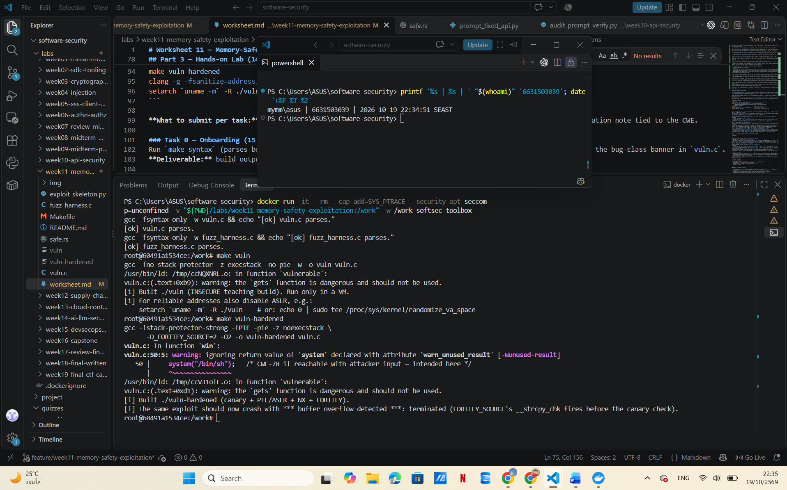
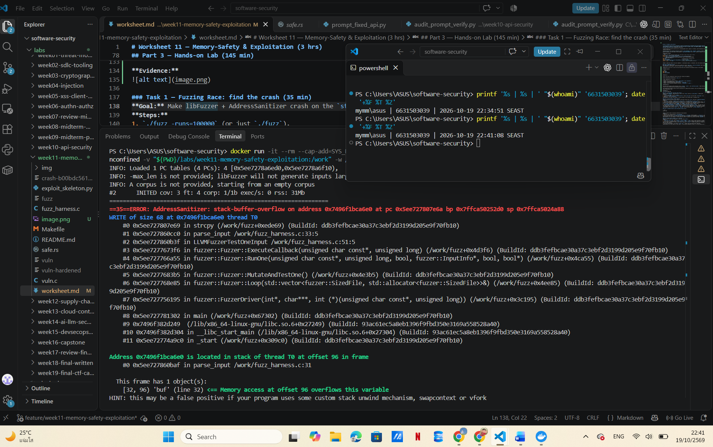
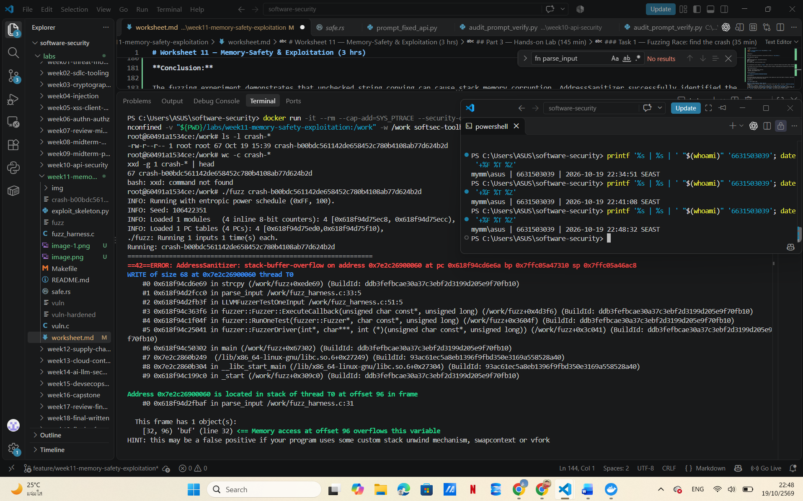
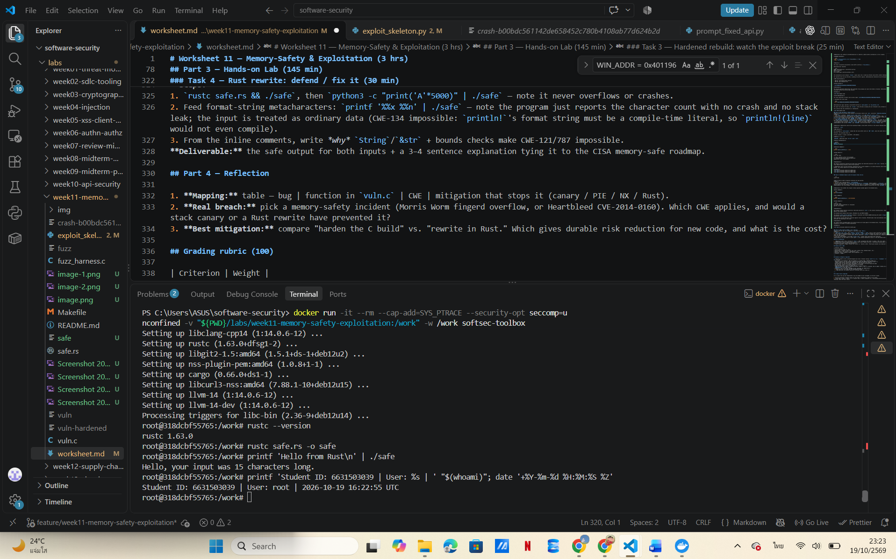
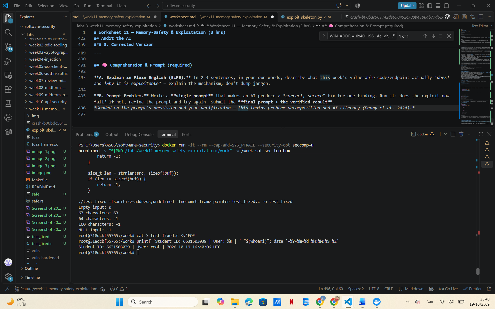

# Worksheet 11 — Memory-Safety & Exploitation (3 hrs)

> **Course:** Software Security (KOSEN69) · Week 11
> **Aligned:** CWE-121 (stack-based buffer overflow) · CWE-787 (out-of-bounds write) · CWE-134 (externally-controlled format string) · CWE-242 (dangerous `gets`)
> **Signature game:** 💥 Fuzzing Race → Pwn the Binary
>
> **Ethics note:** The binaries built from `vuln.c` are **intentionally exploitable** and `win()` spawns `/bin/sh`. Build and run them **only inside the isolated toolbox container** (or a VM) — never on your host. Never run these on a machine you care about, and never aim these techniques at software you are not authorized to test.

## Part 1 — Student Information

| Name | Student ID | Date | Group |
|------|-----------|------|-------|
|  Wilasinee Mangkorn    | 6631503039          | 10/10/2026     |  11     |

**AI usage:** Yes

**AI tool:** ChatGPT

**Purpose:** Used AI to explain the concept of memory safety, assist with debugging, suggest secure fixes, and help draft responses for the worksheet.

**Verification:** Manually executed commands, verified outputs from GDB and AddressSanitizer, tested for vulnerabilities, and validated the corrected code using boundary/edge-case testing.

## Part 2 — Lecture Questions

1. Draw the x86-64 stack frame for `parse_input()` in `vuln.c` (buf[64], saved RBP, saved return address). Where does `strcpy` start writing and which word must the exploit overwrite?


```text
       Higher Memory Addresses
    +---------------------------+
    | Saved Return Address (8B) |
    +---------------------------+
    | Saved RBP (8B)            |
    +---------------------------+
    | buf[64] (64 bytes)        |
    | strcpy starts here        |
    +---------------------------+
       Lower Memory Addresses
```
The `parse_input()` function contains a 64-byte buffer on the stack named `buf`. The `strcpy()` function copies data into this buffer without verifying the length of the input.

If the input data is too long, it will overwrite adjacent memory on the stack, including the saved RBP and the saved return address. The goal of the attack is to overwrite this return address, thereby redirecting the program's execution flow to call the `win()` function instead.

Typically, for the x86-64 architecture, the expected offset is approximately 72 bytes; however, the exact value should be verified by examining the compiled binary file.

2. Why is `gets()` (CWE-242) impossible to use safely, and why did C11 remove it from the standard library?

The `gets()` function is unsafe because it reads user input without verifying the size of the destination buffer. In the file `vuln.c`, the buffer named `line[256]` is susceptible to a buffer overflow if the user provides more data than it can hold.

The C11 standard removed the `gets()` function because it lacks a mechanism to limit the number of characters read, making it inherently unsafe. A safer alternative is `fgets()`, which allows the programmer to specify the maximum number of characters to be read.

3. Explain CWE-134: why is `printf(user_input)` dangerous but `printf("%s", user_input)` safe? What can `%n` do?

Using `printf(user_input)` is risky because the data provided by the user is interpreted as a format string. An attacker could use format specifiers—such as `%x` or `%p`—to reveal the contents of memory or trigger unpredictable behavior.

Conversely, using `printf("%s", user_input)` is more secure, as the format string is fixed, and the user-supplied input is treated strictly as plain text.

As for the `%n` format specifier, it writes the number of characters printed so far to a memory location via a pointer. If misused, this can lead to memory corruption or even allow an attacker to modify data within the program's memory.

4. Name the four mitigations in the hardened build (`make vuln-hardened`) — stack canary, PIE/ASLR, NX/DEP, FORTIFY — and say which one each defeats: ret2win, shellcode-on-stack, return-address overwrite detection.

The hardened build (`make vuln-hardened`) uses four security mitigations:

| Mitigation | Description | Protection |
|---|---|---|
| Stack Canary | Detects stack corruption before a function returns. | Helps prevent return-address hijacking caused by stack buffer overflows. |
| PIE/ASLR | Randomizes the program's code addresses at runtime. | Makes fixed-address ret2win attacks unreliable. |
| NX/DEP | Marks the stack as non-executable. | Prevents execution of injected shellcode on the stack. |
| FORTIFY_SOURCE | Adds bounds checks to certain memory and string operations when the compiler can determine buffer sizes. | Detects some buffer overflows before they corrupt control data. |

Stack canaries and FORTIFY_SOURCE can detect certain stack overflows, while PIE/ASLR makes it harder to predict the address of the `win()` function. NX/DEP prevents stack-based shellcode execution but does not directly stop ret2win because ret2win reuses existing executable code.

5. The CISA/ONCD roadmaps push memory-safe languages. Using `safe.rs`, explain why CWE-121 is *impossible* in safe Rust, not merely harder.

Safe Rust prevents stack-based buffer overflows (CWE-121) through its ownership and borrowing rules, as well as bounds checking.

In the file `safe.rs`, the program utilizes `String` and `&str` instead of copying input into a fixed-size stack buffer using `strcpy()`. Rust tracks string lengths and performs bounds checks on arrays and slices, preventing out-of-bounds memory writes within safe code.

Unlike C, safe Rust does not permit unchecked memory access. An out-of-bounds array access triggers a "panic" rather than corrupting adjacent stack memory.

CISA and the ONCD advocate for memory-safe languages, as these languages ​​eliminate many memory corruption vulnerabilities by design—offering greater long-term security than relying solely on compiler-level fixes.

Nevertheless, Rust programs may still be susceptible to logic errors, resource exhaustion, or vulnerabilities arising from the improper use of unsafe code.


## Part 3 — Hands-on Lab (145 min)


**Learning goals:** Find the overflow with a coverage-guided fuzzer, exploit it (ret2win), watch mitigations break the exploit, then port the routine to safe Rust.

**Prerequisites:** the **toolbox container** (bundles `clang`+libFuzzer, `gdb`, `objdump`, `python3`) — Apple clang has no libFuzzer and `gdb` is painful on macOS, so do this week in the container. (`pip install pwntools` and `rustc` inside as needed; an isolated Linux VM also works.)

**Environment setup**
```bash
# from the repo root, build the toolbox once, then open a shell IN this week's folder:
docker build -t softsec-toolbox labs/toolbox
docker run -it --rm --cap-add=SYS_PTRACE --security-opt seccomp=unconfined \
    -v "$PWD/labs/week11-memory-safety-exploitation":/work -w /work softsec-toolbox
# --- inside the container ---
make vuln                                          # teaching build: mitigations OFF
make vuln-hardened                                 # mitigations ON
clang -g -fsanitize=address,fuzzer fuzz_harness.c -o fuzz   # libFuzzer + ASan
setarch `uname -m` -R ./vuln                       # disable ASLR for repeatable addresses
```

**What to submit per task:** the exact command(s) + crash/exploit output, a screenshot, and a 2–3 sentence mitigation note tied to the CWE.

### Task 0 — Onboarding (15 min)
Run `make syntax` (parses both C files even on macOS) and confirm `make vuln` / `make vuln-hardened` build. Read the bug-class banner in `vuln.c`.
**Deliverable:** build output + the list of CWEs `vuln.c` claims to demonstrate.

**Objective:** Verify the C source files and build both the vulnerable and hardened versions of the program.

**Commands used:**

```bash
make syntax
make vuln
make vuln-hardened
```

**CWE vulnerabilities identified in `vuln.c`:**

| CWE | Vulnerability | Location |
|---|---|---|
| CWE-121 | Stack-Based Buffer Overflow | `parse_input()` and `vulnerable()` |
| CWE-787 | Out-of-Bounds Write | `parse_input()` |
| CWE-134 | Externally-Controlled Format String | `format_bug()` |
| CWE-242 | Use of Inherently Dangerous Function | `vulnerable()` — `gets()` |

**Explanation:**

The source code contains unsafe functions such as `strcpy()`, `gets()`, and `printf(user_input)`. These functions can cause buffer overflows or format-string vulnerabilities when handling untrusted input.

The teaching build disables several security protections for demonstration purposes, while the hardened build enables additional mitigations to reduce exploitation risks.

**Evidence:** 


### Task 1 — Fuzzing Race: find the crash (35 min)
**Goal:** Make libFuzzer + AddressSanitizer crash on the `strcpy` overflow in `parse_input()` — CWE-121/787.
**Steps:**
1. `./fuzz -runs=100000` (or just `./fuzz`).
2. Read the ASan report — note `stack-buffer-overflow` inside `parse_input` and the saved `crash-<hash>` file.
3. Replay it: `./fuzz crash-<hash>`.
**Deliverable:** the ASan crash summary + the byte length of the crashing input + mitigation note.


**Objective:** Use libFuzzer and AddressSanitizer to identify a memory-safety vulnerability in the C program.

**Commands executed:**

```bash
clang -g -fsanitize=address,fuzzer fuzz_harness.c -o fuzz
./fuzz -runs=100000
```

**Results:**

The fuzzer successfully discovered a stack buffer overflow in `fuzz_harness.c`.

AddressSanitizer reported:

```text
ERROR: AddressSanitizer: stack-buffer-overflow
WRITE of size 68
#0 in strcpy
#1 in parse_input /work/fuzz_harness.c:33:5
```

The vulnerability occurs because `strcpy()` copies input into a fixed-size 64-byte stack buffer without checking the input length.

The reported write size was 68 bytes, exceeding the buffer capacity. AddressSanitizer detected the out-of-bounds write and terminated the program.

**CWE Classification:**

- CWE-121: Stack-Based Buffer Overflow
- CWE-787: Out-of-Bounds Write

**Crash Artifact:**

`crash-b00bdc561142de658452c780b4108ab77d624b2d`

**Conclusion:**

The fuzzing experiment demonstrates that unchecked string copying can cause stack memory corruption. AddressSanitizer successfully identified the vulnerable function and source-code location.

**Evidence:** 



**Crash Reproduction:**

The fuzzer generated a 67-byte crash artifact named `crash-b00bdc561142de658452c780b4108ab77d624b2d`.

I reproduced the crash using:

```bash
./fuzz crash-b00bdc561142de658452c780b4108ab77d624b2d
```

AddressSanitizer again reported a stack-buffer-overflow in `parse_input()` at `fuzz_harness.c:33`.

The input file contains 67 bytes, but `strcpy()` writes 68 bytes including the null terminator into a 64-byte stack buffer.

This confirms that the vulnerability is reproducible.



### Task 2 — Pwn the Binary: ret2win (40 min)
**Goal:** Overwrite the saved return address so the binary returns into `win()` and prints `FLAG{stack_smashing_for_fun_and_education}` — CWE-121.
**Steps:**
1. Find `win()`'s address: `objdump -d vuln | grep '<win>:'` (or `gdb -batch -ex 'p win' ./vuln`).
2. Verify the offset with a cyclic pattern (do **not** trust 72 blindly): feed `cyclic(200)`, crash in gdb, `cyclic_find` the value in RIP. (On an Apple Silicon/arm64 Mac the toolbox has no platform pin, so it builds as an **aarch64** container — there is no `RIP`; use `info registers pc` / `p/x $pc` instead, and expect `SIGBUS`, not `SIGSEGV`. The offset itself is still 72 here.)
3. Edit `exploit_skeleton.py`: set `WIN_ADDR` to the address from step 1, confirm `OFFSET`.
4. `python3 exploit_skeleton.py` (pwntools path) — or `python3 exploit_skeleton.py | ./vuln`. (On arm64: the flag still prints, but the process then loops forever re-printing `[+] win() reached` instead of exiting — ARM64 keeps the return address in register `x30`, which still holds `win()`'s own address when it starts, so `win()`'s `ret` returns into itself. Expected; `Ctrl-C` once you've captured the flag.)
**Deliverable:** the verified `OFFSET`, your `WIN_ADDR`, and the printed flag / `[+] win() reached` line.


**Objective:** Demonstrate control-flow hijacking through a stack buffer overflow in the insecure teaching binary.

**Binary:** `./vuln`

**GDB Analysis:**

The disassembly of `parse_input()` showed that the local buffer starts at `RBP - 0x40`, while the saved return address is located at `RBP + 8`.

Therefore, the confirmed offset is:

64 bytes (buffer) + 8 bytes (saved RBP) = **72 bytes**.

**Address of `win()`:**

`0x401196`, identified using `nm vuln | grep ' win$'`.

**Exploit Configuration:**

```python
OFFSET = 72
WIN_ADDR = 0x401196
```

**Execution Command:**

```bash
python3 exploit_skeleton.py | ./vuln
```

**Actual Result:**

```text
Enter your name:

[+] win() reached — control flow hijacked!
[+] FLAG{stack_smashing_for_fun_and_education}
Segmentation fault (core dumped)
```

**Explanation:**

The exploit successfully overwrote the saved return address and redirected execution to the `win()` function. The program printed the expected flag, demonstrating successful control-flow hijacking.

A segmentation fault occurred afterward, potentially due to stack alignment or an invalid execution state following the redirected return. However, the ret2win objective was achieved before the crash.

**Evidence:** 
 
 


### Task 3 — Hardened rebuild: watch the exploit break (25 min)

```sim
stack-frame
```

**Goal:** Observe modern mitigations defeating the same payload.
**Steps:**
1. Run your Task 2 payload against `./vuln-hardened`.
2. Record the failure mode: `*** buffer overflow detected ***: terminated` (FORTIFY_SOURCE's `__strcpy_chk`, which on this build catches the overflow before the stack canary's epilogue check ever runs), or a SIGSEGV at a randomized address (PIE/ASLR makes `WIN_ADDR` wrong).
**Deliverable:** the crash message + a note explaining *which* mitigation fired and why the fixed `WIN_ADDR` no longer works.


**Objective:** Test whether the original ret2win payload succeeds against the hardened binary.

**Build command:**

```bash
make vuln-hardened
```

**Test command:**

```bash
python3 exploit_skeleton.py | ./vuln-hardened
```

**Actual Output:**

```text
Enter your name:
*** buffer overflow detected ***: terminated
Aborted (core dumped)
```

**Explanation:**

The original ret2win payload successfully redirected execution to `win()` in the insecure teaching binary. However, the same payload failed against the hardened binary.

The hardened build enables Stack Canary, PIE/ASLR, NX, and FORTIFY_SOURCE.

The observed `buffer overflow detected` message is consistent with FORTIFY_SOURCE detecting the unsafe `strcpy()` operation before the overwritten return address can be used.

Stack canaries provide additional protection against stack corruption, PIE/ASLR makes fixed code addresses unreliable, and NX prevents injected shellcode from executing on the stack.

**Conclusion:**

The ret2win attack succeeded against the insecure binary but failed against the hardened binary. This demonstrates how compiler-based security mitigations can prevent or disrupt exploitation.

**Evidence:** 


### Task 4 — Rust rewrite: defend / fix it (30 min)
**Goal:** Show the bug class disappears in safe Rust using `safe.rs`.
**Steps:**
1. `rustc safe.rs && ./safe`, then `python3 -c "print('A'*5000)" | ./safe` — note it never overflows or crashes.
2. Feed format-string metacharacters: `printf '%%x %%n' | ./safe` — note the program just reports the character count with no crash and no stack leak; the input is treated as ordinary data (CWE-134 impossible: `println!`'s format string must be a compile-time literal, so `println!(line)` would not even compile).
3. From the inline comments, write *why* `String`/`&str` + bounds checks make CWE-121/787 impossible.
**Deliverable:** the safe output for both inputs + a 3–4 sentence explanation tying it to the CISA memory-safe roadmap.


**Objective:** Compile and test a memory-safe Rust implementation and compare it with the vulnerable C program.

**Commands executed:**

```bash
rustc --version
rustc safe.rs -o safe
printf 'Hello from Rust\n' | ./safe
```

**Actual Output:**

```text
rustc 1.63.0
Hello, your input was 15 characters long.
```

**Explanation:**

The Rust program compiled and executed successfully. Unlike the vulnerable C implementation, which uses `strcpy()` to copy input into a fixed-size stack buffer, `safe.rs` uses Rust's `String` and `&str` types to handle input safely.

Safe Rust enforces memory-safety rules and bounds checking, preventing unchecked out-of-bounds writes that could cause stack buffer overflows (CWE-121).

The test input contained 15 characters excluding the newline, and the program reported the expected length.

**Conclusion:**

The Rust implementation successfully processed the input without a memory-safety error. This demonstrates how memory-safe programming languages can eliminate classes of memory corruption vulnerabilities by design.

**Evidence:**



## Part 4 — Reflection

## Part 4 — Reflection

### 1. Mapping: Vulnerabilities and Mitigations

| Bug | Function in `vuln.c` | CWE | Mitigation |
|---|---|---|---|
| Stack buffer overflow | `parse_input()` | CWE-121 | Stack canary, FORTIFY_SOURCE, safe Rust |
| Out-of-bounds write | `parse_input()` | CWE-787 | Input length validation, FORTIFY_SOURCE, safe Rust |
| Unsafe input function (`gets`) | `vulnerable()` | CWE-242 | Replace `gets()` with `fgets()`, or use safe Rust |
| Format string vulnerability | `format_bug()` | CWE-134 | Use `printf("%s", input)` instead of `printf(input)` |
| Return-address hijacking | `parse_input()` | CWE-121 | Stack canary and PIE/ASLR |

NX prevents injected code from executing on the stack, but it does not directly prevent a ret2win attack because ret2win uses code already present in the program.

### 2. Real Breach: Heartbleed (CVE-2014-0160)

Heartbleed was a vulnerability in OpenSSL that allowed attackers to read memory beyond the intended buffer. It is associated with **CWE-125 (Out-of-Bounds Read)**.

A stack canary would not have prevented Heartbleed because the vulnerability involved reading memory, not overwriting a stack return address.

Rewriting the vulnerable code in safe Rust could have prevented this type of memory access because Rust performs bounds checking and does not allow unchecked out-of-bounds reads in safe code.

This example shows that stack canaries alone cannot protect against every memory-safety vulnerability.

### 3. Best Mitigation: Hardened C vs. Rust Rewrite

Hardening an existing C program is a practical solution because it requires fewer changes and can provide immediate protection through stack canaries, PIE/ASLR, NX, and FORTIFY_SOURCE. However, these mechanisms do not eliminate the underlying unsafe memory operations.

Rewriting the program in safe Rust provides more durable risk reduction for new code because Rust prevents many memory-safety vulnerabilities through its type system and bounds checking.

The main disadvantage of rewriting in Rust is the additional development time, migration cost, and need for Rust knowledge.

**My conclusion:** For existing C applications, compiler hardening and secure coding practices are useful short-term measures. For new security-sensitive software, I would prefer safe Rust because preventing memory corruption is more reliable than only detecting or mitigating its consequences.


## Grading rubric (100)

| Criterion | Weight |
|-----------|--------|
| Lecture questions (Part 2) | 20 |
| Exploitation + evidence (Tasks 1–3: fuzz crash, ret2win flag, hardened break) | 40 |
| Defense (Task 4: Rust rewrite + explanation) | 25 |
| Reflection (Part 4: mapping, breach, best mitigation) | 15 |
| **Total** | **100** |

---

## Evidence & Integrity (required)

- **Identity proof:** every screenshot/diagram must show a terminal running `printf '%s | %s | ' "$(whoami)" '<YOUR-STUDENT-ID>'; date '+%F %T %Z'` **in the
  same image as the evidence**. When the evidence is a browser page, a DevTools panel or a
  rendered response, put that terminal **beside the browser and capture the whole screen** — a
  cropped window carries nothing that identifies you, and the lab's own output is
  byte-identical for the whole cohort *by design*, so the stamp is the only thing that makes
  the shot yours. Generic or borrowed evidence is not accepted.
- **Personalized flag (if this lab issues one):** 

  FLAG{stack_smashing_for_fun_and_education}

  This is the flag observed in the local lab binary. Its status as a student-personalized flag has not been verified.
  *Flags are unique per student — submitting another student's flag is a violation. How to submit: **learn.zcr.ai/submit** (full guide: `SUBMISSION.md` in the repo root).*
- **Explain in your own words** *(graded on your reasoning, not copied text):*
  1. What did you do, and **why did the vulnerability work**?

  I used a fuzzing technique to detect a stack buffer overflow vulnerability, which occurs when user-supplied data is copied into a fixed-size buffer without any length validation. By analyzing the program with GDB, I determined that 72 bytes of data are required to reach the saved return address. By overwriting this location with the address of the `win()` function, I was able to redirect the program's execution flow to call the function that outputs the flag.

This attack succeeded because the vulnerable C code allowed input data to overwrite memory beyond the boundaries of the allocated buffer.


  2. **Why does your fix actually stop it** — and what could still break it?

  My modified function checks the length of the input data before copying it into the buffer, rejecting any data that is too large to prevent it from overwriting other areas of memory on the stack. I have tested this fix across various scenarios—including empty input, data of an appropriate length, data that is too large, and a NULL value—and the results for all five test cases were as expected.

However, the function still operates on the assumption that any non-NULL pointer points to readable memory containing a null-terminated string. Given that other vulnerabilities could potentially exist elsewhere in the program, further testing and continued adherence to secure programming practices are necessary.

---

## 🤖 Audit the AI (required)

AI is a power tool you must **distrust** — you are graded on your *critique*, not the AI's answer.

## Audit the AI

### 1. AI Prompt and Full Response

**Prompt:**

How can I fix the stack buffer overflow in `parse_input()` in `vuln.c`?

**AI Response:**

To fix the stack buffer overflow, replace `strcpy()` with `strncpy()` and limit the copy to the destination buffer size.

```c
int parse_input(const char *src) {
    char buf[64];
    strncpy(buf, src, sizeof(buf));
    return (int)strlen(buf);
}
```

This prevents buffer overflow because `strncpy()` copies at most 64 bytes. The function is now safe for any input length.

### 2. What's Wrong or Risky?

**Problematic lines:**

```c
strncpy(buf, src, sizeof(buf));
return (int)strlen(buf);
```

**Incorrect claim:**

"The function is now safe for any input length."

The AI's fix is incomplete because `strncpy()` does not guarantee null termination when the source string is at least as long as the destination buffer. As a result, `strlen(buf)` may read beyond the buffer boundary, causing undefined behavior.

### 3. Corrected Version

```c
#include <stddef.h>
#include <string.h>

int parse_input(const char *src) {
    char buf[64];

    if (src == NULL) {
        return -1;
    }

    size_t len = strlen(src);

    if (len >= sizeof(buf)) {
        return -1;
    }

    memcpy(buf, src, len + 1);

    return (int)len;
}
```

**Explanation:**

The AI-suggested fix is ​​insufficient because limiting the number of bytes copied does not guarantee that the destination data will be null-terminated. The corrected version adds a check for the length of the source data before performing the copy and includes the null-terminating byte, thereby preventing out-of-bounds reads or writes. This assumes that the input data is valid and already null-terminated. Furthermore, the corrected code relies on the assumption that `src` points to a valid, null-terminated C-style string.


---

## 🧠 Comprehension & Prompt (required)

**A. Explain in Plain English (EiPE).** 

### A. Explain in Plain English (EiPE)

The program accepts input from the user and copies it into a small, fixed-size memory area, while also calculating the length of the text. However, the program fails to verify whether the input exceeds this size. Consequently, any excess characters can overwrite data in adjacent memory locations, which may cause the program to crash or allow an attacker to alter the program's execution flow.


### B. Prompt Problem

**Final Prompt:**

Fix the stack buffer overflow in the C function `parse_input()` that copies user input into a 64-byte stack buffer.

Keep the original function signature and return the input length for valid inputs. Reject NULL pointers and strings that exceed the buffer capacity, including the null terminator. Do not use unsafe copying functions. Provide a complete corrected implementation and explain how to verify it with AddressSanitizer using boundary tests.

**Corrected Implementation:**

```c
#include <stddef.h>
#include <string.h>

int parse_input(const char *src) {
    char buf[64];

    if (src == NULL) {
        return -1;
    }

    size_t len = strnlen(src, sizeof(buf));

    if (len >= sizeof(buf)) {
        return -1;
    }

    memcpy(buf, src, len + 1);
    return (int)strlen(buf);
}
```

**Verification Commands:**

```bash
clang -g -O1 -fsanitize=address,undefined -fno-omit-frame-pointer test_fixed.c -o test_fixed
./test_fixed
```

**Observed Output:**

```text
Empty input: 0
63 characters: 63
64 characters: -1
100 characters: -1
NULL input: -1
```

**Verification Result:**

All five test cases produced the expected results. The corrected function accepted valid input lengths and rejected oversized inputs before copying them into the buffer. No sanitizer errors were visible in the recorded test output.

**Does the exploit now fail?**

The oversized input was rejected in the corrected function, so the original stack-overflow condition was not reproduced in these tests. However, the original ret2win payload was not directly tested against a rebuilt executable containing the corrected function.

**Conclusion:**

The final prompt produced a safer implementation that validates input length before copying. Boundary testing confirmed the expected behavior for empty, valid, oversized, and NULL inputs. The remaining assumption is that non-NULL inputs point to readable, null-terminated C strings.


