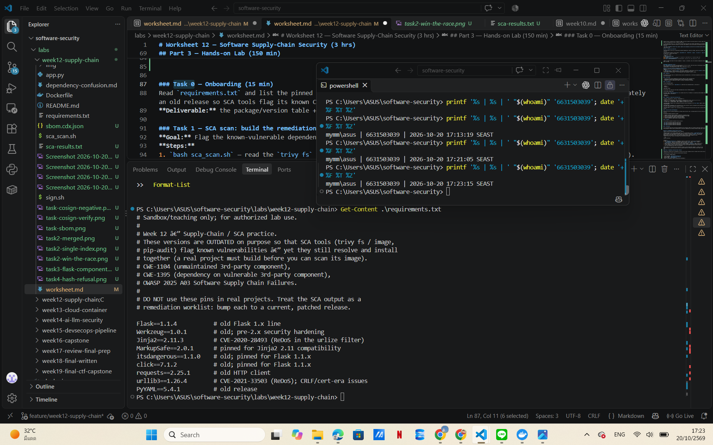
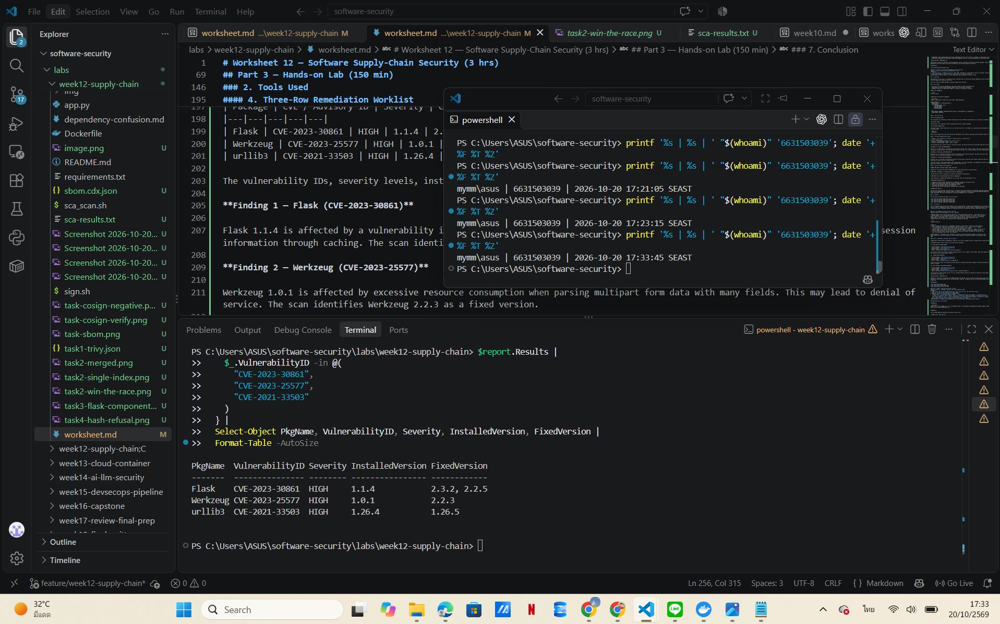
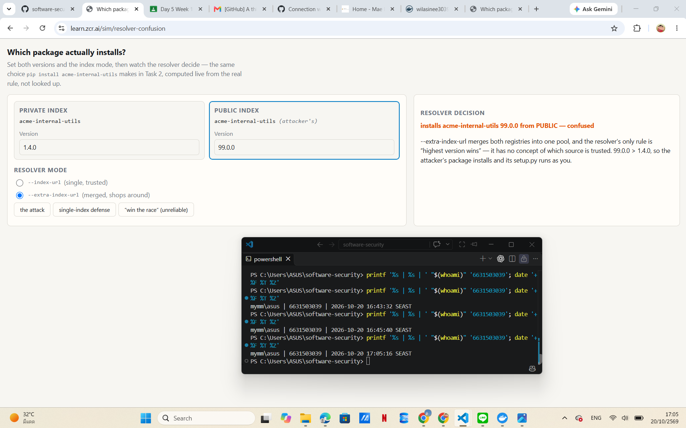
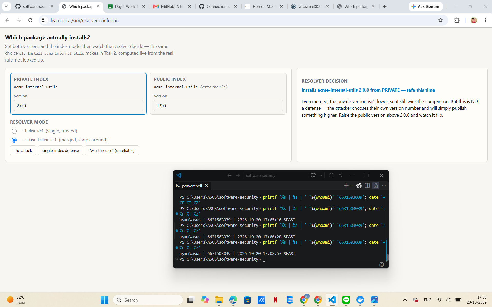
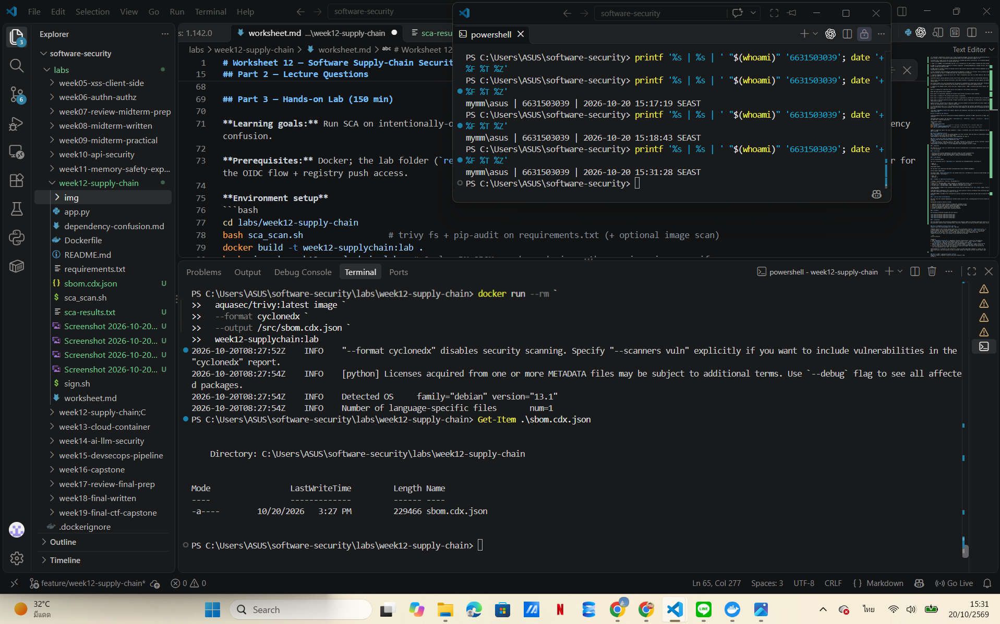
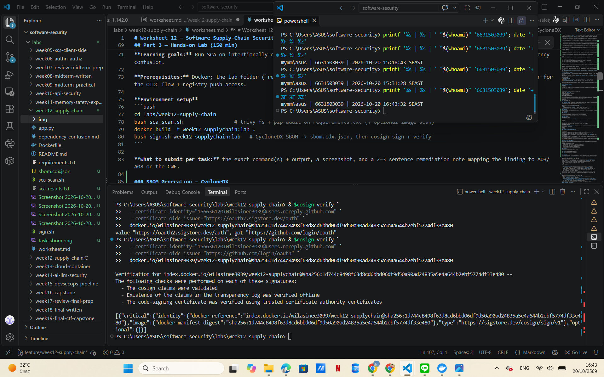
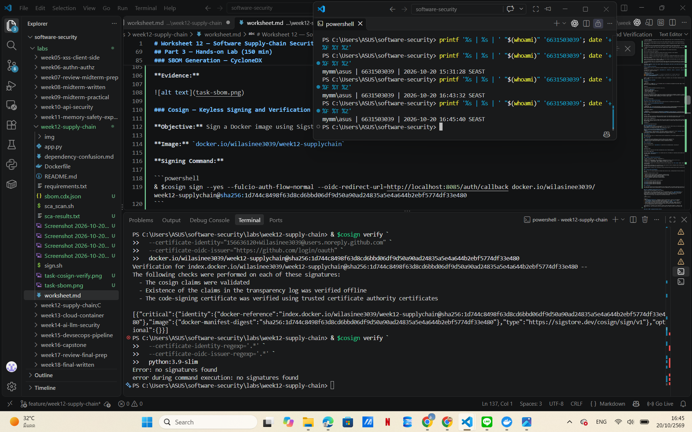
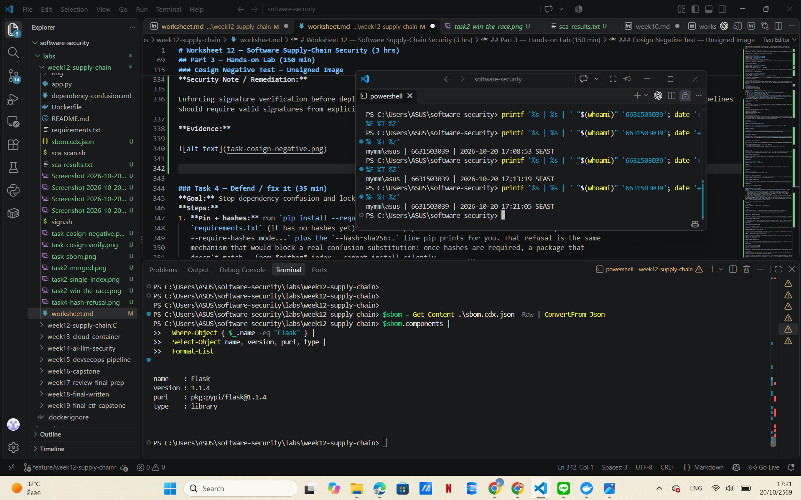
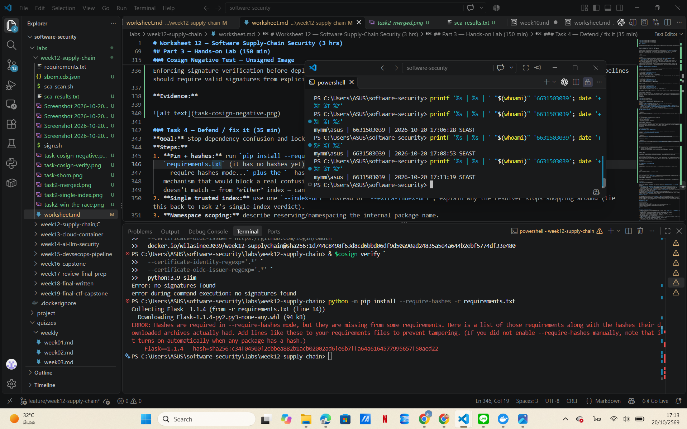

# Worksheet 12 — Software Supply-Chain Security (3 hrs)

> **Course:** Software Security (KOSEN69) · Week 12
> **Aligned:** OWASP 2025 — A03 Software Supply Chain Failures · A08 Software or Data Integrity Failures · **CWE:** CWE-1104, CWE-829, CWE-1357, CWE-1395
> **Signature game:** 📦 Dependency Confusion Heist
>
> **Ethics note:** This lab has **no live private/public registry to attack** — the dependency-confusion exercise is a controlled walkthrough (`dependency-confusion.md`) plus the interactive resolver simulation in Task 2, not a real package pull. **Never** plant or publish look-alike packages on the real PyPI or npm — that is an attack on every downstream user, and nothing in this lab requires it.

## Part 1 — Student Information

| Name | Student ID | Date | Group |
|------|-----------|------|-------|
| Wilasinee Mangkorn     | 6631503039          |  20/10/2026    |   11    |

I used ChatGPT to help me understand concepts related to software supply chain security, troubleshoot issues with verification using Cosign, and draft explanations for lab assignments. Additionally, I leveraged AI to generate security recommendations for the lab tasks—identifying inaccurate or risky statements—and compared these revised suggestions against the actual outcomes from the labs. Throughout this process, I personally executed the lab commands and verified the validation results myself.

## Part 2 — Lecture Questions

1. Explain **dependency confusion** (substitution). Why does a public `acme-internal-utils==99.0.0` win over a private `==1.4.0` when a resolver shops both indexes?

A dependency confusion attack is a type of software supply chain attack in which an attacker publishes a malicious package to a public registry, using the same name as a private package belonging to an organization.

For example, if a private registry contains `acme-internal-utils==1.4.0` and a public registry contains `acme-internal-utils==99.0.0`, a package resolver configured to search both registries might select the public package because it has a higher version number. This could result in the installation of code controlled by the attacker.

Prevention: Use a single, trusted package registry or a controlled internal package proxy. Explicitly define trusted package sources, and avoid mixing public and private registries without appropriate controls in place.

2. How does **typosquatting** (`reqeusts`, `urlib3`) achieve code execution *at install time* before any of your code runs?

Typosquatting occurs when an attacker publishes a malicious package with a name very similar to a legitimate one—for example, using `reqeusts` instead of `requests`, or `urlib3` instead of `urllib3`.

If a developer inadvertently installs one of these misspelled packages, malicious code may be executed during the installation process—via build scripts or other installation mechanisms—long before the actual application begins to run.

To prevent this, always verify the correct spelling of a package name before installation, use validated dependency lockfiles, and restrict package installations to trusted sources only.

3. What is an **SBOM** (CycloneDX/SPDX) and why is it a prerequisite for both incident response and SLSA provenance?

An SBOM is a machine-readable inventory of software components, including dependencies, package versions, and relationships. Common SBOM formats include CycloneDX and SPDX.

An SBOM supports incident response by helping security teams quickly identify whether affected components are present when a new vulnerability is disclosed.

It also complements SLSA provenance by identifying the components included in an artifact, while provenance describes how, where, and by whom the artifact was built. An SBOM alone does not establish build provenance.

4. Sigstore **keyless** signing uses Fulcio (CA) + Rekor (transparency log) tied to an OIDC identity. Why is that safer than a long-lived private key (CWE-321)?

Sigstore’s keyless signing approach utilizes short-lived signing identities linked to verified OIDC identities.

Fulcio issues short-lived signing certificates, while Rekor provides a transparency log that supports the auditing and verification of signing events.

This method reduces the risks associated with the exposure or mishandling of long-lived private keys. Furthermore, it allows signatures to be traced back to verified identities and facilitates the detection of suspicious signing activity.

5. Summarize the **SLSA** levels. Which level does "signed artifact + SBOM + provenance gate before deploy" put you at, and what is still missing?

SLSA is a framework for improving the security and integrity of the software build process.

Under the SLSA software build framework:

Build Level 0: No guarantees regarding the software build process according to SLSA standards.

Build Level 1: Evidence of the software build process is generated.

Build Level 2: Evidence of the software build process is generated by a hosted build platform and is verified for authenticity.

Build Level 3: The build platform provides stronger protections against tampering, including build isolation and the generation of more robust build evidence.

Signed artifacts, Software Bill of Materials (SBOM), and build evidence verification gates are useful supply chain security controls, but they do not automatically confer a specific SLSA level.

To claim SLSA Build Level 2 or 3, the software build process must meet the relevant requirements for verified build evidence, trusted build infrastructure, and build isolation. The actual level depends on how the artifacts are produced and how the build evidence is generated.


## Part 3 — Hands-on Lab (150 min)

**Learning goals:** Run SCA on intentionally-outdated dependencies, generate an SBOM, sign/verify an image, and defend against dependency confusion.

**Prerequisites:** Docker; the lab folder (`requirements.txt`, `Dockerfile`, `app.py`, `sca_scan.sh`, `sign.sh`). For signing: browser for the OIDC flow + registry push access.

**Environment setup**
```bash
cd labs/week12-supply-chain
bash sca_scan.sh                 # trivy fs + pip-audit on requirements.txt (+ optional image scan)
docker build -t week12-supplychain:lab .
bash sign.sh week12-supplychain:lab   # CycloneDX SBOM -> sbom.cdx.json, then cosign sign + verify
```

**What to submit per task:** the exact command(s) + output, a screenshot, and a 2–3 sentence remediation note mapping the finding to A03/A08 or the CWE.


### Task 0 — Onboarding (15 min)
Read `requirements.txt` and list the pinned packages with their versions. Note why they are intentionally outdated (each is deliberately an old release so SCA tools flag its known CVEs).
**Deliverable:** the package/version table + which OWASP/CWE this maps to.

#### Task 0 — Onboarding: Dependency Inventory

**Command:**

```powershell
Get-Content .\requirements.txt
```

**Pinned Dependencies:**

| No. | Package | Pinned Version |
|---|---|---|
| 1 | Flask | 1.1.4 |
| 2 | Werkzeug | 1.0.1 |
| 3 | Jinja2 | 2.11.3 |
| 4 | MarkupSafe | 2.0.1 |
| 5 | itsdangerous | 1.1.0 |
| 6 | click | 7.1.2 |
| 7 | requests | 2.25.1 |
| 8 | urllib3 | 1.26.4 |
| 9 | PyYAML | 5.4.1 |

**Why Are These Versions Outdated?**

These dependencies were intentionally pinned to older versions for software supply-chain security training. Some of these releases contain known vulnerabilities that can be detected by Software Composition Analysis (SCA) tools such as Trivy and pip-audit.

For example, the lab identifies CVE-2020-28493 in Jinja2 2.11.3 and CVE-2021-33503 in urllib3 1.26.4.

**Security Mapping:**

- **OWASP A03:2025 — Software Supply Chain Failures:** Risks introduced through vulnerable or outdated third-party dependencies.
- **CWE-1104 — Use of Unmaintained Third Party Components:** Risks from relying on outdated or unmaintained components.
- **CWE-1395 — Dependency on Vulnerable Third-Party Component:** Risks from using dependencies with known security vulnerabilities.

**Security Note / Remediation:**

Applications should use supported, patched dependency versions instead of relying on outdated packages. Teams should regularly scan dependencies with SCA tools and review vulnerability reports before deploying software.

**Evidence:**



### Task 1 — SCA scan: build the remediation worklist (35 min)
**Goal:** Flag the known-vulnerable dependencies — A03.
**Steps:**
1. `bash sca_scan.sh` — read the `trivy fs` table (CVE, installed vs. fixed version) and the `pip-audit` advisory IDs (GHSA-/PYSEC-).
2. Pick three findings; record CVE/advisory id, severity, and the fixed version.
**Deliverable:** the SCA output + a 3-row remediation table (package → current → fixed).

### 1. Objective

The objective of this task is to identify known vulnerabilities in third-party Python dependencies and the Docker container image using Software Composition Analysis (SCA) tools.

This task focuses on OWASP A03:2025 — Software Supply Chain Failures.

### 2. Tools Used

- **Trivy:** Scans project dependencies and Docker images for known vulnerabilities.
- **pip-audit:** Checks Python packages against known vulnerability databases.
- **Docker:** Builds the application image for container vulnerability scanning.

**Main scan command:**

```bash
bash sca_scan.sh
```

**Additional verification command:**

```powershell
$report = Get-Content .\task1-trivy.json -Raw | ConvertFrom-Json

$report.Results |
  ForEach-Object { $_.Vulnerabilities } |
  Where-Object {
    $_.VulnerabilityID -in @(
      "CVE-2023-30861",
      "CVE-2023-25577",
      "CVE-2021-33503"
    )
  } |
  Select-Object PkgName, VulnerabilityID, Severity, InstalledVersion, FixedVersion |
  Format-Table -AutoSize
```

#### 3. SCA Scan Results

**Trivy Filesystem Scan**

The filesystem scan identified 11 HIGH vulnerabilities and 0 CRITICAL vulnerabilities in the project's Python dependencies.

**pip-audit Scan**

The pip-audit scan reported 33 known vulnerabilities across 6 Python packages.

**Trivy Docker Image Scan**

The Docker image `week12-supplychain:lab` was scanned using Trivy. The Debian 13.1 operating system package results identified 125 vulnerabilities:

- HIGH: 119
- CRITICAL: 6

These results demonstrate that both application dependencies and container operating system packages require vulnerability management.

#### 4. Three-Row Remediation Worklist

| Package | CVE / Advisory ID | Severity | Current Version | Fixed Version |
|---|---|---|---|---|
| Flask | CVE-2023-30861 | HIGH | 1.1.4 | 2.2.5 / 2.3.2 |
| Werkzeug | CVE-2023-25577 | HIGH | 1.0.1 | 2.2.3 |
| urllib3 | CVE-2021-33503 | HIGH | 1.26.4 | 1.26.5 |

The vulnerability IDs, severity levels, installed versions, and fixed versions were confirmed using the Trivy JSON scan results.

**Finding 1 — Flask (CVE-2023-30861)**

Flask 1.1.4 is affected by a vulnerability involving the missing `Vary: Cookie` header, which may lead to unintended disclosure of session information through caching. The scan identifies Flask 2.2.5 and 2.3.2 as fixed versions for this vulnerability.

**Finding 2 — Werkzeug (CVE-2023-25577)**

Werkzeug 1.0.1 is affected by excessive resource consumption when parsing multipart form data with many fields. This may lead to denial of service. The scan identifies Werkzeug 2.2.3 as a fixed version.

**Finding 3 — urllib3 (CVE-2021-33503)**

urllib3 1.26.4 is affected by inefficient parsing of certain URLs, which may cause regular expression denial of service (ReDoS). The scan identifies urllib3 1.26.5 as a fixed version.

The fixed versions listed above address the selected CVEs. For a real deployment, the dependencies should be updated to compatible, supported releases that address other known vulnerabilities as well.

#### 5. Security Mapping and Remediation

**OWASP A03:2025 — Software Supply Chain Failures**

Outdated or vulnerable third-party dependencies can expose applications to known attacks.

**CWE-1395 — Dependency on Vulnerable Third-Party Component**

The application relies on packages with publicly documented vulnerabilities.

**CWE-1104 — Use of Unmaintained Third Party Components**

Using outdated or unsupported dependencies can increase security and maintenance risks.

**Recommended Remediation:**

1. Upgrade vulnerable Python dependencies to compatible, supported, patched versions.
2. Update the container base image and rebuild the application.
3. Run Trivy and pip-audit again after dependency updates.
4. Integrate SCA scanning into the CI/CD pipeline.
5. Review and prioritize vulnerability findings before deployment.

**Remediation Note:**

The SCA scans revealed known vulnerabilities in outdated third-party dependencies. Upgrading affected packages and regularly scanning application dependencies and container images can reduce supply-chain risks associated with OWASP A03:2025 and CWE-1395. However, scanning cannot guarantee that every vulnerability or malicious dependency will be detected.

### 6. Evidence

The following screenshots document the scan results:

 
 
 



### 7. Conclusion

This task demonstrated how SCA tools identify known vulnerabilities in application dependencies and container images. The findings were used to create a remediation worklist containing vulnerability IDs, severity levels, installed versions, and fixed versions. Regular scanning and timely dependency updates are important practices for improving software supply-chain security.


### Task 2 — Dependency Confusion Heist (35 min)
**Goal:** Watch the wrong package win — A03 / CWE-1357.

**Reality check:** this lab does **not** stand up a live private/public registry. `acme-internal-utils` is
a worked example, not an installable package — there is nothing to actually `pip install` here (the name
doesn't exist on real PyPI either, so don't expect that to work as a shortcut). Task 2 is a controlled
walkthrough of the resolver's own rule, using the simulation below, which computes the real
"highest version wins" logic live instead of just asserting the outcome.

```sim
resolver-confusion
```

**Steps:**
1. Read `dependency-confusion.md`'s "Dependency confusion (substitution)" section for the mechanism.
2. In the simulation, load the **"the attack"** preset (private `1.4.0`, public `99.0.0`, merged /
   `--extra-index-url` mode) and record which index the resolver picks and why.
3. Keep the same version numbers and switch to the **single-index** (`--index-url`) mode; record how the
   verdict changes — this is the resolver behavior Task 4's "single trusted index" defense relies on.
4. Try the **"win the race"** preset (private version numerically higher than public) and note why the
   sim's own explanation calls that "not a defense."

**Deliverable:** a screenshot of the simulation's verdict in both index modes (merged vs. single) for the
same version pair, plus one sentence on why an attacker defeats the "keep my internal version number high"
idea.

#### Task 2 — Dependency Confusion Heist: Results

**Objective:** Demonstrate how dependency confusion occurs when a package resolver considers both private and public registries.

**Simulation URL:** https://learn.zcr.ai/sim/resolver-confusion

**1. The Attack — Merged Index**

- Private package: `acme-internal-utils==1.4.0`
- Public package: `acme-internal-utils==99.0.0`
- Resolver mode: `--extra-index-url`
- Result: **Vulnerable — Public version 99.0.0 selected.**

The resolver selects the attacker's public package because it has a higher version number. When both indexes are merged, the resolver does not prioritize the trusted private registry.

**2. Single-index Defense**

- Private package: `acme-internal-utils==1.4.0`
- Public package: `acme-internal-utils==99.0.0`
- Resolver mode: `--index-url`
- Result: **Safe — Private version 1.4.0 selected.**

The resolver only checks the configured private registry, preventing the public package from being considered even though its version number is higher.

**3. Win the Race — Unreliable Defense**

- Private package: `acme-internal-utils==2.0.0`
- Public package: `acme-internal-utils==1.9.0`
- Resolver mode: `--extra-index-url`
- Result: **Private version 2.0.0 selected, but not a reliable defense.**

Increasing the private package version is not a reliable defense because an attacker can publish an even higher public version and cause the resolver to select it.

**Security Note / Remediation:**

Dependency confusion is associated with OWASP A03:2025 and CWE-1357. Using a single trusted package index prevents the resolver from selecting a same-named package from an untrusted public registry. Package hashes and an approved dependency list can provide additional protection.

**Evidence:**





### Task 3 — SBOM + signing/verification (30 min)
**Goal:** Produce a component inventory and prove integrity — A08.
**Steps:**
1. After `bash sign.sh week12-supplychain:lab`, open `sbom.cdx.json` and find Flask's entry.
2. Read the `cosign verify` PASS for the signed image.
3. Negative test on an unsigned image (it **must** fail):
   `cosign verify --certificate-identity-regexp '.*' --certificate-oidc-issuer-regexp '.*' python:3.9-slim`
   → `Error: no signatures found`. (Both `--certificate-identity*` flags are required in keyless mode; without
   them cosign stops at `Error: --certificate-identity or --certificate-identity-regexp is required` — a usage
   error, which is *not* the same thing as proving the image is unsigned.)
**Deliverable:** the SBOM Flask component entry + the verify PASS + the negative-test failure.

### SBOM Generation — CycloneDX

**Command:**

```powershell
docker run --rm -v "${PWD}:/src" -v /var/run/docker.sock:/var/run/docker.sock aquasec/trivy:latest image --format cyclonedx --output /src/sbom.cdx.json week12-supplychain:lab
```

**Output:**

The CycloneDX SBOM was generated successfully using Trivy.

- Output file: `sbom.cdx.json`
- File size: 229,466 bytes
- Detected operating system: Debian 13.1
- Format: CycloneDX JSON

**Security Note / Remediation:**

Generating an SBOM improves software supply-chain visibility by documenting the components included in a container image. It supports vulnerability tracking and incident response, helping address software integrity risks associated with OWASP A08:2025. The SBOM should be maintained and regenerated whenever dependencies or container images change.

**Evidence:**



### Cosign — Keyless Signing and Verification

**Objective:** Sign a Docker image using Sigstore Cosign and verify its authenticity and integrity.

**Image:** `docker.io/wilasinee3039/week12-supplychain`

**Signing Command:**

```powershell
& $cosign sign --yes --fulcio-auth-flow=normal --oidc-redirect-url=http://localhost:8085/auth/callback docker.io/wilasinee3039/week12-supplychain@sha256:1d744c8498f63d8cd6bbd06df9d50a90ad24835a5e4a644b2ebf5774df33e480
```

**Verification Command:**

```powershell
& $cosign verify --certificate-identity="156636120+Wilasinee3039@users.noreply.github.com" --certificate-oidc-issuer="https://github.com/login/oauth" docker.io/wilasinee3039/week12-supplychain@sha256:1d744c8498f63d8cd6bbd06df9d50a90ad24835a5e4a644b2ebf5774df33e480
```

**Verification output (excerpt):**

```
Verification for index.docker.io/wilasinee3039/week12-supplychain@sha256:1d744c8498f63d8cd6bbd06df9d50a90ad24835a5e4a644b2ebf5774df33e480 --
The following checks were performed on each of these signatures:
  - The cosign claims were validated
  - Existence of the claims in the transparency log was verified offline
  - The code-signing certificate was verified using trusted certificate authority certificates

```

**Result: PASS**

The Docker image was successfully signed using Sigstore Cosign with GitHub OIDC authentication. Signature verification succeeded, confirming the signed image digest, transparency-log evidence, and trusted code-signing certificate.

**Security Note / Remediation:**

Keyless signing reduces the need to manage long-lived private signing keys and helps mitigate software integrity risks associated with OWASP A08:2025. Deployment pipelines should verify signatures against an expected signer identity and OIDC issuer before accepting container images.

**Evidence:**



### Cosign Negative Test — Unsigned Image

**Command:**

```powershell
& $cosign verify --certificate-identity-regexp='.*' --certificate-oidc-issuer-regexp='.*' python:3.9-slim
```

**Output:**

```text
Error: no signatures found
error during command execution: no signatures found
```

**Result: PASS (Expected Rejection)**

Cosign rejected the unsigned `python:3.9-slim` image because no signatures were found. This demonstrates that signature verification can prevent unsigned container images from passing an integrity check.

**Security Note / Remediation:**

Enforcing signature verification before deployment helps mitigate OWASP A08:2025 Software or Data Integrity Failures. Production pipelines should require valid signatures from explicitly trusted identities and reject unsigned or untrusted artifacts.

**Evidence:**



#### Flask Component Entry in CycloneDX SBOM

**Command:**

```powershell
$sbom = Get-Content .\sbom.cdx.json -Raw | ConvertFrom-Json
$sbom.components |
  Where-Object { $_.name -eq "Flask" } |
  Select-Object name, version, purl, type |
  Format-List
```

**Output:**

```text
name    : Flask
version : 1.1.4
purl    : pkg:pypi/flask@1.1.4
type    : library
```

**Result: PASS**

The CycloneDX SBOM successfully identified Flask version 1.1.4 as a library component. Its Package URL (`pkg:pypi/flask@1.1.4`) provides a standardized identifier for tracking the dependency.

**Security Note / Remediation:**

The SBOM helps identify outdated or vulnerable dependencies and supports vulnerability management and incident response. Flask should be updated to an appropriate patched version after checking compatibility, and the SBOM should be regenerated after the update.

**Evidence:**



### Task 4 — Defend / fix it (35 min)
**Goal:** Stop dependency confusion and lock integrity — defenses from `dependency-confusion.md` + `sign.sh`.
**Steps:**
1. **Pin + hashes:** run `pip install --require-hashes -r requirements.txt` against this lab's own
   `requirements.txt` (it has no hashes yet) and record pip's refusal — `ERROR: Hashes are required in
   --require-hashes mode...` plus the `--hash=sha256:…` line pip prints for you. That refusal is the same
   mechanism that would block a real confusion substitution: once hashes are required, a package that
   doesn't match — from *either* index — cannot install silently.
2. **Single trusted index:** use one `--index-url` instead of `--extra-index-url`; explain why the resolver stops shopping around (tie this back to Task 2's single-index verdict).
3. **Namespace scoping:** describe reserving/namespacing the internal package name.
4. **Provenance gate:** state how the `cosign verify` from `sign.sh` becomes a gate before a simulated deploy.
**Deliverable:** the `--require-hashes` refusal output (step 1) + the simulation's before/after verdict for merged vs. single index (from Task 2) + the one defense you found most effective and why.

#### Task 4.1 — Pinning and Hash Verification

**Command:**

```powershell
python -m pip install --require-hashes -r requirements.txt
```

**Output:**

```text
ERROR: Hashes are required in --require-hashes mode, but they are missing from some requirements.

Flask==1.1.4 --hash=sha256:c34f04500f2cbbea882b1acb02002ad6fe6b7ffa64a6164577995657f50aed22
```

**Result: PASS (Expected Refusal)**

Pip refused to install the dependencies because the requirements file did not contain the required SHA-256 hashes. Hash verification ensures that downloaded packages match the approved artifacts and helps prevent unauthorized package substitution.

**Security Note / Remediation:**

To mitigate OWASP A03:2025 Software Supply Chain Failures, dependencies should be pinned to approved versions and verified using cryptographic hashes. All required package hashes should be recorded in a trusted requirements or lockfile.

**Evidence:**



#### Task 4.2 — Single Trusted Index

**Objective:** Prevent dependency confusion by restricting package resolution to a single trusted private registry.

**Before — Merged Index (`--extra-index-url`):**

The resolver selected the public package `acme-internal-utils==99.0.0` instead of the legitimate private version `1.4.0`, because both registries were considered and the public version was higher.

**After — Single Trusted Index (`--index-url`):**

The resolver selected the legitimate private package `acme-internal-utils==1.4.0`. The public registry was not queried, so the attacker's higher-version package was excluded.

**Result: PASS (Simulation)**

**Security Note / Remediation:**

Using a single trusted private package index prevents dependency confusion by ensuring that packages are resolved only from an approved source. This mitigates OWASP A03:2025 Software Supply Chain Failures and CWE-1357.

**Evidence:**

 


#### Task 4.3 — Namespace Scoping

**Objective:** Mitigate the risk of dependency confusion by preventing name collisions between internal and public packages.

**Mitigation:**

Organizations should, whenever possible, reserve the names of their internal packages within public registries and employ consistent naming conventions or private namespaces for internal packages.

For example, an internal package named `acme-internal-utils` should be managed via an approved private registry. The source from which packages are fetched should be restricted to prevent an attacker from substituting an internal package with a public one bearing the same name.

**Security Note / Remediation:**

Namespace scoping reduces the risk of package name collisions, while restricting installations to trusted registries provides even stronger protection against dependency confusion. These controls help mitigate risks associated with OWASP A03:2025 (Software Supply Chain Failures) and CWE-1357.

#### Task 4.4 — Verifying Image Provenance Before Deployment

**Objective:** Verify the integrity of container images and the identity of the signer prior to deployment.

**Protection:**

The CI/CD pipeline should execute `cosign verify` before deploying any container image. This verification must validate the expected signer's identity, the OIDC issuer, and the image digest.

If the signature verification succeeds, the pipeline may proceed with the deployment. If the verification fails—or if no valid signature is found—the pipeline must halt and reject the image.

**Outcome:**

In Task 3, Cosign successfully verified the integrity of the signed image `wilasinee3039/week12-supplychain`. Conversely, the unsigned image `python:3.9-slim` failed verification, returning the error: `Error: no signatures found`.

**Security Note / Remediation Guidance:**

Enforcing signature verification at the deployment stage helps mitigate risks associated with software or data integrity failures, in line with the OWASP A08:2025 standard. While signature verification establishes file integrity and confirms the signer's identity, a comprehensive verification of software provenance requires additional attestations and the validation of build-related metadata.

## Part 4 — Reflection

1. **Mapping:** table — finding | tool (`sca_scan.sh` / `sign.sh`) | OWASP 2025 id | CWE | fix.
2. **Real breach:** analyze the **XZ Utils backdoor (CVE-2024-3094)**. Which OWASP/CWE applies, and would an SBOM + signing + provenance gate have caught a maliciously-modified upstream dependency? (Compare with SolarWinds or Log4Shell if useful.)
3. **Best mitigation + SLSA self-assessment:** one paragraph — which SLSA level your defenses reach and why, and the single highest-leverage control for your team.


### 1. Mapping: Security Findings, Tools, OWASP 2025, CWE, and Fixes

| Finding | Tool | OWASP 2025 ID | CWE | Fix |
|---|---|---|---|---|
| Vulnerable Flask 1.1.4 (CVE-2023-30861, HIGH) | `sca_scan.sh` (Trivy) | A03 — Software Supply Chain Failures | CWE-1395 | Upgrade Flask to a supported, patched version and rescan |
| Vulnerable Werkzeug 1.0.1 (CVE-2023-25577, HIGH) | `sca_scan.sh` (Trivy) | A03 — Software Supply Chain Failures | CWE-1395 | Upgrade Werkzeug to a compatible, patched version |
| Vulnerable urllib3 1.26.4 (CVE-2021-33503, HIGH) | `sca_scan.sh` (Trivy) | A03 — Software Supply Chain Failures | CWE-1395 | Upgrade urllib3 to a supported, patched version |
| Dependency confusion caused by mixed public and private indexes | Dependency Confusion Heist simulation | A03 — Software Supply Chain Failures | CWE-427 | Use a single trusted package index and enforce private namespace controls |
| Dependencies without verified package hashes | `pip install --require-hashes` | A03 — Software Supply Chain Failures | CWE-494 | Pin dependencies and include verified SHA-256 hashes |
| Unsigned container image fails signature verification | Cosign verification (signing workflow associated with `sign.sh`) | A03 — Software Supply Chain Failures | CWE-345 | Require valid signatures and verify the expected signer before deployment |

### 2. Real Breach: XZ Utils Backdoor (CVE-2024-3094)

**What happened?**

The XZ Utils backdoor incident was a software supply chain attack in which malicious code was inserted into versions 5.6.0 and 5.6.1 of XZ Utils. These compromised software files could potentially impact the security of SSH-based authentication on certain Linux systems.

**OWASP/CWE Mapping:**

- **OWASP A03:2025 — Software Supply Chain Failures:** This type of attack involves the insertion of malicious changes via software supply chain components.
- **CWE-506 — Embedded Malicious Code:** Distributed software contains malicious functionality that has been intentionally inserted.
- **CWE-494 — Download of Code Without Integrity Check:** Relates to the broader risk of accepting software that has not been verified for authenticity—though the XZ incident involved more than just a failure to verify hash values.

**Would SBOM, signing, and provenance gates have caught it?**

- **SBOM:** Can identify affected versions of XZ Utils and assist teams in responding following the discovery of a malicious release; however, it does not automatically detect backdoors.

- **Signing:** Can verify the integrity of an artifact and the identity of the signer; however, a malicious release signed by a trusted maintainer could still pass such checks.

- **Source provenance gates:** Can help detect unexpected build sources or unauthorized build processes; however, they may fail to detect malicious code introduced via a seemingly legitimate upstream release.

**Conclusion:**

The use of an SBOM (Software Bill of Materials), digital signatures, and verification of the software build provenance can improve traceability and incident response; however, these measures do not necessarily guarantee protection against attacks like the one on XZ Utils. Independent code audits, a trusted software build process, and the scrutiny of suspicious changes to the source code are also essential.

### 3. Best Mitigation and SLSA Self-Assessment

Our laboratory has implemented dependency scanning using Trivy and pip-audit, generated CycloneDX SBOMs, and successfully signed and verified Docker images using Cosign. However, these controls alone do not demonstrate compliance with a specific SLSA (Supply-chain Levels for Software Artifacts) build level, as we have not established verifiable build provenance or a qualified automated build platform. Consequently, our current SLSA level remains formally undefined. The most impactful improvement for our team would be the adoption of a controlled CI/CD build pipeline that generates verifiable build provenance and mandates successful signing and verification of that provenance prior to deployment. This would strengthen the traceability of artifacts and mitigate the risk of deploying untrusted builds.

## Grading rubric (100)

| Criterion | Weight |
|-----------|--------|
| Lecture questions (Part 2) | 20 |
| Exploitation + evidence (Tasks 1–3: SCA findings, confusion proof, SBOM/verify) | 40 |
| Defense (Task 4: pinning/hashes, single index, scoping, provenance gate) | 25 |
| Reflection (Part 4: mapping, XZ breach, SLSA self-assessment) | 15 |
| **Total** | **100** |

---

## Evidence & Integrity (required)

- **Identity proof:** every screenshot/diagram must show a terminal running `printf '%s | %s | ' "$(whoami)" '<YOUR-STUDENT-ID>'; date '+%F %T %Z'` **in the
  same image as the evidence**. When the evidence is a browser page, a DevTools panel or a
  rendered response, put that terminal **beside the browser and capture the whole screen** — a
  cropped window carries nothing that identifies you, and the lab's own output is
  byte-identical for the whole cohort *by design*, so the stamp is the only thing that makes
  the shot yours. Generic or borrowed evidence is not accepted.
- **Personalized flag (if this lab issues one):** N/A — No personalized flag issued.
  *Flags are unique per student — submitting another student's flag is a violation. How to submit: **learn.zcr.ai/submit** (full guide: `SUBMISSION.md` in the repo root).*
- **Explain in your own words** *(graded on your reasoning, not copied text):*
  1. What did you do, and **why did the vulnerability work**?

   I scanned for outdated Python dependencies using Trivy and pip-audit, and tested for dependency confusion within the provided simulation. When using a combined package index containing a private version 1.4.0 and a public version 99.0.0, the resolver selected the higher public version. This vulnerability exists because the resolver compares available package versions without automatically prioritizing trusted private sources. An attacker can exploit this behavior by publishing a package with the same name but a higher version number to a public registry.

  2. **Why does your fix actually stop it** — and what could still break it?

   Using a single, trusted private package repository prevents the package selection mechanism from pulling packages controlled by an attacker from untrusted public repositories. In my simulations, restricting the system to a private repository ensures that the selection mechanism chooses version 1.4.0 of a package from that private source. However, this safeguard could fail if the private repository itself is compromised, if an attacker gains the authority to publish packages to it, or if configurations are altered to allow the use of untrusted repositories once again. Implementing measures such as verifying package hashes, enforcing strict access controls, and continuously scanning external components for vulnerabilities will further strengthen your security posture.

---

## 🤖 Audit the AI (required)

AI is a power tool you must **distrust** — you are graded on your *critique*, not the AI's answer.

1. Ask an AI assistant to exploit **or** fix this week's vulnerability. Paste its full answer.
2. **Find what's wrong or risky** in it — insecure code, a subtly incomplete fix, a hallucinated API/function/CVE, a missed edge case, or wrong reasoning. Quote the exact line(s).
3. Produce the **correct, verified** version yourself and explain in 2–3 sentences why the AI's output was insufficient.

## Audit the AI (Required)

### 1. AI Assistant's Full Answer

**Prompt asked to AI:**

"How can I verify my Docker image signed with Cosign keyless signing? Please provide a verification command using the certificate identity and OIDC issuer."

**AI-Generated Answer**

To securely verify a Docker image signed with Cosign keyless signing, you should verify its digital signature and the identity of the signer.

First, run the following command:

```powershell
cosign verify `
  --certificate-identity="156636120+Wilasinee3039@users.noreply.github.com" `
  --certificate-oidc-issuer="https://oauth2.sigstore.dev/auth" `
  docker.io/wilasinee3039/week12-supplychain@sha256:1d744c8498f63d8cd6bbd06df9d50a90ad24835a5e4a644b2ebf5774df33e480
```

**Explanation:**

1. `cosign verify` checks the digital signature associated with the container image.
2. `--certificate-identity` specifies the expected identity of the person or account that signed the image.
3. `--certificate-oidc-issuer` identifies the OpenID Connect provider used during keyless signing.
4. The SHA-256 digest identifies the exact image artifact being verified.

If the command succeeds, the image signature has been verified and the image can be considered safe to deploy.

This verification helps protect the software supply chain by preventing unsigned or modified container images from being accepted.

### 2. What Was Wrong or Risky?

**Problem 1 — Incorrect OIDC Issuer**

```text
--certificate-oidc-issuer="https://oauth2.sigstore.dev/auth"
```

This issuer did not match the certificate used in my GitHub-based signing workflow. The correct issuer was https://github.com/login/oauth.

**Problem 2 — Unsafe Security Assumption**

```text
If the command succeeds, the image signature has been verified and the image can be considered safe to deploy.
```
This statement is incorrect because a valid digital signature does not guarantee that the image is free from vulnerabilities or malicious code.


### 3. Corrected and Verified Version

**Corrected command:**

```powershell
& $cosign verify `
  --certificate-identity="156636120+Wilasinee3039@users.noreply.github.com" `
  --certificate-oidc-issuer="https://github.com/login/oauth" `
  docker.io/wilasinee3039/week12-supplychain@sha256:1d744c8498f63d8cd6bbd06df9d50a90ad24835a5e4a644b2ebf5774df33e480
```

**Verified result: PASS**

```text
The following checks were performed on each of these signatures:
- The cosign claims were validated
- Existence of the claims in the transparency log was verified offline
- The code-signing certificate was verified using trusted certificate authority certificates
```

**Why the AI's Output Was Insufficient (2–3 sentences):**

The OIDC issuer information was incorrectly specified, causing the verification of the signed image to fail. I corrected the issuer value to match the actual signing certificate, which allowed the image to be successfully verified using Cosign. However, signature verification alone cannot guarantee software security; therefore, it remains necessary to perform vulnerability scanning and conduct additional security checks.

> Disclose your AI use in the Part 1 table. This task counts toward your **Defense + Reflection** score.

---

## 🧠 Comprehension & Prompt (required)

**A. Explain in Plain English (EiPE).** In 2–3 sentences, in your own words, describe what this week's vulnerable code/endpoint actually *does* and *why it is exploitable* — explain the mechanism, don't dump jargon.

Package managers download required components from package indexes during application installation. This vulnerability arises when both private and public indexes are used, as the package manager might select a higher-version package from a public index instead of the intended private one. An attacker can exploit this behavior by publishing a malicious package with the same name but a higher version number.

**B. Prompt Problem.** Write a **single prompt** that makes an AI produce a *correct, secure* fix for one finding. Run it: does the exploit now fail? If not, refine the prompt and try again. Submit the **final prompt + the verified result**.
*Graded on the prompt's precision and your verification — this trains problem decomposition and AI literacy (Denny et al. 2024).*


**Final Prompt:**

Fix a dependency confusion vulnerability in a Python project. The package resolver currently uses both public and private indexes, allowing a malicious public package with a higher version number to be selected. Provide a secure solution using only one trusted private package index. Do not use `--extra-index-url` or public fallback indexes. Explain how to verify that the public package is no longer selected.

**AI-Generated Fix:**

The AI recommended using a single trusted private package index with `--index-url` instead of combining public and private indexes.

```bash
python -m pip install --index-url https://private.example.com/simple/ internal-package==1.4.0
```

The AI also recommended removing untrusted `extra-index-url` settings from pip configuration files, environment variables, and CI/CD workflows.

**Verification Result: PASS (Simulation)**

- **Before fix:** The merged-index resolver selected the public package version `99.0.0` instead of the private version `1.4.0`.
- **After fix:** The single-index resolver selected the private package version `1.4.0`.
- **Exploit status:** The simulated dependency confusion attack failed after restricting package resolution to the trusted private index.


**Conclusion:**

The AI-generated fix matched the secure configuration tested in Task 2. The simulation confirmed that using a single trusted private index prevented the public package from being selected. However, a compromised private registry or an incorrect future configuration could still introduce malicious dependencies.

**Prompt Refinement:** Not required because the AI's proposed fix matched the verified secure approach.
