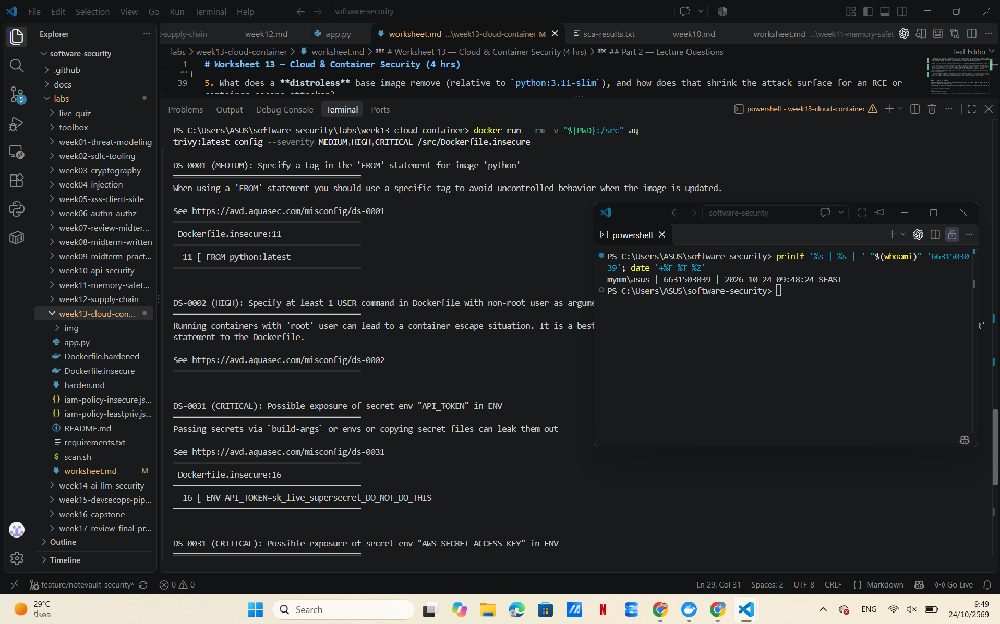
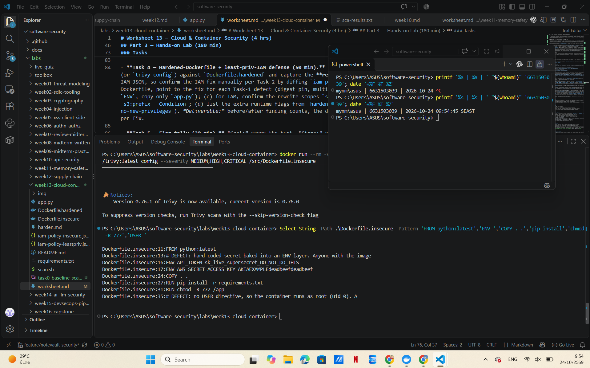
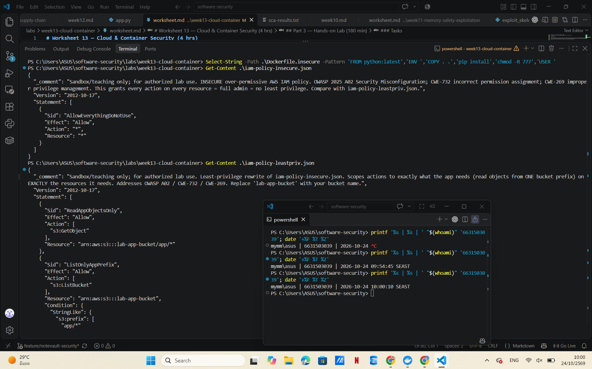
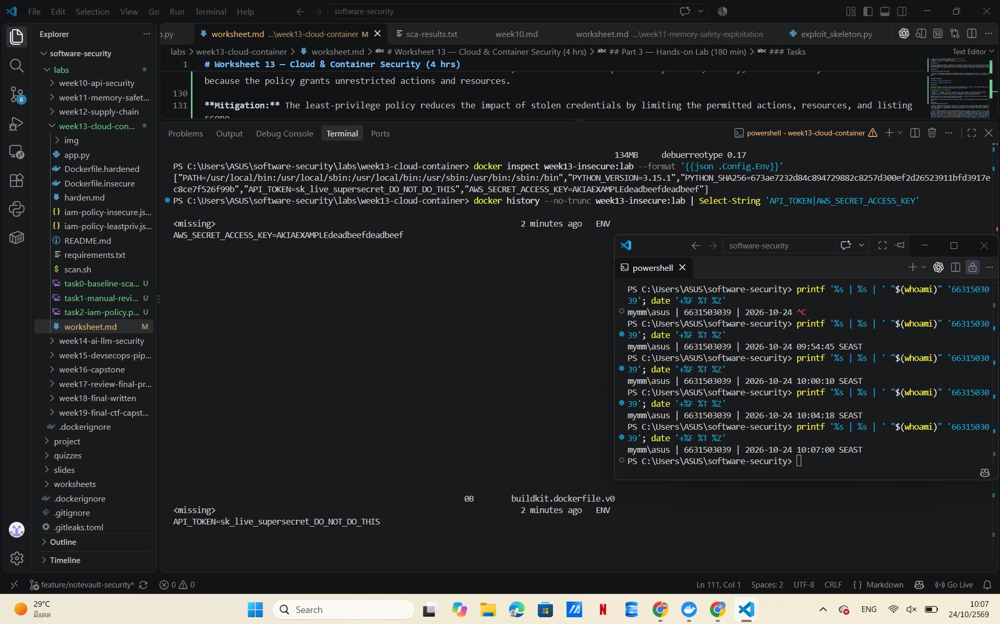
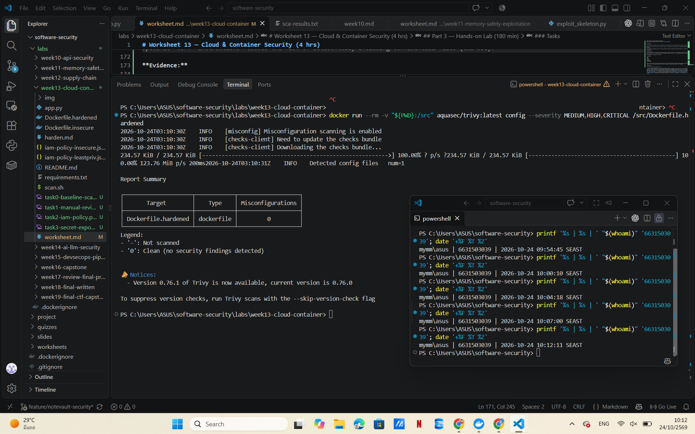
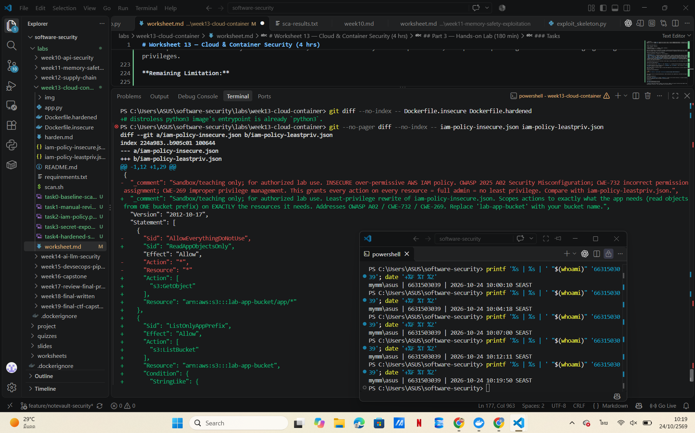
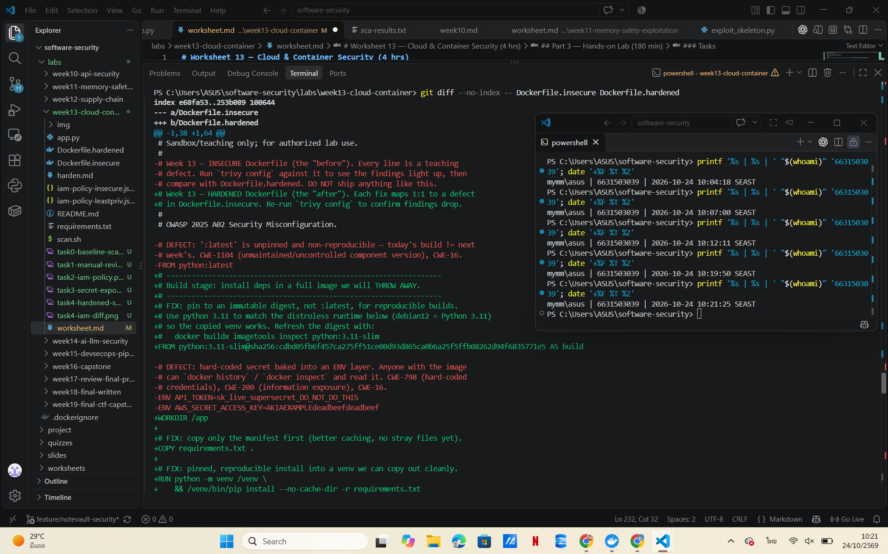
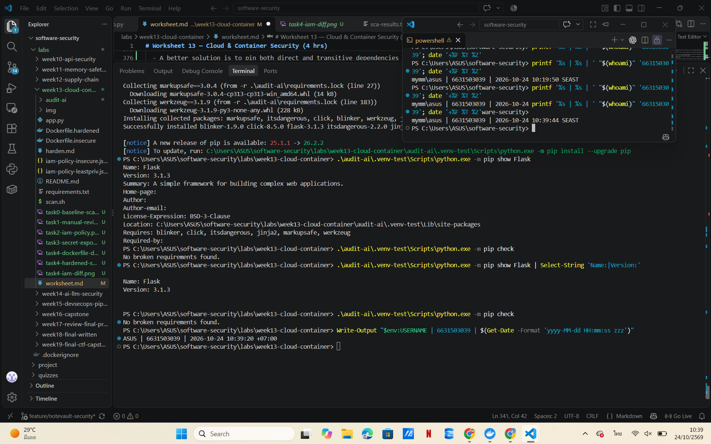

# Worksheet 13 — Cloud & Container Security (4 hrs)

> **Course:** Software Security (KOSEN69) · Week 13
> **Aligned to:** OWASP 2025 **A02 Security Misconfiguration** · **CWE-732** (incorrect permission assignment), **CWE-16** (configuration), plus CWE-798, CWE-250, CWE-538, CWE-269, CWE-1104
> **Signature game:** 🔍 *Misconfig Hunt* (CloudGoat-style) — each misconfig you find **and** fix = a flag.

> ⚠️ **Ethics note:** All artifacts here are deliberately broken for teaching and are marked *"Sandbox/teaching only; for authorized lab use."* Scan, exploit, and harden **only** these lab files (or systems you own / are authorized to test). Never point Trivy or these techniques at third-party cloud accounts or images without written permission.

---

## Part 1 — Student Information

| Name | Student ID | Date | Group |
|------|-----------|------|-------|
| Wilasinee Mangkorn     |  6631503039      |  24/10/2026  | 11


**AI Usage Disclosure:**

- I used ChatGPT to help explain lab instructions, understand improper security configurations, and organize my answers for the lab worksheet. Additionally, the AI ​​assisted with Docker commands, IAM policy analysis, and recommendations for securing dependencies. I personally executed the lab commands, verified the results, and confirmed the accuracy of the AI-generated answers using tools such as Trivy, Docker, and pip-tools.
---

## Part 2 — Lecture Questions

Answer in your own words (2–4 sentences each).

1. Explain the **shared-responsibility model**. In `harden.md` it says "the cloud provider secures *of* the cloud; you secure what you put *in* it." Give one concrete example of each side for an S3-backed app.

  - The shared-responsibility model means that both the cloud service provider and the customer have distinct security responsibilities. AWS is responsible for securing the cloud infrastructure—such as physical servers and data centers—while the customer is responsible for securing their applications and the data within those applications, for example, by correctly configuring access permissions for S3 buckets and establishing appropriate IAM policies.

2. `iam-policy-insecure.json` uses `"Action": "*"` and `"Resource": "*"`. Describe **why this violates least privilege** and map it to CWE-732 vs CWE-269 — what is the difference between the two CWEs here?

  - Using "Action": "*" and "Resource": "*" grants excessive permissions to a user, as it allows them to perform any action on all resources. CWE-732 refers to incorrect permission settings that enable access to resources beyond what is necessary, while CWE-269 pertains to improper privilege management—for instance, granting a user more actions or privileges than are actually required for their tasks.

3. The insecure Dockerfile bakes `ENV API_TOKEN=sk_live_...`. Explain how an attacker recovers that secret from a shipped image (name the `docker` commands) and why this is **CWE-798 / CWE-200**.

  - An attacker with access to a Docker image can use the `docker inspect` or `docker history --no-trunc` commands to discover secrets stored in environment variables (ENV variables). This scenario is classified as CWE-798, as credentials are embedded directly within the image; it also constitutes CWE-200, as sensitive information may be exposed to unauthorized individuals

4. Why is `FROM python:latest` (CWE-1104/CWE-16) a security and reproducibility problem, and how does pinning to an `@sha256:` digest fix it?

  - Using `python:latest` carries risks because the image can change over time. Consequently, each application build might utilize a different version of the image—potentially containing varying security vulnerabilities—which makes it difficult to ensure consistent results during application reproduction and testing. Specifying an image using a digest (e.g., `@sha256:`) guarantees that the exact same image content is used for every build. Nevertheless, users must still proactively manage updates to maintain security.

5. What does a **distroless** base image remove (relative to `python:3.11-slim`), and how does that shrink the attack surface for an RCE or container-escape attacker?

  - Distroless images strip away unnecessary tool such shells, package managers, and other utilities not required for running an application thereby the number of components that an attacker could exploit. Furthermore, this makes attacks more difficult, as an attacker would have fewer tools at their disposal within the container should they manage to gain access to the system.


---

## Part 3 — Hands-on Lab (180 min)

**Learning goals:** find cloud/container misconfigurations with Trivy, map each to a CWE, and rebuild the IAM policy + Dockerfile to least privilege / hardened so the findings drop.

**Prerequisites:** Docker installed and running; the `week13-cloud-container/` lab folder; internet access to pull `aquasec/trivy:latest`.

### Environment setup (real commands)

```bash
cd labs/week13-cloud-container

# Option A — the provided wrapper (trivy config over the Dockerfiles; IAM JSON is reviewed manually, see Task 2):
bash scan.sh

# Option B — run Trivy directly (MEDIUM is in the filter on purpose: one of the
# three rules Task 1 asks you to cite is rated MEDIUM, and HIGH,CRITICAL hides it):
docker run --rm -v "$PWD:/src" aquasec/trivy:latest config --severity MEDIUM,HIGH,CRITICAL /src

# (Optional) build + CVE-scan the hardened image:
docker build -f Dockerfile.hardened -t week13-hardened:lab .
docker run --rm -v /var/run/docker.sock:/var/run/docker.sock aquasec/trivy:latest image --severity HIGH,CRITICAL week13-hardened:lab
```

**What to submit per task:** the command(s) you ran + the relevant output (finding count or the specific finding line), a screenshot of the Trivy/terminal result, and a 2–3 sentence mitigation explaining *why* the fix reduces risk (cite the CWE).


### Tasks

- **Task 0 — Onboarding (15 min).** Confirm Docker works (`docker version`), run `bash scan.sh`, and record the **baseline finding count** against `Dockerfile.insecure` (Trivy's `config` scanner does not parse standalone IAM policy JSON, so `iam-policy-insecure.json` is reviewed manually instead — see Task 2). **Deliverable:** screenshot of the baseline scan.


- **Task 1 — Misconfig Hunt: container image (40 min).** *Goal:* find every defect in `Dockerfile.insecure`. *Steps:* read each `# DEFECT:` comment, then locate the matching Trivy finding where one exists — only 3 of the 6 (unpinned `:latest`, runs as root, secrets in `ENV`) map to a Trivy config rule (`DS-0001`, `DS-0002`, `DS-0031`); `COPY . .`, `chmod -R 777`, and unpinned `pip install` are instruction-level RUN/COPY semantics Trivy's Dockerfile scanner doesn't check, so identify those 3 by code review instead. Build a table: defect → CWE → Trivy rule/severity (write "manual review — no Trivy rule" where none exists). *Deliverable:* completed table (6 rows) using the IDs from `harden.md`.


**Command executed:**

`docker run --rm -v "${PWD}:/src" aquasec/trivy:latest config --severity MEDIUM,HIGH,CRITICAL /src/Dockerfile.insecure`

`Select-String -Path .\Dockerfile.insecure -Pattern 'FROM python:latest','ENV ','COPY . .','pip install','chmod -R 777','USER '`

**Results:**

Trivy detected 4 misconfiguration findings in `Dockerfile.insecure`: 1 MEDIUM, 1 HIGH, and 2 CRITICAL. These findings correspond to three types of insecure configuration: an unpinned base image, running as root, and exposed environment-variable secrets.

Manual code review identified three additional defects: copying the entire build context, using world-writable file permissions, and installing dependencies without strict version pinning.

| Defect | CWE | Trivy Rule / Severity |
|---|---|---|
| `FROM python:latest` | CWE-1104 / CWE-16 | DS-0001 / MEDIUM |
| Secrets stored in `ENV` | CWE-526 / CWE-798 / CWE-200 | DS-0031 / CRITICAL (2 findings) |
| `COPY . .` | CWE-538 | Manual review — no Trivy rule |
| `chmod -R 777 /app` | CWE-732 | Manual review — no Trivy rule |
| Running as root | CWE-250 | DS-0002 / HIGH |
| Unpinned `pip install` | CWE-1104 | Manual review — no Trivy rule |

**Mitigation:**

The insecure Dockerfile should be replaced with a hardened multi-stage build that uses digest-pinned base images, a non-root user, and only the necessary application files. Secrets should be provided securely at runtime, while unnecessary file permissions and unpinned dependencies should be avoided. These changes reduce the risk of credential exposure, unauthorized file modification, and privilege escalation.

**Evidence:** 



- **Task 2 — Misconfig Hunt: IAM (30 min).** *Goal:* document why `iam-policy-insecure.json` is full-admin. *Steps:* identify the `Action:*` / `Resource:*` / no-`Condition` problems; map to CWE-269 / CWE-732. *Deliverable:* 3-row table + one sentence on the blast radius if these creds leak.


**Commands executed:**

`Get-Content .\iam-policy-insecure.json`

`Get-Content .\iam-policy-leastpriv.json`

**Results:**

The insecure IAM policy allows all actions on all resources without any conditions. The least-privilege policy restricts access to specific S3 actions and resources, and adds a prefix condition for bucket listing.

| Misconfiguration | CWE | Mitigation |
|---|---|---|
| `Action: "*"` | CWE-269 | Allow only `s3:GetObject` and `s3:ListBucket` to prevent excessive privileges. |
| `Resource: "*"` | CWE-732 | Restrict access to `lab-app-bucket` and the `app/*` object prefix. |
| Missing `Condition` | CWE-732 | Add an `s3:prefix` condition to restrict S3 bucket listing. |

**Blast radius:** If the insecure IAM credentials were stolen, an attacker could potentially access, modify, or delete many AWS resources because the policy grants unrestricted actions and resources.

**Mitigation:** The least-privilege policy reduces the impact of stolen credentials by limiting the permitted actions, resources, and listing scope.

**Evidence:** 


- **Task 3 — Secrets & storage (25 min).** *Goal:* show secrets must not live in the image. *Steps:* explain how `ENV API_TOKEN` / `AWS_SECRET_ACCESS_KEY` are exposed via `docker history`; propose where they belong instead (secrets manager / mounted secret / orchestrator secret per `harden.md`). *Deliverable:* 2–3 sentence remediation + the `.dockerignore` entries you would add to stop `COPY . .` leaking `.git`/`.env` (CWE-538).


**Commands executed:**

```powershell
docker build -f Dockerfile.insecure -t week13-insecure:lab .
docker history --no-trunc week13-insecure:lab
docker inspect week13-insecure:lab --format '{{json .Config.Env}}'
```

**Results:**

The insecure Docker image was built successfully. Docker reported two security warnings about secrets stored in ENV variables.

Using `docker history --no-trunc` and `docker inspect`, I found that both `API_TOKEN` and `AWS_SECRET_ACCESS_KEY` were exposed in the image metadata.

This demonstrates CWE-526 (exposure through environment variables), CWE-798 (hard-coded credentials), and CWE-200 (exposure of sensitive information).

**Remediation:**

Secrets should not be hard-coded in Dockerfiles because anyone with access to the image may be able to retrieve them. Instead, secrets should be provided securely at runtime using a secrets manager, mounted secret files, or an orchestrator secret mechanism.

**Recommended `.dockerignore` entries:**

```gitignore
.git
.env
.env.*
*.pem
*.key
__pycache__/
node_modules/
```

These entries prevent sensitive and unnecessary files from being included in the Docker build context. Additionally, replacing `COPY . .` with specific `COPY` instructions reduces the risk of accidentally including confidential files (CWE-538).

**Evidence:**



- **Task 4 — Hardened-Dockerfile + least-priv-IAM defense (50 min).** *Goal:* prove the "after" is clean. *Steps:* (a) re-run `bash scan.sh` (or `trivy config`) against `Dockerfile.hardened` and capture the **reduced** finding count (Trivy's config scanner does not parse standalone IAM JSON, so confirm the IAM fix manually per Task 2 by diffing `iam-policy-leastpriv.json` against the insecure policy); (b) for the Dockerfile, point to the fix for each Task-1 defect (digest pin, multi-stage venv, distroless runtime, `USER 65532:65532`, no secrets in `ENV`, copy only `app.py`); (c) for IAM, confirm the rewrite scopes `s3:GetObject` to `arn:aws:s3:::lab-app-bucket/app/*` and adds the `s3:prefix` `Condition`; (d) list the extra runtime flags from `harden.md` (`--read-only`, `--cap-drop ALL`, `--security-opt no-new-privileges`). *Deliverable:* before/after finding counts, the defect→fix mapping, and the diffed policy/Dockerfile with one sentence per fix.

**Commands executed:**

```powershell
docker run --rm -v "${PWD}:/src" aquasec/trivy:latest config --severity MEDIUM,HIGH,CRITICAL /src/Dockerfile.insecure
docker run --rm -v "${PWD}:/src" aquasec/trivy:latest config --severity MEDIUM,HIGH,CRITICAL /src/Dockerfile.hardened
```

**Before and After Results:**

| Scan | Findings | Severity |
|---|---:|---|
| Dockerfile.insecure | 4 | 1 MEDIUM, 1 HIGH, 2 CRITICAL |
| Dockerfile.hardened | 0 | No findings |

The Trivy configuration scan showed that the number of detected misconfigurations decreased from 4 to 0, representing a 100% reduction in detected findings. However, this does not guarantee that the container is completely secure because some issues require manual review.

**Dockerfile Hardening — Defect and Fix Mapping:**

| Insecure Configuration | Hardened Fix | Security Benefit |
|---|---|---|
| `FROM python:latest` | Pinned base images using SHA256 digests | Prevents unexpected image changes and improves reproducibility (CWE-1104). |
| Secrets stored in `ENV` | Removed hard-coded secrets | Prevents credentials from being exposed through image metadata (CWE-526 / CWE-798). |
| `COPY . .` | Copies only `app.py` and required dependencies | Reduces accidental exposure of sensitive files (CWE-538). |
| `chmod -R 777 /app` | Removed world-writable permissions | Prevents unnecessary file modification (CWE-732). |
| Running as root | Added `USER 65532:65532` | Limits privileges and reduces the impact of container compromise (CWE-250). |
| Unpinned dependency installation | Uses a multi-stage build with `requirements.txt` | Improves dependency management, but exact version pinning is still required (CWE-1104). |

The hardened Dockerfile also uses a distroless runtime image, reducing unnecessary tools and packages available inside the container.

**IAM Least-Privilege Defense:**

The insecure IAM policy used `"Action": "*"` and `"Resource": "*"`, allowing excessive permissions without conditions.

The hardened IAM policy restricts permissions to `s3:GetObject` and `s3:ListBucket`, limits resources to `lab-app-bucket`, and adds an `s3:prefix` condition for bucket listing.

These changes reduce the potential impact of stolen IAM credentials by restricting access to only the required actions and resources (CWE-269 / CWE-732).

**Additional Runtime Hardening:**

```bash
docker run --read-only --cap-drop ALL --security-opt no-new-privileges week13-hardened:lab
```

These options restrict filesystem modifications, remove unnecessary Linux capabilities, and prevent privilege escalation through gaining new privileges.

**Remaining Limitation:**

The provided `requirements.txt` contains `Flask>=3.1.3`, which is not an exact version pin. To improve reproducibility, Flask and its transitive dependencies should be pinned to verified versions.

**Evidence:**






- **Task 5 — Flag tally (20 min).** *Goal:* score the hunt. *Steps:* one flag per misconfig found **and** fixed (6 container + 3 IAM = 9). *Deliverable:* flag count + the single biggest-risk misconfig and why.

### Task 5 — Flag Tally

**Results:**

The Misconfig Hunt identified 9 security misconfigurations in total: 6 container misconfigurations and 3 IAM misconfigurations.

The hardened Dockerfile reduced Trivy configuration findings from 4 to 0. The IAM policy was also improved by restricting actions, resources, and adding a condition for S3 bucket listing.

**Flag Tally:**

| Category | Misconfigurations Found | Fix Status |
|---|---:|---|
| Container Security | 6 | 5 fully addressed; dependency pinning partially addressed |
| IAM Security | 3 | 3 addressed in the provided policy |
| Total | 9 | 8 fully addressed, 1 partially addressed |

**Biggest-Risk Misconfiguration:**

The biggest risk is the over-permissive IAM policy using `"Action": "*"` and `"Resource": "*"`. If an attacker steals the credentials, they could potentially access, modify, or delete many cloud resources.

The least-privilege policy reduces this risk by allowing only the required S3 actions and limiting access to specific resources (CWE-269 / CWE-732).

**Conclusion:**

The lab successfully demonstrated how container hardening and least-privilege IAM policies reduce security risks. However, dependency versions still need exact pinning to improve reproducibility and supply-chain security.

**Evidence:**

- 
- 
- 
- 
- 

---

## Part 4 — Reflection

1. **Mapping.** For three findings, write the line of the artifact → CWE → OWASP 2025 A02, and the one-line fix.

  - Three security misconfigurations found in the lab are:

  | Artifact / Vulnerable Line | CWE | OWASP | Fix |
  |---|---|---|---|
  | `Dockerfile.insecure:11` — `FROM python:latest` | CWE-1104 / CWE-16 | A02 Security Misconfiguration | Pin the base image using a SHA256 digest. |
  | `Dockerfile.insecure:16` — `ENV API_TOKEN=...` | CWE-526 / CWE-798 | A02 Security Misconfiguration | Remove hard-coded secrets and inject them securely at runtime. |
  | `Dockerfile.insecure:31` — `RUN chmod -R 777 /app` | CWE-732 | A02 Security Misconfiguration | Remove world-writable permissions and apply least privilege. |

  These issues can lead to unexpected image changes, credential exposure, and unauthorized file modification. Applying secure configurations reduces these risks.


  2. **Real incident.** Briefly describe a real breach caused by a cloud/container misconfiguration (e.g., a public S3 bucket leak, or an over-permissive IAM role). What single control from this lab would have prevented it?

    - In 2017, Accenture exposed information through four misconfigured AWS S3 buckets that were publicly accessible. Researchers discovered that the buckets contained sensitive information, including credentials and internal configuration data.

  Enabling S3 Block Public Access and restricting bucket permissions could have prevented this exposure. This incident shows why cloud storage must follow the least-privilege principle.

  **Reference:** SecurityWeek (2017), *Accenture Exposed Data via Unprotected Cloud Storage Bucket*.

  https://www.securityweek.com/accenture-exposed-data-unprotected-cloud-storage-bucket/


  3. **Best mitigation.** Of everything you did, which control gives the most risk reduction per unit of effort, and why? Argue for least-privilege IAM vs. distroless+non-root.

    - I think least-privilege IAM provides the greatest risk reduction for the effort required. Restricting `"Action": "*"` and `"Resource": "*"` to specific permissions reduces the damage an attacker could cause if credentials are stolen.

  Distroless images and non-root containers are also important because they reduce the attack surface and limit container privileges. However, least-privilege IAM can protect multiple cloud resources, making it the more valuable control in this scenario.

---

## Grading rubric (100)

| Component | Points | What earns full marks |
|-----------|:------:|-----------------------|
| Part 2 — Lecture questions | 20 | All 5 answered correctly with CWE/A02 reasoning |
| Part 3 — Tasks + evidence | 40 | Tasks 0–5 complete; commands, outputs, and screenshots present |
| Defense (Task 4 hardening) | 25 | Hardened Dockerfile + least-priv IAM shown to reduce findings; per-fix justification |
| Part 4 — Reflection | 15 | Accurate mapping, relevant incident, well-argued best mitigation |

---

## Evidence & Integrity (required)

- **Identity proof:** every screenshot/diagram must show a terminal running `printf '%s | %s | ' "$(whoami)" '<YOUR-STUDENT-ID>'; date '+%F %T %Z'` **in the
  same image as the evidence**. When the evidence is a browser page, a DevTools panel or a
  rendered response, put that terminal **beside the browser and capture the whole screen** — a
  cropped window carries nothing that identifies you, and the lab's own output is
  byte-identical for the whole cohort *by design*, so the stamp is the only thing that makes
  the shot yours. Generic or borrowed evidence is not accepted.
- **Personalized flag (if this lab issues one):** N/A — No student-specific flag  was issued during this lab.
  *Flags are unique per student — submitting another student's flag is a violation. How to submit: **learn.zcr.ai/submit** (full guide: `SUBMISSION.md` in the repo root).*
- **Explain in your own words** *(graded on your reasoning, not copied text):*
  1. What did you do, and **why did the vulnerability work**?
    - I scanned an insecure Dockerfile using the Trivy tool and also manually reviewed the Dockerfile and IAM policies to identify unsafe configurations. These vulnerabilities stem from improper container settings such as running with root privileges, storing secrets in environment variables, and granting overly permissive access rights. Furthermore, I confirmed that hard-coded secrets can be retrieved using the `docker history` and `docker inspect` commands.
  2. **Why does your fix actually stop it** — and what could still break it?
    - The hardened Dockerfile removes embedded secrets, utilizes a non-root user, and pins the base image, while updated IAM policies restrict access to specific actions and resources. These changes mitigate risks related to credential exposure, privilege escalation, and unauthorized access. Nevertheless, vulnerable dependencies, leaked runtime secrets, or misconfigured deployments can still pose security concerns.
---

## 🤖 Audit the AI (required)

AI is a power tool you must **distrust** you are graded on your *critique*, not the AI's answer.

1. Ask an AI assistant to exploit **or** fix this week's vulnerability. Paste its full answer.
  - **Prompt:**

    How can I fix the unpinned Python dependency in my Week 13 Docker container? My requirements.txt currently contains `Flask>=3.1.3`. Please suggest a secure fix.

    **AI Response:**

    To improve dependency security, replace the version range with an exact version in `requirements.txt`.

    Change:

    ```text
    Flask>=3.1.3
    ```

    To:

    ```text
    Flask==3.1.3
    ```

    This pins Flask to a specific version, preventing pip from installing a newer Flask release automatically. You can then rebuild the Docker image using the updated requirements file.

  2. **Find what's wrong or risky** in it insecure code, a subtly incomplete fix, a hallucinated API/function/CVE, a missed edge case, or wrong reasoning. Quote the exact line(s).

    - The AI suggested using `Flask==3.1.3`. This is partially correct because it pins the direct dependency to one version. However, the AI did not consider transitive dependencies, which may still change between builds.

    The response also did not include dependency hashes or security verification. Therefore, the suggested fix does not guarantee a fully reproducible and secure dependency installation.

  3. Produce the **correct, verified** version yourself and explain in 2–3 sentences why the AI's output was insufficient.

    - I used `pip-tools` to generate a dependency lockfile with exact versions and SHA256 hashes. The lockfile includes Flask 3.1.3 and six transitive dependencies.

    **Commands executed:**

    ```powershell
    python -m venv .\audit-ai\.venv
    .\audit-ai\.venv\Scripts\python.exe -m pip install pip-tools
    Set-Content -Path .\audit-ai\requirements.in -Value "Flask==3.1.3"
    .\audit-ai\.venv\Scripts\pip-compile.exe --generate-hashes --output-file=.\audit-ai\requirements.lock .\audit-ai\requirements.in

    python -m venv .\audit-ai\.venv-test
    .\audit-ai\.venv-test\Scripts\python.exe -m pip install --require-hashes -r .\audit-ai\requirements.lock
    .\audit-ai\.venv-test\Scripts\python.exe -m pip show Flask
    .\audit-ai\.venv-test\Scripts\python.exe -m pip check
    ```

    **Verification Results:**

    - The dependency lockfile was generated successfully.
    - All 7 packages were installed successfully using `--require-hashes`.
    - Flask version 3.1.3 was confirmed.
    - `pip check` returned `No broken requirements found.`

    The corrected solution is more complete because it pins direct and transitive dependencies and verifies package hashes during installation.

    **Limitation:** Verification was performed on Windows with Python 3.13.5, not inside the Linux container using Python 3.11.

    **Evidence:** 
    


> Disclose your AI use in the Part 1 table. This task counts toward your **Defense + Reflection** score.

---

## 🧠 Comprehension & Prompt (required)

**A. Explain in Plain English (EiPE).** In 2–3 sentences, in your own words, describe what this week's vulnerable code/endpoint actually *does* and *why it is exploitable* — explain the mechanism, don't dump jargon.

  - An insecure Dockerfile stores credentials directly within environment variables and runs containers with excessive privileges. Anyone who gains access to such a Docker image can read the stored credentials using Docker commands. Furthermore, running a container with root-level privileges amplifies the potential impact of an attack. Consequently, the container becomes vulnerable to credential leaks, in addition to security risks stemming from the use of privileges that exceed what is necessary.

**B. Prompt Problem.** Write a **single prompt** that makes an AI produce a *correct, secure* fix for one finding. Run it: does the exploit now fail? If not, refine the prompt and try again. Submit the **final prompt + the verified result**.
*Graded on the prompt's precision and your verification — this trains problem decomposition and AI literacy (Denny et al. 2024).*

  - **Final Prompt:**

  I have a Python Flask Docker application with `Flask>=3.1.3` in `requirements.txt`. Provide a secure and reproducible dependency management solution.

  The solution must pin Flask and all transitive dependencies to exact versions, generate SHA256 hashes using pip-tools, and verify installation using `pip install --require-hashes` and `pip check`.

  Do not hard-code secrets or modify the original insecure Dockerfile. Explain the verification steps and any remaining limitations.

  **AI-Generated Solution:**

  The AI recommended using pip-tools to generate a dependency lockfile containing exact versions for Flask and its transitive dependencies, together with SHA256 hashes. It also recommended installing the locked dependencies using `--require-hashes` and checking dependency compatibility with `pip check`.

  **Commands Executed:**

  ```powershell
  .\audit-ai\.venv\Scripts\pip-compile.exe --generate-hashes --output-file=.\audit-ai\requirements.lock .\audit-ai\requirements.in

  .\audit-ai\.venv-test\Scripts\python.exe -m pip install --require-hashes -r .\audit-ai\requirements.lock

  .\audit-ai\.venv-test\Scripts\python.exe -m pip check
  ```

  **Verification Results:**

  - Dependency lockfile generated successfully.
  - All 7 dependencies installed successfully with SHA256 hash verification.
  - Flask version 3.1.3 confirmed.
  - `pip check` returned `No broken requirements found.`

  **Did the vulnerability still exist?**

  The original unpinned dependency issue was addressed in the separate locked installation by pinning all resolved dependencies and verifying their hashes. However, the original Dockerfile and requirements.txt were not modified, so the fix has not yet been applied or verified inside the Docker image.

  **Conclusion:**

  The final prompt produced a more complete solution than simply pinning Flask. Testing confirmed that the locked dependencies installed successfully on Windows Python 3.13.5, although Linux Docker compatibility still requires verification.

  **Evidence:** 
    
