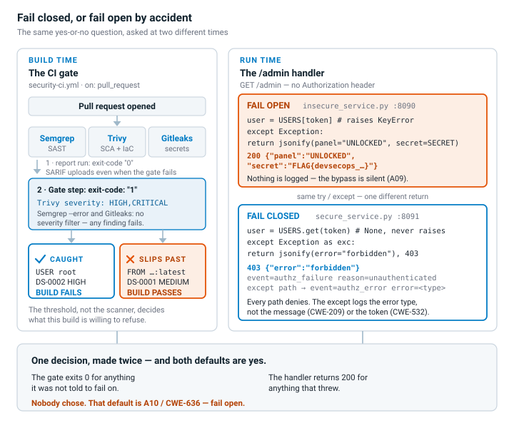
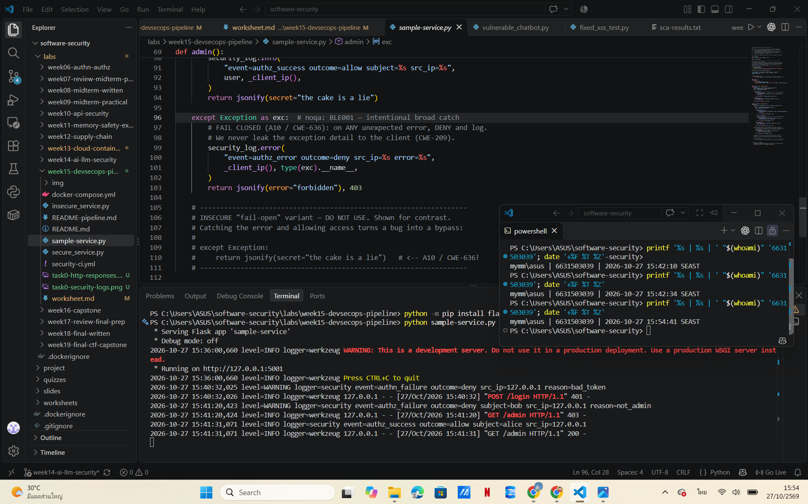
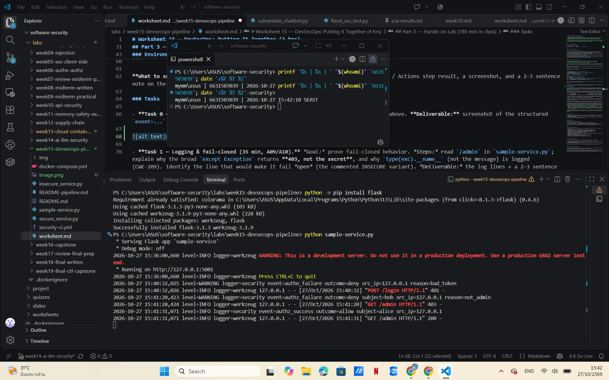
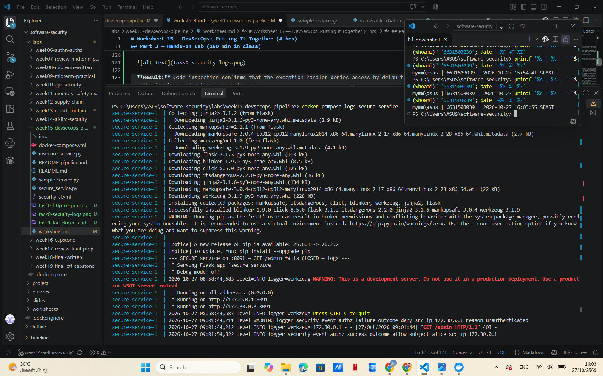
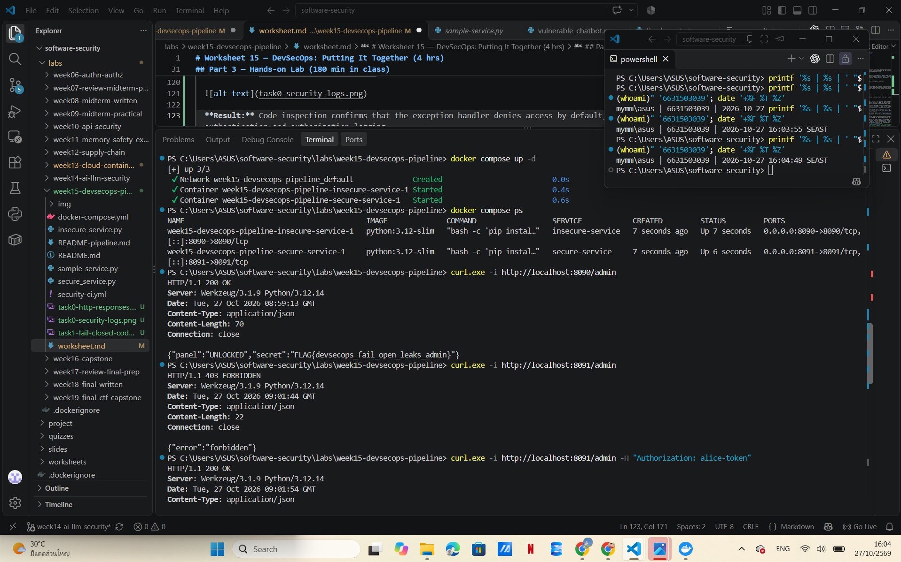
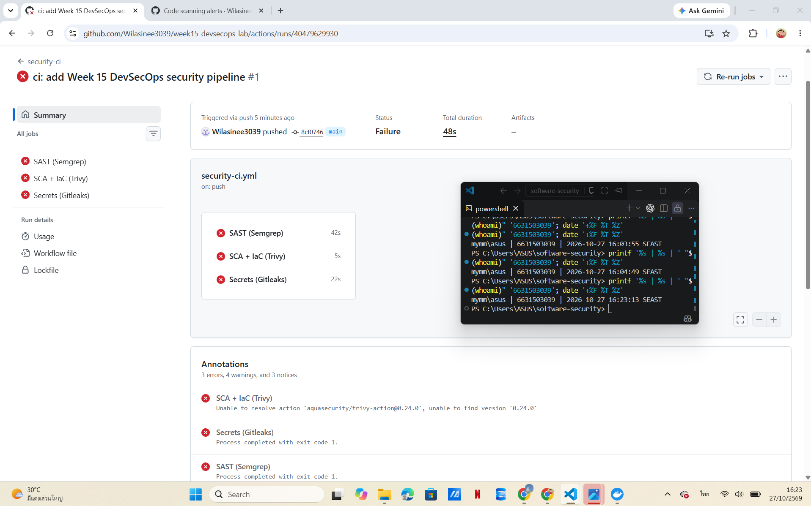
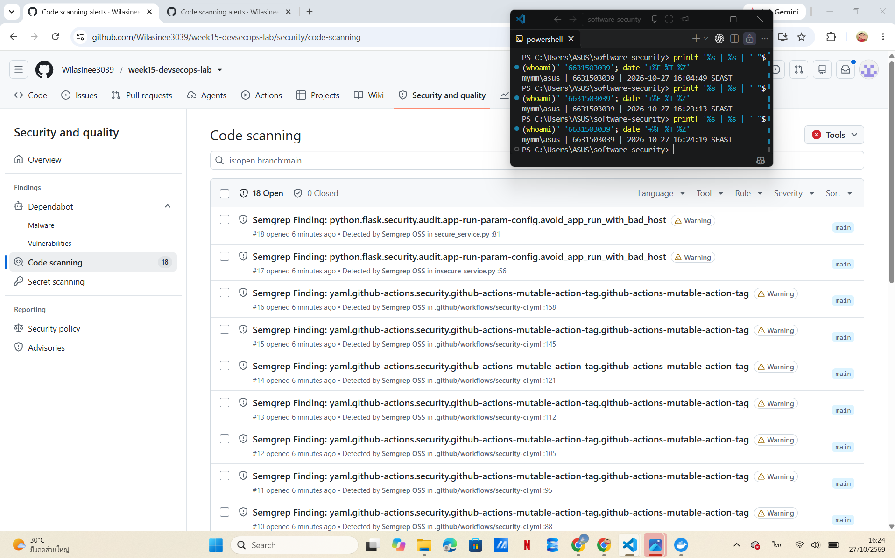
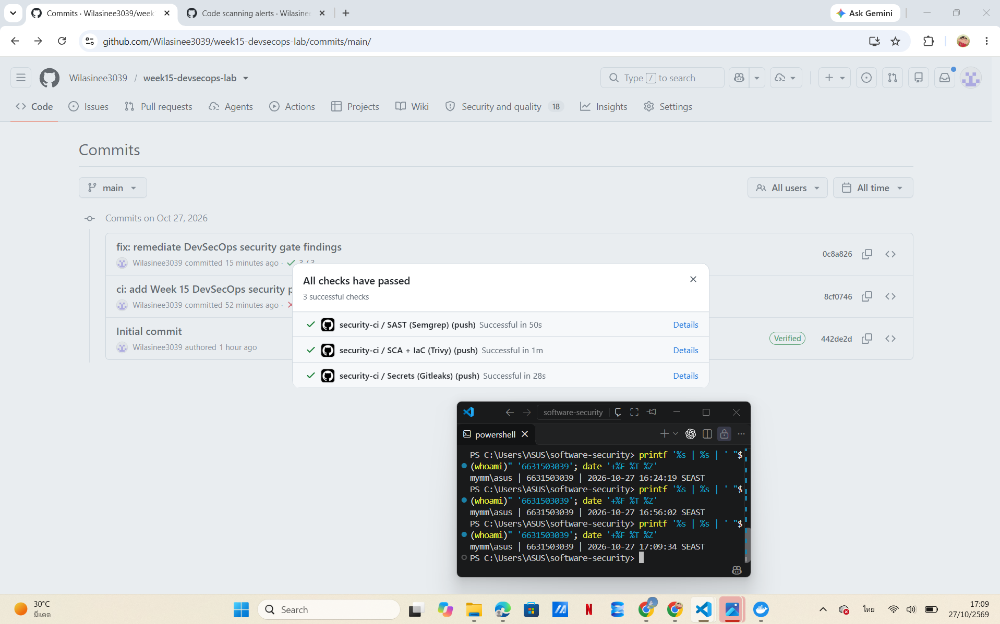
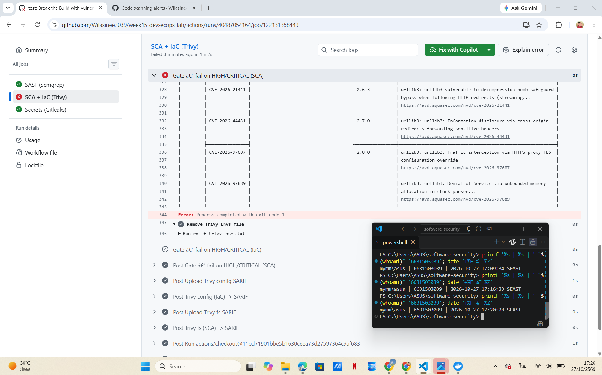
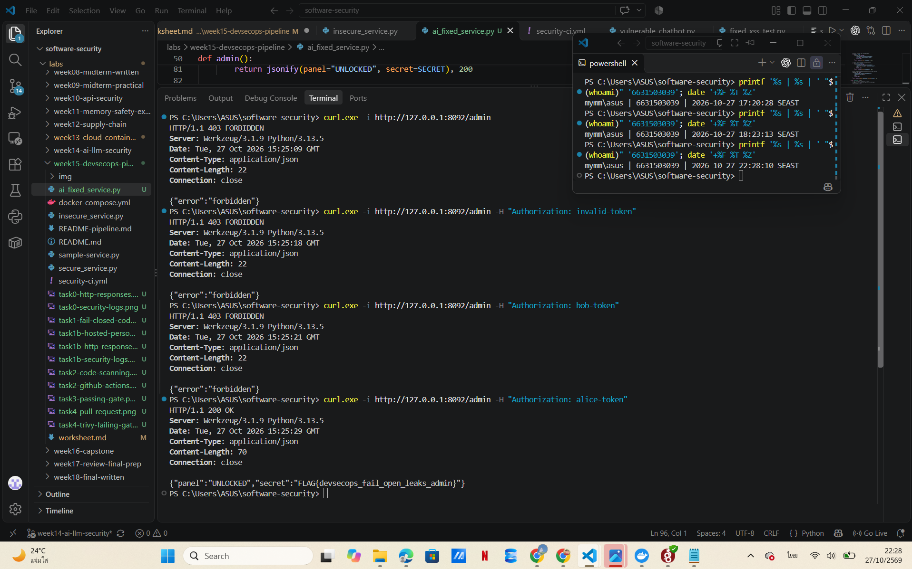

# Worksheet 15 — DevSecOps: Putting It Together (4 hrs)

> **Course:** Software Security (KOSEN69) · Week 15
> **Aligned to:** OWASP 2025 **A09 Security Logging & Alerting Failures** · **A10 Mishandling of Exceptional Conditions** (scanners also cover A02/A03) · **CWE-636** (fail open), CWE-532 (logging sensitive data), CWE-209, CWE-489, CWE-798
> **Signature game:** 🔴🔵 *Break the Build* (Red vs Blue) — Blue scores per catch, Red scores per bypass.

> ⚠️ **Ethics note:** The pipeline and `sample-service.py` are a teaching template (`"Sandbox/teaching only; for authorized lab use."`). Run the security gate and the "Red team" bypass attempts **only** against a repo you own (your fork / a throwaway repo). Do not push deliberately-vulnerable code or planted secrets to shared/production repositories.

---

## Part 1 — Student Information

| Name | Student ID | Date | Group |
|------|-----------|------|-------|
|  Wilasinee Mangkorn    |  6631503039         |  27/10/2026    |   11    |


**AI Tool:** ChatGPT

**AI Use Disclosure:** I used ChatGPT to understand DevSecOps concepts, troubleshoot CI pipeline issues, and assist with writing the lab report. I reviewed the AI suggestions and verified the results through my own testing.
---

## Part 2 — Lecture Questions

Answer in your own words (2–4 sentences each).

1. `README-pipeline.md` says each tool runs **twice** (report step, then gate step). Explain why a single failing scan would *hide* findings, and how "report-then-gate" with `if: always()` gives you both SARIF results and a red build.

  - The report generation step produces a SARIF file without causing the build to fail, allowing security scan results to be uploaded and reviewed. The `if: always()` condition ensures that the upload step executes even if preceding steps fail—provided that the job reaches this stage and a report is available. The "Security" tab may display findings that fall below the severity thresholds defined for security checks, as the processes for generating reports and enforcing security policies are separate. The security check step, however, will cause the build to fail if the scan results meet the configured blocking criteria—triggered by using `exit-code: "1"` or the `--error` flag in Semgrep.

2. What is the difference between **fail-closed** and **fail-open**? In `sample-service.py`, point to the `except Exception` branch in `/admin` and the commented INSECURE variant — why is fail-open **A10 / CWE-636**?

  - "Fail-closed" means that a system denies access when an unexpected error occurs, whereas "fail-open" means that a system permits access even in the event of an error. In `sample-service.py`, a secure exception handler for the `/admin` endpoint returns an HTTP 403 status code and logs the error type without revealing sensitive information. Conversely, the commented-out, insecure variant returns sensitive data when an exception occurs, leading to unauthorized access. This is an example of OWASP A10 (improper handling of exception conditions) and CWE-636.

3. The `permissions:` block in `security-ci.yml` is `contents: read`, `security-events: write`. Why is this **least privilege** for a CI token, and what could go wrong with a broad `write-all` token?

  The `contents: read` permission allows a workflow to read the contents of a repository, while `security-events: write` permits the uploading of security scan results. These permissions are sufficient for the pipeline’s intended scanning and reporting tasks, without granting unnecessary access to modify the repository. Using `write-all` could increase the potential impact of a compromised workflow or the actions of a third party by allowing unauthorized modifications to repository resources.

4. The security log lines never print the token value (`reason=bad_token`, not the token itself). Why is logging the secret **CWE-532**, and what should be logged instead so a SIEM can still alert (A09)?

  Logging authentication tokens or passwords may expose sensitive credentials to anyone with access to the logs, creating a risk of information exposure as defined by CWE-532. Instead, applications should log the event type, outcome, source IP address, reason for failure, and user identity, where appropriate. These structured fields enable SIEM systems to detect suspicious authentication activity without requiring the storage of confidential values, in alignment with the OWASP A09 standard.

5. Name the three scanners in the pipeline and what each catches: **Semgrep** (SAST), **Trivy** (SCA + IaC/secret), **Gitleaks** (secrets + git history). Which OWASP categories does each map to per the README table?

  Semgrep is a SAST tool that detects insecure source code patterns using a set of security rules, including those aligned with OWASP. Trivy performs Software Composition Analysis (SCA) to identify vulnerable dependencies, scans Infrastructure as Code (IaC) and Docker configurations, and detects potential secrets—addressing risks such as OWASP A03 (Software Supply Chain Failures) and A02 (Security Misconfiguration). Gitleaks identifies credentials and secrets embedded within source code and Git history, in accordance with CWE-798. Together, these tools provide multi-layered security checks within a CI/CD pipeline.

---

## Part 3 — Hands-on Lab (180 min in class)

> The task budgets below add up to 205 min. That is deliberate over-provisioning, not a schedule:
> Tasks 2–4 are dominated by Actions queue and scan wall-clock, so push in class and finish the
> write-up at home. Your instructor will say which task runs as homework.



**Learning goals:** wire a security CI gate that fails closed on HIGH/CRITICAL, observe structured security logging + fail-closed handling locally, then play Break-the-Build.

**Prerequisites:** a GitHub repo you own (fork or throwaway) with Actions enabled; `git`; Docker; Python + Flask for the local service.

### Environment setup (real commands)

```bash
# --- A) Wire the gate into a repo you own (README-pipeline.md §1) ---
mkdir -p .github/workflows
cp labs/week15-devsecops-pipeline/security-ci.yml .github/workflows/security-ci.yml
git add .github/workflows/security-ci.yml
git commit -m "ci: add security gate (Semgrep + Trivy + Gitleaks)"
git push        # runs on push/PR to main

# --- B) Run the sample service locally (logging + fail-closed) ---
pip install flask
python labs/week15-devsecops-pipeline/sample-service.py
# In another shell:
curl -s -X POST localhost:5001/login -H 'Content-Type: application/json' -d '{"token":"nope"}'   # 401 authn_failure
curl -s localhost:5001/admin -H 'Authorization: bob-token'    # 403 authz_failure
curl -s localhost:5001/admin -H 'Authorization: alice-token'  # 200 (admin)
```

**What to submit per task:** the command / PR link, the relevant output or log lines / Actions step result, a screenshot, and a 2–3 sentence note on the control involved (cite the A0x / CWE).

### Tasks

- **Task 0 — Onboarding (15 min).** Run the sample service; trigger the three curls above. **Deliverable:** screenshot of the structured `event=...` security log lines for authn_failure, authz_failure, and authz_success.


  **Objective:** Verify that the Flask service records authentication and authorization events correctly.

  **Commands:**

  ```powershell
  python sample-service.py

  $body = @{ token = "nope" } | ConvertTo-Json
  try {
      Invoke-WebRequest -Uri "http://127.0.0.1:5001/login" -Method POST -ContentType "application/json" -Body $body
  } catch {
      Write-Host "HTTP Status:" ([int]$_.Exception.Response.StatusCode)
  }

  curl.exe -i http://127.0.0.1:5001/admin -H "Authorization: bob-token"
  curl.exe -i http://127.0.0.1:5001/admin -H "Authorization: alice-token"
  ```

  **Actual Results:**

  | Test Case | HTTP Status | Security Event | Result |
  |---|---|---|---|
  | Invalid login token | 401 | `authn_failure` | PASS |
  | Non-admin access | 403 | `authz_failure` | PASS |
  | Admin access | 200 | `authz_success` | PASS |

  **Evidence:**

  
  

  **Explanation:**

  The Flask service successfully recorded authentication and authorization events using structured security logs. Invalid login attempts returned HTTP 401, non-admin access returned HTTP 403, and valid admin access returned HTTP 200. The logs recorded security events without exposing authentication tokens, supporting OWASP A09 Security Logging & Alerting Failures.


- **Task 1 — Logging & fail-closed (35 min, A09/A10).** *Goal:* prove fail-closed behavior. *Steps:* read `/admin` in `sample-service.py`; explain why the broad `except Exception` returns **403, not the secret**, and why `type(exc).__name__` (not the message) is logged (CWE-209). Identify the line that would make it fail *open* (the commented INSECURE variant). *Deliverable:* the log lines + a 2–3 sentence explanation of fail-closed vs fail-open.


  **OWASP:** A09 Security Logging & Alerting Failures, A10 Mishandling of Exceptional Conditions

  **CWE:** CWE-209, CWE-636

  **Explanation:**

  The secure `/admin` endpoint handles unexpected exceptions by returning HTTP 403 instead of revealing the secret, ensuring fail-closed behavior. It logs the exception type using `type(exc).__name__` rather than the full exception message to reduce the risk of exposing sensitive internal details (CWE-209). The commented insecure variant returns the secret when an exception occurs, creating a fail-open vulnerability (CWE-636).

  **Evidence:**

  

  

  **Result:** Code inspection confirms that the exception handler denies access by default, while Task 0 demonstrates structured authentication and authorization logging.


- **Task 1b — Break the Build, live (25 min, A10 / CWE-636).** *Goal:* exploit a real fail-open, then prove the fix. *Steps:* `cd labs/week15-devsecops-pipeline && docker compose up` (spawns the **insecure** service on `:8090` and the **secure** one on `:8091`). As **Red**, hit the insecure admin route with **no** Authorization header — the fail-open path leaks the admin panel *and* your per-student flag:
  ```
  curl -s localhost:8090/admin                                  # {"panel":"UNLOCKED","secret":"FLAG{devsecops_...}"}  <- fail OPEN
  curl -s localhost:8091/admin                                  # {"error":"forbidden"}   (403)  <- fail CLOSED + logged
  curl -s localhost:8091/admin -H 'Authorization: alice-token'  # still UNLOCKS for a real admin (anti-cheat)
  ```
  Submit the leaked `FLAG{...}`. *Deliverable:* the flag, the two contrasting `/admin` responses (`:8090` leak vs `:8091` deny), and the exact line in `insecure_service.py` that fails open. *(The instructor auto-grader re-runs these exploits against your hardened box — you pass only if every bypass is blocked **and** a valid admin token still works.)*


  **Objective:** Demonstrate the fail-open vulnerability and verify the secure implementation.

  **OWASP:** A09 Security Logging & Alerting Failures, A10 Mishandling of Exceptional Conditions.

  **CWE:** CWE-636 (Fail-open).

  #### Commands

  ```powershell
  docker compose up -d
  docker compose ps

  curl.exe -i http://localhost:8090/admin
  curl.exe -i http://localhost:8091/admin
  curl.exe -i http://localhost:8091/admin -H "Authorization: alice-token"

  docker compose logs secure-service
  ```

  #### Actual Results

  | Test Case | HTTP Status | Result |
  |---|---|---|
  | Insecure without token | 200 OK | Vulnerable |
  | Secure without token | 403 Forbidden | Protected |
  | Secure with valid admin token | 200 OK | Authorized |
  | Secure security logging | Logged | PASS |

  #### Vulnerable Code

  File: `insecure_service.py`

  ```python
  except Exception:
      return jsonify(panel="UNLOCKED", secret=SECRET)
  ```

  #### Explanation

  The insecure service grants administrative access when a missing authorization token causes a KeyError. This is a fail-open vulnerability because the exception handler returns HTTP 200 and exposes the admin secret instead of denying access. The secure service prevents unauthorized access using safe token validation and fail-closed error handling, while recording security events without exposing sensitive tokens.

  #### Local Demo Flag

  `FLAG{devsecops_fail_open_leaks_admin}`

  This is a public local demonstration flag, not the personalized graded flag from the hosted CTFd instance.

  #### Evidence

    
    

  #### Result

  The local tests confirmed that the insecure endpoint leaks the secret without authentication, while the secure endpoint denies unauthorized access and still allows a valid administrator. Structured security logs were also generated successfully.


- **Task 2 — Stand up the gate (35 min).** *Goal:* get the workflow running. *Steps:* push `security-ci.yml`, open the Actions run, confirm the three jobs (`semgrep`, `trivy`, `gitleaks`) execute and SARIF appears in the Security tab. *Deliverable:* screenshot of the Actions run + the Code scanning alerts page.


  **Objective:** Configure and execute a GitHub Actions security pipeline using Semgrep, Trivy, and Gitleaks.

  **Repository:** https://github.com/Wilasinee3039/week15-devsecops-lab

  **Workflow Run:** https://github.com/Wilasinee3039/week15-devsecops-lab/actions/runs/40479629930

  #### Actual Results

  | Job | Status | Observation |
  |---|---|---|
  | Semgrep (SAST) | Failed | Security findings detected |
  | Trivy (SCA + IaC) | Failed | GitHub Action version could not be resolved |
  | Gitleaks (Secrets) | Failed | Exit code 1; detailed cause requires log inspection |

  The workflow was triggered successfully by a push to the main branch. All three jobs were initiated, and the GitHub Code Scanning page displayed 18 open Semgrep alerts. However, the Trivy job encountered an Action resolution error, which must be corrected before its scanning results can be evaluated.

  #### Evidence

  
  

  **Result:** The CI workflow was successfully triggered, but the initial build failed. The issues will be investigated and addressed in Task 3.


- **Task 3 — Blue team: pass the gate (30 min).** *Goal:* a green build. *Steps:* ensure the protected repo has no HIGH/CRITICAL findings and no secrets; fix or justify-and-document any (no blanket-ignore, per README §4). *Deliverable:* link to the passing run.


  **Objective:** Remediate security findings and achieve a passing GitHub Actions security pipeline without disabling security scanners.

  **OWASP Categories:**
  - A02 — Security Misconfiguration
  - A03 — Software Supply Chain Failures
  - A09 — Security Logging & Alerting Failures

  **Repository:** https://github.com/Wilasinee3039/week15-devsecops-lab

  #### 1. Initial Security Scan Results

  After configuring the GitHub Actions security pipeline in Task 2, the initial workflow failed. The results showed issues in all three security jobs.

  | Security Tool | Initial Status | Findings / Errors |
  |---|---|---|
  | Semgrep (SAST) | Failed | 13 blocking findings, including unpinned GitHub Actions and Flask host binding |
  | Trivy (SCA + IaC) | Failed | Unable to resolve the configured Trivy Action version (`0.24.0`) |
  | Gitleaks (Secret Scanning) | Failed | 5 findings involving the sample authentication token `alice-token` |

  These results demonstrated that the security pipeline could identify potential risks, but the workflow configuration and reported findings required further investigation.

  #### 2. Security Remediation

  **2.1 GitHub Actions — Pin Dependencies to Commit SHAs**

  Semgrep identified GitHub Actions that used version tags instead of fixed commit references. To reduce software supply chain risks, I replaced the version tags with verified commit SHAs.

  | GitHub Action | Pinned Commit SHA |
  |---|---|
  | `actions/checkout` | `11bd71901bbe5b1630ceea73d27597364c9af683` |
  | `github/codeql-action/upload-sarif` | `c298edae2d512d807fe4bdc57c0ac5a036f61501` |
  | `aquasecurity/trivy-action` | `ed142fd0673e97e23eac54620cfb913e5ce36c25` |

  Pinning actions to specific commits helps prevent unintended changes to CI/CD dependencies and improves build integrity.

  **2.2 Trivy — Fix Workflow Configuration**

  The original Trivy job failed because GitHub could not resolve the configured Action version.

  I corrected the Trivy Action references in `.github/workflows/security-ci.yml` using a fixed commit SHA.

  The Trivy security gates remain enabled with the following settings:

  ```yaml
  severity: HIGH,CRITICAL
  exit-code: "1"
  ```

  These settings ensure that HIGH or CRITICAL findings can cause the security job to fail.

  **2.3 Semgrep — Review Flask Host Binding**

  Semgrep also reported Flask applications using `host="0.0.0.0"`.

  The lab requires this binding inside Docker containers so that the services can be accessed through Docker port mapping.

  I documented the lab-specific reason and added a narrowly scoped Semgrep suppression to the relevant lines.

  Example:

  ```python
  # Lab-only: Docker requires binding to all container interfaces.
  # Host access is restricted to localhost through Docker Compose.
  app.run(host="0.0.0.0", port=8091, debug=False)  # nosemgrep
  ```

  I also modified `docker-compose.yml` to restrict the published ports to localhost.

  ```yaml
  ports:
    - "127.0.0.1:8090:8090"
  ```

  ```yaml
  ports:
    - "127.0.0.1:8091:8091"
  ```

  This maintains the required Docker functionality while reducing unnecessary network exposure.

  **2.4 Gitleaks — Investigate False Positives**

  Gitleaks reported five findings involving `alice-token`, a publicly documented authentication token used in the Week 15 teaching example.

  All five findings matched the `curl-auth-header` rule.

  | File | Line | Classification |
  |---|---|---|
  | `README-pipeline.md` | 91 | Teaching token |
  | `WEEK15_LAB_REPORT.md` | 59 | Teaching token |
  | `WEEK15_LAB_REPORT.md` | 84 | Teaching token |
  | `WEEK15_LAB_REPORT.md` | 129 | Teaching token |
  | `WEEK15_LAB_REPORT.md` | 149 | Teaching token |

  After reviewing these findings, I added the five exact fingerprints to `.gitleaksignore`.

  This approach documents known false positives without disabling Gitleaks or ignoring all authentication tokens.

  #### 3. Commands Used

  **Inspect modified files:**

  ```powershell
  git status
  git diff --stat
  ```

  **Verify pinned GitHub Actions:**

  ```powershell
  Select-String -Path ".github\workflows\security-ci.yml" -Pattern "uses:"
  ```

  **Verify Flask-specific exceptions:**

  ```powershell
  Select-String -Path "insecure_service.py","secure_service.py" -Pattern "nosemgrep"
  ```

  **Verify Docker port restrictions:**

  ```powershell
  Select-String -Path "docker-compose.yml" -Pattern "127.0.0.1"
  ```

  **Verify Gitleaks exceptions:**

  ```powershell
  (Get-Content .gitleaksignore | Where-Object {
      $_ -match "^[0-9a-f]{40}:"
  }).Count
  ```

  **Observed result:** The `.gitleaksignore` file contained five reviewed fingerprints, both Flask files contained the documented exceptions, and both Docker ports were restricted to localhost.

  #### 4. Security Verification

  After applying the security remediation changes and pushing the updated code, the GitHub Actions workflow completed successfully.

  | Security Job | Initial Result | Final Result |
  |---|---|---|
  | Semgrep (SAST) | Failed | PASS |
  | Trivy (SCA + IaC) | Failed | PASS |
  | Gitleaks (Secret Scanning) | Failed | PASS |


  **Remediation Commit:** `0c8a826`

  #### Evidence

  **Evidence 1 — Initial Security Findings**

    

    **Evidence 2 — Initial Code Scanning Alerts**

    

    **Evidence 3 — Passing Security Gate**

    

  #### Conclusion

  The initial DevSecOps pipeline failed due to security findings and workflow configuration issues. After pinning GitHub Actions to verified commit SHAs, documenting Docker-specific Flask host binding, restricting published ports to localhost, and adding reviewed Gitleaks false-positive fingerprints, the latest commit passed all three GitHub Actions checks. This demonstrates how security findings can be remediated while keeping the CI security gates enabled.


- **Task 4 — Red team: Break the Build (40 min).** *Goal:* make the gate say **no**. *Steps:* on a branch/PR, inject *one* planted defect (per README §5), each of which is caught by a *different* job: an outdated vulnerable dependency (e.g. an old `urllib3`) → Trivy SCA; a Dockerfile that runs as **root** — drop the `USER` line, or write `USER root` → Trivy config (`DS-0002`, HIGH); or a hard-coded token → Gitleaks. Open the PR and watch the matching gate step fail. *Deliverable:* screenshot of the **failing** gate step + which job caught it (Trivy SCA / Trivy config / Gitleaks) and which `exit-code: "1"` / `--error` step enforced it.
  > **Why root and not `chmod 777`.** Both gate steps filter to `--severity HIGH,CRITICAL`, and Trivy's Dockerfile scanner has no rule for `chmod` at all — it checks instruction-level `RUN`/`COPY` semantics, exactly as Week 13 Task 1 says. `chmod 777` therefore returns **nothing**, at any severity, and the build goes green: a defect that slips the gate is a Task 5 *Red point*, not a Task 4 screenshot. `:latest` is no good either — that is `DS-0001` and Trivy rates it MEDIUM, which this gate filters out. Running as root is `DS-0002` HIGH, so it fails the build for real.


  **Objective:** Test whether the CI security gate can detect and reject a pull request containing a known vulnerable dependency.

  **OWASP Category:** A03 — Software Supply Chain Failures

  **Security Tool:** Trivy (Software Composition Analysis)

  **Repository:** https://github.com/Wilasinee3039/week15-devsecops-lab

  **Pull Request:** https://github.com/Wilasinee3039/week15-devsecops-lab/pull/1

  **Failing Workflow Run:** https://github.com/Wilasinee3039/week15-devsecops-lab/actions/runs/40487054164

  #### 1. Injected Vulnerability

  I created a separate branch named `red/vulnerable-dependency` and added an outdated Python dependency to `requirements.txt`:

  ```text
  urllib3==1.26.5
  ```

  The change was committed and submitted through Pull Request #1 without merging it into the protected `main` branch.

  #### 2. Commands Used

  ```powershell
  git switch -c red/vulnerable-dependency
  Set-Content -Path requirements.txt -Value "urllib3==1.26.5" -Encoding ascii
  git add requirements.txt
  git commit -m "test: inject vulnerable urllib3 dependency"
  git push -u origin red/vulnerable-dependency
  ```

  #### 3. Actual Security Scan Results

  | Security Job | Status | Observation |
  |---|---|---|
  | Semgrep (SAST) | PASS | No blocking findings |
  | Trivy (SCA + IaC) | FAIL | Vulnerable dependency detected |
  | Gitleaks (Secrets) | PASS | No blocking secret findings |

  Trivy identified known vulnerabilities associated with the injected `urllib3` dependency, including CVE-2026-21441, CVE-2026-44431, CVE-2026-97687, and CVE-2026-97689.

  The **Gate — fail on HIGH/CRITICAL (SCA)** step terminated with:

  ```text
  Error: Process completed with exit code 1.
  ```

  The SCA gate uses the following configuration:

  ```yaml
  severity: HIGH,CRITICAL
  exit-code: "1"
  ```

  #### 4. Explanation

  The Red Team introduced an outdated dependency through a pull request to test the security pipeline. Trivy detected known vulnerabilities and returned exit code 1, causing the SCA job to fail. This demonstrates that the CI security gate can reject vulnerable dependencies before they are merged into the main branch.

  #### 5. Evidence

  
  


  #### 6. Result

  **PASS — The Red Team successfully triggered a security gate rejection, and the Blue Team's Trivy scanner detected the injected vulnerability.**

  The intentionally vulnerable pull request was left unmerged to avoid introducing the dependency into the main branch.


- **Task 5 — Score Break-the-Build (25 min).** *Goal:* tally Red vs Blue. *Steps:* one Blue point per finding the gate caught, one Red point per finding that slipped through; for any bypass, propose the rule that would have caught it. *Deliverable:* scoreboard + one proposed gate improvement.

  ### Task 5 — Score Break-the-Build (Red vs Blue)

  **Objective:** Evaluate the effectiveness of the DevSecOps security gate and propose an improvement to address potential bypasses.

  #### 1. Scoring Rules

  - **Blue Team:** +1 point for each injected finding successfully detected by the security gate.
  - **Red Team:** +1 point for each injected finding that bypasses the gate.

  #### 2. Test Results

  In Task 4, I introduced a deliberately vulnerable dependency, `urllib3==1.26.5`, through Pull Request #1.

  Trivy detected known vulnerabilities in the dependency and blocked the pull request by failing the `Gate — fail on HIGH/CRITICAL (SCA)` step with exit code 1.

  | Injected Defect | Scanner | Detection Result | Score |
  |---|---|---|---|
  | Vulnerable `urllib3==1.26.5` | Trivy SCA | Detected and blocked | Blue +1 |

  #### 3. Final Scoreboard

  | Team | Points | Explanation |
  |---|---|---|
  | Blue Team | 1 | The Trivy security gate detected the vulnerable dependency. |
  | Red Team | 0 | No bypass was observed in the tested pull request. |

  **Winner: Blue Team (1–0)**

  The result demonstrates that the pipeline can reject a known vulnerable dependency before it is merged into the main branch.

  #### 4. Proposed Security Gate Improvement

  The existing Trivy IaC gate only blocks findings classified as HIGH or CRITICAL. This means MEDIUM findings, such as the use of mutable Docker image tags (`DS-0001`), may pass the current gate.

  I propose extending the Trivy configuration gate to include MEDIUM severity.

  ```yaml
  - name: Gate — fail on MEDIUM/HIGH/CRITICAL (IaC)
    uses: aquasecurity/trivy-action@ed142fd0673e97e23eac54620cfb913e5ce36c25
    with:
      scan-type: config
      severity: MEDIUM,HIGH,CRITICAL
      exit-code: "1"
  ```

  This change would improve the detection of security misconfigurations that could otherwise pass the current severity threshold. Since broader severity coverage may introduce additional findings, each exception should be reviewed and documented instead of being ignored globally.

  **Implementation Status:** Proposed improvement only; not applied to the current passing pipeline.

  #### 5. Evidence

  **Passing Blue Team Pipeline:**

  

  **Red Team Vulnerability Rejected:**

  

  **Pull Request:** https://github.com/Wilasinee3039/week15-devsecops-lab/pull/1

  #### 6. Conclusion

  The Blue Team successfully defended the pipeline against the tested vulnerable dependency. Trivy detected the vulnerability and caused the security gate to fail, preventing the intentionally insecure change from passing the CI checks. Expanding the IaC severity policy would further improve the pipeline's ability to detect lower-severity misconfigurations.

---

## Part 4 — Reflection

1. **Mapping.** For three controls you exercised, give: control → A09/A10 (or A02/A03 for a scanner) → CWE → one-line rationale.

  | Security Control | OWASP Category | CWE | Rationale |
  |---|---|---|---|
  | Structured Security Logging | A09 — Security Logging & Alerting Failures | CWE-532 | Records authentication and authorization events without exposing sensitive tokens or passwords. |
  | Fail-closed Error Handling | A10 — Mishandling of Exceptional Conditions | CWE-636 | Denies unauthorized access with HTTP 403 when authentication or exception handling fails. |
  | Trivy Dependency Scanning (SCA) | A03 — Software Supply Chain Failures | CWE-1104 | Detects known vulnerabilities in outdated dependencies and blocks unsafe changes through the CI security gate. |

2. **Real incident.** Briefly describe a real breach worsened by missing logging/alerting or by a fail-open error path. Which control here would have changed the outcome?

  In 2013, Target experienced a massive data breach that exposed the payment information of millions of customers. The company’s security monitoring tools detected malicious activity and issued alerts, but these warnings were not addressed effectively. This incident demonstrates that security monitoring alone is insufficient without timely oversight and an appropriate response.

  A systematic approach to security logging and alerting as presented in Week 15 could have facilitated earlier detection and a more rapid response to the incident, provided it was integrated with effective monitoring procedures.

3. **Best mitigation.** Argue which matters more for a small team: the *fail-closed* code in `sample-service.py`, or the *CI gate* in `security-ci.yml` — and why both together beat either alone.

  For small development teams, I believe a "fail-closed" approach to error handling is particularly important, as it directly prevents unauthorized access in the event of an unexpected error. In Task 1b, for instance, an insecure service exposed sensitive administrator information without requiring authentication, whereas a secure service denied access by returning an HTTP 403 error.

  At the same time, CI security gates are equally vital; they automatically detect vulnerable dependencies, insecure configurations, and exposed secrets before code is merged. In Task 4, for example, Trivy identified an outdated `urllib3` dependency and triggered a failure in the security gate.

  Employing both measures provides more robust protection: a fail-closed mechanism safeguards the application during runtime, while the CI pipeline identifies security issues during the development phase. Together, they help mitigate risks across various stages of the software development lifecycle.

---

## Grading rubric (100)

| Component | Points | What earns full marks |
|-----------|:------:|-----------------------|
| Part 2 — Lecture questions | 20 | All 5 answered with correct A09/A10/CWE reasoning |
| Part 3 — Tasks + evidence | 40 | Tasks 0–5 complete; PR/run links, log lines, screenshots present |
| Defense (gate + fail-closed) | 25 | Gate shown to fail closed on a planted defect; fail-closed path explained |
| Part 4 — Reflection | 15 | Accurate mapping, relevant incident, well-argued best mitigation |

---

## Evidence & Integrity (required)

- **Identity proof:** every screenshot/diagram must show a terminal running `printf '%s | %s | ' "$(whoami)" '<YOUR-STUDENT-ID>'; date '+%F %T %Z'` **in the
  same image as the evidence**. When the evidence is a browser page, a DevTools panel or a
  rendered response, put that terminal **beside the browser and capture the whole screen** — a
  cropped window carries nothing that identifies you, and the lab's own output is
  byte-identical for the whole cohort *by design*, so the stamp is the only thing that makes
  the shot yours. Generic or borrowed evidence is not accepted.
- **Personalized flag (if this lab issues one):** 

    **Personalized Flag — Hosted CTFd**

    **Challenge:** Break the Build (DevSecOps)

    **Status:** Personalized flag successfully recovered from my assigned hosted instance.

    **Flag:** Submitted separately through CTFd / private worksheet. Not published in this repository.

    **Target:** `http://10.66.0.1:30000/admin`

    **Command:**

    ```powershell
    curl.exe -i --max-time 10 http://10.66.0.1:30000/admin
    ```

    **Observed Result:** HTTP 200 OK — the admin panel and personalized flag were returned without an Authorization header.

    

- **Explain in your own words** *(graded on your reasoning, not copied text):*
  1. What did you do, and **why did the vulnerability work**?

    I tested the `/admin` endpoint—which lacks security controls—on port 8090 without including an `Authorization` header. The application attempts to access `USERS[token]`, triggering a `KeyError` because the token is missing. Instead of denying access, the exception handler returns an HTTP 200 response, revealing the admin panel and sensitive information. This allows unauthorized users to gain access to the system due to a "fail-open" vulnerability (CWE-636).

  2. **Why does your fix actually stop it** — and what could still break it?

    This secure service mitigates such vulnerabilities by using `USERS.get(token)` to safely handle missing or invalid tokens, returning an HTTP 403 status code when access is unauthorized. Furthermore, the exception-handling mechanism defaults to denying access, and security events are logged without exposing any tokens or sensitive information. Nevertheless, the system remains vulnerable to attack if an administrator's token is stolen, if authentication credentials are poorly managed, or if other weaknesses exist within the access control framework.

---

## 🤖 Audit the AI (required)

AI is a power tool you must **distrust** — you are graded on your *critique*, not the AI's answer.

1. Ask an AI assistant to exploit **or** fix this week's vulnerability. Paste its full answer.

    **AI Tool:** ChatGPT

    **Prompt:**

    > Fix the fail-open vulnerability in the Flask /admin endpoint below. Make sure users without valid authorization cannot access the secret. Provide the corrected Python code and briefly explain your changes.

    **AI Response:**

    Corrected Flask /admin Endpoint — Fail-Closed Security Fix
The original Flask /admin endpoint contains a fail-open vulnerability (OWASP A10 / CWE-636). When an invalid or missing token causes an exception, the application incorrectly grants access to the admin panel and exposes the secret.
1. Corrected Python Code
Replace the existing /admin function in insecure_service.py with the following:
```python
import logging
from flask import Flask, request, jsonify

app = Flask(__name__)

logging.basicConfig(
    level=logging.INFO,
    format="%(asctime)s level=%(levelname)s logger=%(name)s %(message)s"
)

security_log = logging.getLogger("security")

USERS = {"alice-token": "alice", "bob-token": "bob"}
ADMINS = {"alice"}


@app.route("/admin", methods=["GET"])
def admin():
    try:
        token = request.headers.get("Authorization", "")
        user = USERS.get(token)

        # Reject missing or invalid tokens
        if user is None:
            security_log.warning(
                "event=authz_failure outcome=deny reason=invalid_token"
            )
            return jsonify(error="forbidden"), 403

        # Reject users without admin privileges
        if user not in ADMINS:
            security_log.warning(
                "event=authz_failure outcome=deny subject=%s reason=not_admin",
                user
            )
            return jsonify(error="forbidden"), 403

        # Allow authorized administrators
        security_log.info(
            "event=authz_success outcome=allow subject=%s",
            user
        )
        return jsonify(panel="UNLOCKED", secret=SECRET), 200

    except Exception as exc:
        # Fail closed on unexpected errors
        security_log.error(
            "event=authz_error outcome=deny error=%s",
            type(exc).__name__
        )
        return jsonify(error="forbidden"), 403 
```


  Note: This replacement expects SECRET to remain defined elsewhere in the original application. It also uses the existing lab's demonstration token store, which should not be used for production authentication.
  2. Explanation of Changes
    Change	Security Benefit
    Replaced USERS[token] with USERS.get(token)	Prevents missing or invalid tokens from raising KeyError
    Added if user is None	Denies requests with missing or invalid tokens
    Added admin role verification	Prevents ordinary users from accessing the admin panel
    Returns HTTP 403 on exceptions	Ensures fail-closed behavior
    Added structured security logging	Records authorization failures and successes
    Logs type(exc).__name__	Avoids exposing potentially sensitive exception messages

  3. Expected Verification Results
    Test Case	Expected HTTP Status	Expected Result
    No Authorization header	403 Forbidden	Access denied
    Invalid token	403 Forbidden	Access denied
    bob-token (non-admin)	403 Forbidden	Access denied
    alice-token (admin)	200 OK	Admin panel unlocked
    Unexpected exception	403 Forbidden	Access denied and error logged

    These are expected results from code inspection, not a new execution of this replacement code.
  4. Why This Fix Is Secure
    The corrected implementation follows the fail-closed principle, ensuring that missing credentials, insufficient privileges, and unexpected errors cannot grant administrative access. It also implements structured security logging without recording authentication tokens or full exception messages.

    However, the application still relies on hard-coded demonstration tokens. A production system should use a secure identity provider, properly managed credentials, and stronger authentication mechanisms.

    OWASP Categories: A09 Security Logging & Alerting Failures; A10 Mishandling of Exceptional Conditions.

    Related CWEs: CWE-636 (Not Failing Securely), CWE-532 (Insertion of Sensitive Information into Log Files), and CWE-209 (Information Exposure Through an Error Message).

  **AI Explanation:**

    The AI explained that the fix prevents missing or invalid tokens from causing a `KeyError`, denies unauthorized users with HTTP 403, and implements structured security logging. It also stated that production applications should use secure authentication instead of hard-coded demonstration tokens.


2. **Find what's wrong or risky** in it — insecure code, a subtly incomplete fix, a hallucinated API/function/CVE, a missed edge case, or wrong reasoning. Quote the exact line(s).

    The AI-generated solution correctly addressed the original fail-open vulnerability, but it had several limitations.

    **Issue 1 — Missing `SECRET` Definition**

    ```python
    return jsonify(panel="UNLOCKED", secret=SECRET), 200
    ```

    The AI-generated code references SECRET without defining it in the displayed example. Although the AI mentioned that this variable should remain in the original application, the provided snippet is not independently executable. If SECRET is undefined, a valid admin request would fail instead of returning the expected admin panel. This is a functional limitation rather than a new fail-open vulnerability

    **Issue 2 — Hard-coded Authentication Tokens**

    ```python
    USERS = {"alice-token": "alice", "bob-token": "bob"}
    ```

    The solution still uses hard-coded demonstration tokens for authentication. Although acceptable for the teaching lab, this is not appropriate for production because static credentials can be exposed or reused.

    **Issue 3 — Verification Was Not Performed on the AI Code**

    The AI provided expected HTTP status codes but did not execute the proposed replacement code. Therefore, the predicted results should not be treated as verified test evidence.

    **Issue 4 — Incomplete Security Event Context**

    ```python
    security_log.warning(
        "event=authz_failure outcome=deny reason=invalid_token"
    )
    ```

  Although the AI added structured security logging, the failure event does not include the source IP address or another request identifier. This makes it more difficult to correlate repeated failed authorization attempts and identify suspicious activity. The provided `secure_service.py` includes source IP information, although production applications should validate proxy headers before trusting client IP values.


  3. Produce the **correct, verified** version yourself and explain in 2–3 sentences why the AI's output was insufficient.

    I used the existing `secure_service.py` implementation as the verified reference.

    The secure service uses `USERS.get(token)` instead of direct dictionary indexing and explicitly rejects unauthorized users with HTTP 403. It also records structured authorization events and denies access when unexpected errors occur.

    **Verified Reference Code:**

    ```python
    token = request.headers.get("Authorization", "")
    user = USERS.get(token)

    if user is None:
        security_log.warning(
            "event=authz_failure outcome=deny src_ip=%s reason=unauthenticated",
            _client_ip(),
        )
        return jsonify(error="forbidden"), 403

    if user not in ADMINS:
        security_log.warning(
            "event=authz_failure outcome=deny subject=%s src_ip=%s reason=not_admin",
            user, _client_ip(),
        )
        return jsonify(error="forbidden"), 403
    ```

    **Fail-closed Exception Handling:**

    ```python
    except Exception as exc:
        security_log.error(
            "event=authz_error outcome=deny src_ip=%s error=%s",
            _client_ip(), type(exc).__name__,
        )
        return jsonify(error="forbidden"), 403
    ```

    **Verification Results from Task 1b:**

    | Test Case | Actual Result |
    |---|---|
    | Insecure endpoint without token | HTTP 200 — Secret exposed |
    | Secure endpoint without token | HTTP 403 — Access denied |
    | Secure endpoint with valid admin token | HTTP 200 — Access allowed |
    | Secure authorization logging | `authz_failure` and `authz_success` recorded |

    **Why the AI Output Was Insufficient:**

    The AI correctly identified the fail-open vulnerability but provided a code example that depended on an external `SECRET` definition and retained hard-coded demonstration credentials. It also presented expected results without executing the proposed code, so those results were not independently verified. I checked the supplied `secure_service.py` implementation against the actual Task 1b HTTP responses and security logs to confirm the intended access-control behavior.

    ### 4. Evidence

    **Secure and Insecure HTTP Responses:**

    

    **Security Logging:**

    

    **AI Use Disclosure:**

    ChatGPT was used to suggest a security fix and assist with reviewing the proposed solution. The AI output was compared with the provided lab source code and actual test results. The AI-generated replacement snippet itself was not executed.


> Disclose your AI use in the Part 1 table. This task counts toward your **Defense + Reflection** score.

---

## 🧠 Comprehension & Prompt (required)

**A. Explain in Plain English (EiPE).** In 2–3 sentences, in your own words, describe what this week's vulnerable code/endpoint actually *does* and *why it is exploitable* — explain the mechanism, don't dump jargon.

  This insecure application allows users to access the administrator page without a valid token, as the system grants access in the event of an error. This type of vulnerability is known as "fail-open" and could lead to the exposure of sensitive information to unauthorized individuals. The secure version of the application addresses this issue by denying access whenever authentication fails or an unexpected error occurs.

**B. Prompt Problem.** Write a **single prompt** that makes an AI produce a *correct, secure* fix for one finding. Run it: does the exploit now fail? If not, refine the prompt and try again. Submit the **final prompt + the verified result**.
*Graded on the prompt's precision and your verification — this trains problem decomposition and AI literacy (Denny et al. 2024).*

  **Final Prompt:**

  Fix the fail-open authentication vulnerability in the provided Flask `/admin` endpoint.

  Requirements:
  1. Preserve the existing Flask application structure and routes.
  2. Reject missing, invalid, and non-admin tokens with HTTP 403.
  3. Allow valid administrator tokens to access `/admin` with HTTP 200.
  4. Handle unexpected exceptions using fail-closed behavior without exposing secrets.
  5. Record structured security events without logging authentication tokens or full exception messages.
  6. Provide a complete, runnable corrected implementation and HTTP test commands for Windows PowerShell.

  Do not remove the admin authorization check or disable security logging.

  The complete original `insecure_service.py` source code was included in the prompt.

  **Verified Result:**

  I saved the AI-generated implementation as `ai_fixed_service.py` and tested the Flask `/admin` endpoint locally on port 8092 using Windows PowerShell.

  | Test Case | Actual HTTP Status | Result |
  |---|---|---|
  | Missing Authorization header | 403 Forbidden | PASS |
  | Invalid token | 403 Forbidden | PASS |
  | Non-admin token (`bob-token`) | 403 Forbidden | PASS |
  | Valid admin token (`alice-token`) | 200 OK | PASS |

  The original fail-open exploit no longer exposed the admin secret when the Authorization header was missing or invalid. The secure implementation denied unauthorized requests while still allowing a valid administrator to access the endpoint.

  

  **Conclusion:** The AI-generated fix passed all four HTTP authorization tests. Unexpected exception handling and structured security logging were implemented in the code but were not independently verified by these HTTP responses.